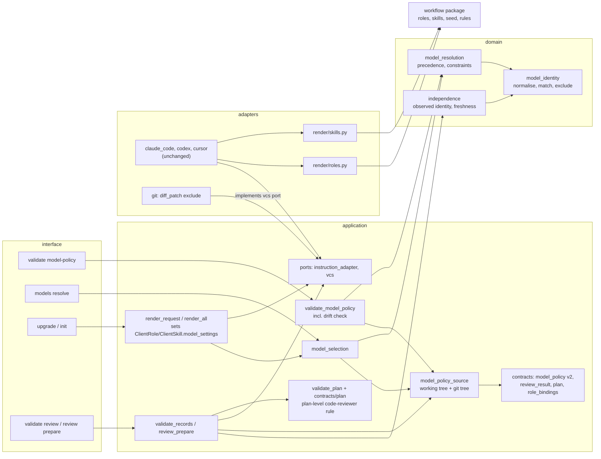

# Design brief and component view: dynamic model profiles

Task: `dynamic-model-profiles`. Class: D3 (a new persisted schema, and authorization of catalog approval). The AS-IS facts are cited as A-n, unknowns as U-n, contradictions as C-n, inferences as I-n, ledger questions as Q-n, decisions as ADR-n.

## 1. Summary and recommended approach

Orqlet gets a team-owned, reviewed **model policy** (`.orqlet/model-policy.yaml`, schema `orqlet.model-policy/v2`). It holds a catalog of logical models with separate states (documented, approved, account access, callable, evaluated), an identity-level exclusion (Fable), three starting profiles (QUALITY, ENGINEERING, ECONOMY) and assignments of roles, skills and PR text to profiles, each in one of three modes: `automatic`, `manual` and `automatic-with-fallbacks` (ADR-001, ADR-002).

Selection stays with the clients. The default is **automatic** (Cursor Auto, the Codex default, the Claude Code default), so generated files keep the model setting they have today until a team opts into a pin (Q-18). Only `manual` mode renders a pin: `orqlet upgrade` writes it deterministically into subagent files, and into Claude Code skill files for an explicit skill assignment; otherwise the main agent is never pinned (ADR-003). For the main agent in Codex and Cursor, "quality first" is a hint that `orqlet models resolve --skill` shows and the skill text offers (ADR-001, Decision 8). Orqlet adds two read-only commands, `orqlet validate model-policy` and `orqlet models resolve`, and calls no model, starts no agent and uses no network.

A **code review gate** is added: a new `orqlet-code-reviewer` role, on every plan phase, independence at least I2, models and context freshness recorded, NOT_RUN with the exact reason when no qualifying reviewer exists, and a human code-owner review on the host as the fallback (ADR-006, ADR-007). Independence is derived after the run from recorded, attested identities and client names (only an observed identity counts), not assumed from selection. The shipped catalog is rechecked on every release of the workflow package, checked by a test that CI runs, and arrives downstream as a pending diff that a reviewed edit approves (ADR-004). Everything Orqlet ships is `proposed` and unevaluated.

## 2. Requirements

| Id | Requirement | Source |
|---|---|---|
| R-1 | Architecture, design and planning prioritise quality; PR titles, descriptions and summaries use the cheapest qualified model; code review is an explicit responsibility. | Request; Q-19 |
| R-2 | Three starting profiles QUALITY, ENGINEERING, ECONOMY with starting candidates. | Request |
| R-3 | Selection by task requirements: task, then logical profile, then an eligible client-specific model; refresh-time application is kept apart from run-time native selection; the most relevant models by default, rechecked and updated on release. | Request; Q-17; Q-20 |
| R-4 | Manual selection: change defaults per client; by profile, skill, task or subagent; preferred candidates and order; an exact pin or a deliberate alias; manual, automatic or automatic with fallbacks; preview and validate before applying; revert. | Request |
| R-5 | A precedence order the person approves; an explicit valid team selection beats automatic ranking. | Request |
| R-6 | Manual choices still satisfy compatibility, organisation restrictions, capabilities, diversity and permissions; an unavailable or incompatible model is reported with the exact reason and never silently replaced; the source of each selection is recorded; personal settings and credentials are not changed. | Request |
| R-7 | Code review: same approved capability category as the coder, a different resolved model, a different family where supported, an independent quality threshold, no silent self-review (another client or a human when none qualifies), no silent lowering; effort, speed, context size or an alias to the same model is not diversity. | Request; Q-19; Q-21 |
| R-8 | Fresh review: a new isolated context with the exact snapshot and inputs and without the coder's conversation or earlier conclusions; every re-review covers the full scope; reviewers stay read-only; NOT_RUN without a fresh context. | Request |
| R-9 | Models are selected on Auto by default. | Q-18; Q-20 |
| R-10 | The code review gate covers every phase at independence I2 (a different client or a known different family), records the resolved models, and falls back to a human (I3). | Q-21 |
| R-11 | Catalog approval: any developer except the author, at least one approval, code-owner review on the catalog paths; the company enforces restrictions on the three clients. | Q-14; Q-23 |
| R-12 | The Fable exclusion is preserved. | Request; Q-7; Q-13; Q-24 |
| R-13 | Deterministic tools produce hashes, validation and results; a model never replaces deterministic evidence or grants permission; ORQLET-NOMODEL-001 and the other team rules keep their enforcement. | Request; Q-17 |
| R-14 | No paid evaluation or callable check without an approved scope and budget (per developer, per month, at most 25 percent of that developer's budget per client). The catalog states are discovered (`documented`) here; evaluation and callable checks are not built (section 8). | Request; Q-16; Q-22; Q-27; Q-28 |
| R-15 | The accounts' facts hold: Cursor Enterprise with the Router enabled and the model displayed; Claude Code Team or Enterprise; Codex desktop app on Enterprise or Edu showing GPT-6 Astra, GPT-6.1 Sol, GPT-6.1 Terra, GPT-6 Luna and GPT-6 Sol (the last stays outside the starting catalog, ADR-002). | Q-10; Q-26; Q-30 |
| R-16 | The catalog is rechecked on every Orqlet release. | Q-8 |

## 3. Behaviour

**Command line**

- `orqlet validate model-policy [PATH]` (default `.orqlet/model-policy.yaml`). Output: PASS or the findings, in the common result envelope with `--json`. **Exit status as every `validate` command: 0 for PASS, 5 for FAIL and for NOT_RUN** (`src/orqlet/interface/cli/commands/validate.py:38-47`). An absent file is NOT_RUN ("no model policy, nothing was checked"), as `validate integrations` treats its absent file. Checks: schema and the bounded types of ADR-002; unique ids; every profile, assignment, fallback and escalation names a known model, profile, role or skill; no approved model, route, candidate, fallback or assignment matches an exclusion (error); an `excluded[]` entry that is present at the base tree and missing from the file (error; the base is an optional `--base` revision, defaulting to the merge base with the protected ref the person names); two entries that claim the same normalised `name` or `also_known_as` (error); every `approved` entry names `approved_by` and an `approval_ref` in the allowed format (error); the credential scan of the integrations loader over free text, extended with the `sk-`, `xai-` and `AIza` key shapes; a `manual` profile or assignment with no eligible candidate, or an `automatic-with-fallbacks` one with no eligible fallback (warning `missing-candidate`); `reviewed_for_release` older than the installed workflow version (a version comparison, no clock), and a `retires_on` date past or near (read through the Clock port) (warnings); a **deletion**: the file is missing from the staged tree but present at the base tree or recorded as seeded in the lock (FAIL, because `upgrade` never recreates a deleted seeded file and `doctor` skips seeded files); and the drift check: the `model` value of every agent and skill file in the client folders against the resolution and the exclusion (warning for a difference in a generated file, error for an excluded name in any file).
- `orqlet models resolve --client C (--role R | --skill S | --profile P) [--task T] [--override MODEL] [--different-family-from CATALOG_ID] [--coder-profile P] [--json]`. Read-only, no clock, no network, no process, no git: a deleted policy file is detected from the lock's seeded row. Prints the profile and mode (the tier hint), the selected route (model, exact name, kind, effort) or "the client chooses" for `automatic` and `automatic-with-fallbacks`, the source (`task-override`, `role-assignment`, `profile-assignment`, `automatic`, `explicit-fallback`), the ordered fallbacks, the profile's `escalation` and list prices as information, and every rejected candidate with its reason (`excluded`, `not-approved`, `disabled-or-retired`, `no-route-for-client`, `route-name-unknown`, `access-blocked`, `same-family-as-coder`, `same-model-as-coder`, `outside-profile`, `override-invalid`). **Exit 0** when a selection or an automatic result exists, including when no policy file was ever present ("no model policy; the client chooses"); **1** when no candidate qualifies (reasons listed), and also whatever the mode, and including when no policy file was ever present, when `--different-family-from` leaves no candidate that can be shown different, so the review skill learns that none qualifies (`--coder-profile` names the coder's profile for the `outside-profile` rule and defaults to `engineering` for the code reviewer); **2** for usage; **3** for a policy that is present but invalid, or deleted, or a v1 file.
- `orqlet init` seeds `.orqlet/model-policy.yaml` once and a role binding for the code reviewer. `orqlet upgrade` shows, in its change plan, the agent and skill files whose model setting changes and these findings: `missing-candidate` with the reason, a skill or Cursor-effort assignment the client cannot honour, the review records made stale by a pin change, and a pending role binding. In an existing project the policy seed is created as a new file, and the role-bindings change arrives as a pending diff (the file is seeded, A-21); until a reviewed edit applies it, a `code-reviewer` record is an error (ORQ-E415). A changed shipped seed is a pending diff in `.orqlet/proposals/`, never a write. A policy file that is present but invalid makes `upgrade` refuse (exit 3) before any write.
- `orqlet validate review RECORD`: reads the policy from the base tree and the staged tree (exclusions from both, families from entries that are not `proposed` at the base tree). For a `code-reviewer` record it requires the freshness attestation and the identity fields to be present (their values may be null with `identity_source: unknown`), and derives I0 to I2 from observed families (ADR-007). It warns, with closed codes printed on the gate line, when a requested model differs from the observed one, when an I2 rests on an unknown identity (`identity-unknown`), when both observed identities are equal across clients (`same-model-different-client`), when the policy changed in the change under review (`policy-changed-in-this-change`) and when a `codex` record omits the phrase "read-only is not enforced by this client"; it errors on an excluded model (I0) and, when the policy is present but unloadable or was deleted, on every record that names a model; a class below the minimum is NOT_RUN with the reason. Only where the file was never present do the legacy rules apply, and the report says that no exclusion list was available. No finding prints a recorded model string.
- `orqlet review prepare TASK PHASE`: the snapshot, the context copies and `diff.patch` leave out `docs/design/**/reviews/**` (a constant pathspec exclusion placed after `--`); three reviewers are listed; the design-manifest copy holds note paths and no conclusion.
- Skill text: the opening step of each workflow skill names the hint (ADR-001, Decision 8); the review skill gains the diversity step (ADR-007, Decision 11); the implement skill gains a last step that starts `orqlet-pr-writer` (ADR-006).

**Files written:** `.orqlet/model-policy.yaml` (seed, once); `.orqlet/proposals/*.diff` (a changed seed or role-bindings file); `.claude/agents`, `.cursor/agents`, `.codex/agents` files for `orqlet-code-reviewer` and `orqlet-pr-writer`, and the model line or keys of a subagent that `manual` mode pins; Claude Code skill front-matter for an explicit skill assignment; lock rows; review records `docs/design/<task>/reviews/code-reviewer-P-<n>-r<k>.yaml` (written by the agent, not by Orqlet).

**Library API, network API, messages and events, scheduled jobs, user interface:** none. Orqlet publishes no new import-level API for users, opens no connection and runs nothing on a schedule.

**Logs and metrics:** findings with codes and closed field names (the plan assigns codes); no finding prints a recorded model string.

## 4. Responsibilities and interfaces

| Component | Layer | Responsibility | Interface |
|---|---|---|---|
| `contracts/model_policy.py` | application | The v2 shape, the bounded `ModelRef` and closed enumerations | Pydantic contract; JSON schema regenerated (DET-003) |
| `model_policy_source` | application | Load through ports, strict YAML, size limit, credential scan, no echo | `load_model_policy(services)` for the working tree and `read_model_policy_at(services, tree)` for a git tree, one parser |
| `domain/model_identity.py` | domain | The normalisation and matching rule of ADR-005; same-identity and exclusion tests | pure functions on strings and plain entries |
| `domain/model_resolution.py` | domain | Precedence, constraints, reasons | `resolve(inputs) -> Resolution` on plain values |
| `model_selection` | application | Map the contract and the workflow's roles and skills to domain inputs; set `model_settings` on roles and skills | used by `build_render_request` (so by `upgrade`, `init` and `explain`, the three callers of `compose`) and by `models resolve` |
| `ports/instruction_adapter.py` | application port | `ClientRole.model_settings` and `ClientSkill.model_settings`, each a mapping from client id to a setting, so one `RenderRequest` serves every client; client adapters unchanged | dataclass fields |
| `render/prompts_seed.py` and the workflow `seeds/` folder | adapter and data | Seed `.orqlet/model-policy.yaml` once, beside the existing `.prompts/` seed | seed files |
| `domain/evidence_artifacts.py`, `domain/binding.py` / `binding_inputs.py` | domain, application | The record-path pattern admits `code-reviewer` (today only the two other roles, so such a record would be an ORQ-E400 ordinary input) | `parse_evidence_path` and its callers |
| `usecases/capabilities.py` | application | `IMPLEMENTED_COMMANDS` lists `models resolve` and `validate model-policy`, so the skill steps that name them are kept | frozen set |
| `render_all.REVIEW_AGENTS`, `review_prepare.DEFAULT_REVIEWERS` | application | Both hard-coded maps gain the third reviewer; a unit test asserts they agree | module constants |
| `validate_model_policy` | application | The checks of section 3 including drift | `validate_model_policy(services, path) -> ValidationResult` |
| `render/roles.py`, `render/skills.py` | adapters | Write the setting per client through `front_matter` and `toml_table`; never a name that was not given | `claude_role`, `cursor_role`, `codex_role`, skill writers |
| `domain/independence.py` | domain | I0 to I2 from approved binding, freshness, clients, observed families; `minimum_independence` gains a role input (I2 at every class for the code reviewer) | `derive_independence(...)`, `minimum_independence(class, role)` |
| `contracts/review_result.py`, `role_bindings.py` | application | Role `code-reviewer`; `agent.client` and `coder_binding.client` become the closed set of three clients; optional `context`, `identity_source`, `selection_source` | Pydantic contracts |
| `validate_records`, `review_prepare` | application | Identity, freshness, exclusion, unloadable-policy checks; packet without earlier reviews; three reviewers | existing entry points |
| `ports/vcs.py`, `adapters/git` | port and adapter | `diff_patch(base, head, exclude=...)`; the exclusion is a constant held by `review_prepare`, spelled as a pathspec after `--` | one new optional parameter |
| `contracts/plan.py`, `validate_plan`, plan-format reference | application | The plan-level check that `code-reviewer` is in every phase's `review_evidence` from the shipping `workflow_version` | `ImplementationPlan` validator reading `header.workflow_version` |
| Workflow package | data | Roles `orqlet-code-reviewer` and `orqlet-pr-writer`; review, implement and other skill text; the seed; rules | files; `MANIFEST.json` rebuilt, version bumped (DET-002) |
| `.prompts/rules.yaml`, `.github/CODEOWNERS`, README, proposal | team files and docs | ORQLET-MODEL-001 and -002 (section 9); owners of the policy path, the seed path and CODEOWNERS; text made true | reviewed edits |

## 5. Failures

| Id | Trigger | Observable result | Recovery |
|---|---|---|---|
| F-1 | The policy file is unreadable, oversize, not strict YAML or breaks its contract | `validate` FAIL; `upgrade` and `models resolve` refuse (exit 3); `validate review` errors on records that name a model; nothing is written | Fix the file; the generated files stay as they were |
| F-2 | An approved model, route or assignment matches an exclusion | `validate` FAIL; `upgrade` refuses | Remove the entry or approve a different one |
| F-3 | `manual` mode and no eligible candidate | Warning `missing-candidate` with each reason; no pin; the role keeps its automatic setting; `models resolve` exits 1 | Approve a candidate, fill its route name, or set `automatic` |
| F-4 | A skill is assigned a model for Codex or Cursor, or an effort for Cursor | Warning that the client documents no skill-level model (or a quoted effort is unverified); nothing rendered | Remove the assignment for that client |
| F-5 | The client replaces a pin (blocked model, forced model, plan limits) | Not visible to Orqlet; a record shows requested differing from observed (warning) | Fix the client setting or the organisation block, or change the policy |
| F-6 | No reviewer reaches I2 | Record NOT_RUN with `capability_limits`; the skill reports it | Run the review in another client, or take a human code-owner review (I3); a new session of the same client is only I1 |
| F-7 | A client reports no model (Codex) | Identity unknown; no family difference is established; a different client still gives a claimed I2 with the `identity-unknown` warning | Record `person-observed` where the person can see the model |
| F-8 | The team's `reviewed_for_release` is older than the installed release | Warning; the new seed appears as a pending diff | Review and approve or reject each new entry |
| F-9 | A route's `retires_on` is past or near | Warning only; selection never reads the date | Replace the candidate through a reviewed edit; set `retired` |
| F-10 | The client cannot start typed subagents | NOT_RUN (existing behaviour) | Another client |
| F-11 | A record's model matches an exclusion | Error, I0, not counted | Redo the review on an allowed model |
| F-12 | A pin change makes in-flight approvals show ORQ-W390 | Warning on `gate status`; reviews stale | The person decides, as the stale-input matrix says |
| F-13 | An existing project has not applied the role-bindings diff | `code-reviewer` records are an error (ORQ-E415); `upgrade` reports the pending binding | Apply the pending diff by a reviewed edit |
| F-14 | A generated file's model line was edited by hand, or differs from the policy | `validate model-policy` warns (or errors for an excluded name) | Run `orqlet upgrade`, or release the file |
| F-15 | The policy file was never present | `validate model-policy` NOT_RUN; `models resolve` says the client chooses; `validate review` uses the legacy rules and says no exclusion list was available | Run `orqlet init` or `upgrade` to seed it |
| F-16 | The policy file was deleted (missing from the staged tree, present at the base tree or recorded as seeded in the lock) | `validate model-policy` FAIL (deletion); `validate review` errors on every record that names a model; `upgrade` and `models resolve` refuse (exit 3). `upgrade` does not recreate a deleted seeded file | Restore the file from git; a deletion is a reviewed change |
| F-17 | A pin is a declared alias | `upgrade` warns `alias-route-rendered`: an environment variable can remap an alias | Use the exact ID, or accept the warning |
| F-18 | The change under review edits the policy | `validate review` warns `policy-changed-in-this-change`; families come from the base tree only | Review the policy edit as the approver's checklist says |

## 6. Acceptance criteria

| Id | Criterion | Source |
|---|---|---|
| BC-1 | With no policy file, the model line or key of every existing role file of the three clients equals today's golden file. The new roles, the changed role text and the changed skill text change the golden files on purpose. | R-3; A-28; ADR-003 |
| BC-2 | In `automatic` and `automatic-with-fallbacks` modes, the model line or key of every role file is unchanged, with or without a policy. | R-9; ADR-001 |
| BC-3 | In `manual` mode with an approved candidate that has a route name for the client, that client's agent file carries that client's name in its own field, with effort where the client supports it (Claude Code, Codex); with two or three clients enabled, each file carries its own client's name. | R-4; ADR-003 |
| BC-4 | In `manual` mode with no eligible candidate, nothing is pinned, `upgrade` states each candidate's reason, and `models resolve` exits 1 with the same reasons. | R-6; ADR-001 |
| BC-5 | One fixture per precedence level shows that a valid higher level wins and that a lower level is used only with a visible finding when the higher one is invalid. | R-5; ADR-001 |
| BC-6 | An invalid override is reported with its reason and is never replaced silently. | R-6; ADR-001 |
| BC-7 | A skill assignment in mode `manual` writes Claude Code front-matter; in any other mode it writes none; for Codex and Cursor it gives a finding and no change. | R-4; ADR-003 |
| BC-8 | No renderer writes a settings, `config.toml` or model file, and the only main-agent pin is an explicit Claude Code skill assignment. | R-6; ADR-003 |
| BC-9 | A policy with an approved Fable route fails validation; no renderer writes `fable`, `best` or `claude-fable-*`; a record whose requested or observed model matches an exclusion is an error with I0. The same holds for each variant: `FABLE`, ` Fable-5.1 `, `anthropic/claude-fable-5-1`, `Claude Fable 5.1`, `claude_fable_5_1`, `claude-fable-5-1[effort=high]`, `Fable5`, `fable-5.1-xhigh` and `x[model=fable]`; and, for the `best` alias, `BEST`, ` best `, `best[1m]` and `anthropic/best`. An `excluded[]` entry present at the base tree and missing from the file is an error, and two entries that claim the same normalised name are an error. | R-12; ADR-005 |
| BC-10 | An entry that is `proposed`, `disabled` or `retired` is never selected or rendered, and a `proposed` entry never contributes to identity or family derivation. | R-11; ADR-004; ADR-007 |
| BC-11 | Every entry of the shipped seed is `proposed` and every route `access: unknown`; the seed passes `validate model-policy`; the Fable exclusion is present; every `id`, `family`, route `name` and `resolves_to` appears in the evidence file its entry cites; seed free text is printable ASCII within a length; a test fails when `reviewed_for_release` differs from the workflow version. | R-16; ADR-004 |
| BC-12 | `upgrade` with a changed shipped seed writes a pending diff and never overwrites the team's file. | R-16; A-21; ADR-004 |
| BC-13 | `validate model-policy` warns on a stale `reviewed_for_release` and a near or past `retires_on`, and errors on an `approved` entry without `approved_by` and `approval_ref`. | R-11; ADR-004 |
| BC-14 | `orqlet-code-reviewer` and `orqlet-pr-writer` render for all three clients, with golden files and lock rows, carrying each client's strongest read-only control (a tool allow-list in Claude Code, `readonly: true` in Cursor, `sandbox_mode` in Codex). The design does not promise that this makes them read-only: Codex does not enforce it, and a Cursor subagent still inherits MCP tools (ADR-006, ADR-007). | R-1; R-7; ADR-006 |
| BC-15 | `/orqlet-review` starts three reviewers; a `code-reviewer` record validates; the plan-level check requires `code-reviewer` in every phase at or above the shipping `workflow_version`; an older plan still validates. | R-10; ADR-006 |
| BC-16 | The freshness attestation is optional in the schema and required by the code reviewer's rule: a `code-reviewer` record without `context.fresh: true` is schema-valid and derives I0; a record below I2 is NOT_RUN with its reasons, not an error. A missing `identity_source` means `unknown`. | R-8; R-10; ADR-007 |
| BC-17 | Same client and same observed family gives I1; a different client gives I2 (Q-21); one client with two observed different families gives I2; a different client with an unknown identity gives I2 with the `identity-unknown` warning; a different client with two equal observed identities gives I2 with the `same-model-different-client` warning. Recording an identity is never worse than omitting it. | R-7; Q-21; ADR-007 |
| BC-18 | Within a client, an alias that resolves to the same model, a bracketed option list, a provider prefix from the closed list, a spelling listed in `also_known_as`, or a different effort, speed or context size is not a difference; a string that matches nothing is unknown. | R-7; ADR-005; ADR-007 |
| BC-19 | A requested model that differs from the observed model is a warning that names catalog ids or `unmatched`, never the recorded string; a requested-only model, or `identity_source: unknown`, is an unknown identity and cannot establish a family difference. | R-6; ADR-002; ADR-007 |
| BC-20 | Every existing review record and approved plan produces the same verdict and the same findings as before the change, except that each record now also reports the new warnings that apply to its fields. | ADR-006; ADR-007 |
| BC-21 | The packet leaves out `docs/design/**/reviews/**` from the snapshot, the context copies and `diff.patch`; a scan of the whole packet for a sentinel taken from an earlier record finds nothing; every round rebuilds the whole packet. | R-8; A-64; ADR-007 |
| BC-22 | A `codex` review record whose `capability_limits` lacks the phrase "read-only is not enforced by this client" gets a warning. | R-8; A-108; ADR-007 |
| BC-23 | `orqlet models resolve` is read-only, starts no process, opens no connection, reads no clock, and gives the same bytes for the same input. | R-13; ORQLET-NOMODEL-001 |
| BC-24 | The implement skill's last step starts `orqlet-pr-writer`; the starting assignment of that role is the profile `economy`. | R-1; ADR-006 |
| BC-25 | No model SDK, network library or new dependency is added; the import checks and the lockfile show it. | R-13; ORQLET-NOMODEL-001 |
| BC-26 | `.prompts/rules.yaml` holds ORQLET-MODEL-001 and ORQLET-MODEL-002 as section 9 defines them, and the README and the proposal no longer say the code reviewer is optional or that pins are unbuilt. | R-13; baseline "update the documentation" |
| BC-27 | `automatic-with-fallbacks` renders the files of `automatic`, `models resolve` returns the ordered fallbacks, and a used fallback is recorded as `explicit-fallback`. | R-4; ADR-001 |
| BC-28 | An alias route renders only when declared as an alias with `resolves_to`; a pin otherwise uses the exact ID. | R-4; ADR-003 |
| BC-29 | Reverting a policy edit and running `orqlet upgrade` restores the earlier generated files. | R-4; ADR-003 |
| BC-30 | `validate model-policy` reports a generated file whose `model` value differs from the resolution (warning) or names an excluded model (error). | R-12; ADR-003; ADR-005 |
| BC-31 | With the policy present but unloadable, `validate review` errors on every record that names a model and never falls back to `model_families`; with it absent, the legacy rules apply and the report says no exclusion list was available. | R-12; ADR-005; ADR-007 |
| BC-32 | A policy field that names a model outside `[A-Za-z0-9._:/@+-]` or longer than 128 characters, and a record string outside printable ASCII with spaces and `[ ] = ,` or longer than 128 characters, is refused, never truncated; a 128-character instruction-shaped string is refused or reported only as `unmatched`; no finding prints a recorded model string; the credential scan flags the integrations shapes and `sk-`, `xai-` and `AIza` keys. | ORQLET-SEC-002; ORQLET-SEC-003; ADR-002 |
| BC-33 | `validate model-policy` exits 0 on PASS and 5 on FAIL or NOT_RUN; `models resolve` exits 0, 1, 2 or 3 as section 3 says. | R-13; ADR-001; `validate.py:38-47` |
| BC-34 | A Cursor pin is written only as a plain ID; an effort assignment for Cursor gives a finding and no bracketed option is written. | R-6; ADR-003; `emit.py:8, 28` |
| BC-35 | `orqlet models resolve --skill S --client C` prints the profile and the ordered candidates, and each workflow skill's opening step names that hint and does not change the model. | R-1; ADR-001 |
| BC-36 | A `code-reviewer` record at `docs/design/<task>/reviews/code-reviewer-P-<n>-r<k>.yaml` is recognised as a record by the path pattern, is excluded from the `code_tests` and `knowledge` inputs like the other two roles, and does not raise ORQ-E400. | R-10; ADR-006 |
| BC-37 | `upgrade` refuses with exit 3 on an invalid, deleted or v1 policy before any write; it reports the review records made stale by a pin change and a pending role binding; until the binding diff is applied, a `code-reviewer` record is ORQ-E415. | R-6; ADR-003; ADR-006 |
| BC-38 | `models resolve --different-family-from CATALOG_ID` that leaves no candidate that can be shown different exits 1 in every mode, with or without a policy. A reviewer candidate from a profile below `--coder-profile` (default `engineering` for the code reviewer) is rejected with `outside-profile`. | R-7; ADR-006; ADR-007 |
| BC-39 | A policy file missing from the staged tree but present at the base tree, or recorded as seeded in the lock, is reported by `validate model-policy` as a deletion and makes `validate review` error on every record that names a model. | R-12; ADR-005 |
| BC-40 | `validate review` takes exclusions from the union of the base and the staged policy, takes families only from entries that are not `proposed` at the base tree, and warns `policy-changed-in-this-change` when the two differ. | R-12; ADR-005; ADR-007 |
| BC-41 | `REVIEW_AGENTS` and `DEFAULT_REVIEWERS` hold the same three reviewers (a unit test), and `IMPLEMENTED_COMMANDS` lists the two new commands so their skill steps are kept. | ADR-006 |
| BC-42 | `agent.client` and `coder_binding.client` accept only the three clients, and every existing record still validates. | ADR-007; BC-20 |
| BC-43 | A task-scoped assignment appears in `models resolve --task` and is never rendered into a generated file; an alias route that is rendered produces the `alias-route-rendered` warning; `orqlet explain`, which also calls `compose`, reports the same selection that `upgrade` would write. | R-4; ADR-001; ADR-003 |
| BC-44 | The policy matrix of ADR-007 Decision 1 holds: staged policy unloadable or deleted gives an error for records that name a model; base absent or unloadable with a valid staged policy is judged on the staged tree with no policy family and the finding `policy-changed-in-this-change`; a binding present only in the staged tree gives `binding-added-in-this-change`; `model_families` still applies to a string the policy cannot match. | R-12; ADR-007 |
| BC-45 | The packet leaves out every path the design manifest names as a review note, and excluded paths appear in neither `omitted` nor `MANIFEST.json`; the sentinel scan runs against the real git adapter. | R-8; ADR-007 |

## 7. Decisions

| Decision | ADR |
|---|---|
| Two selection moments, default `automatic`, three modes (only `manual` pins), precedence, constraints, recorded source, tier hints | [ADR-001](adr-001-selection-boundary-modes-and-precedence.md) |
| Model policy v2 as a seeded team file; five separate states; bounded types; categories as profile membership; starting candidates as proposals | [ADR-002](adr-002-model-policy-v2-contract-and-home.md) |
| Pins carried on `ClientRole` and `ClientSkill`, rendered by `upgrade`; one skill exception; drift check | [ADR-003](adr-003-rendering-model-settings-into-generated-files.md) |
| Approval by reviewed edit; everything shipped is `proposed`; recheck on every workflow release, enforced by tests; no network | [ADR-004](adr-004-catalog-governance-and-release-recheck.md) |
| Exclusion by model identity with one matching rule, checked in three places, union of base and staged policy, deletion rule, defence in depth | [ADR-005](adr-005-fable-exclusion-by-model-identity.md) |
| Code review gate, `orqlet-code-reviewer`, `orqlet-pr-writer`, plan-level rule | [ADR-006](adr-006-code-review-gate-and-new-roles.md) |
| Independence from observed identity and freshness; I3 from the host; a packet without earlier conclusions | [ADR-007](adr-007-independence-model-identity-and-fresh-context.md) |

## 8. Unresolved decisions

| Question | What waits | Blocks |
|---|---|---|
| Q-32: a second code owner for the policy and seed paths | The approval rule cannot be met for the sole owner's own changes | plan |
| Q-33: confirm that the Fable exclusion covers every Fable model and `best` | The exact exclusion entries of the seed | plan |
| Q-34: required reviews, stale-approval dismissal, last-pusher approval and administrator bypass on the protected branch | The human fallback (I3) has nothing enforcing it | implement |
| Q-35: Cursor model IDs for the starting catalog | Cursor pins; until then those routes are `missing-candidate` | nothing |
| Q-36: a required CI check for a NOT_RUN gated review, and for `validate model-policy` on the repository's own policy | Whether those checks block a merge, or only report | nothing |
| Q-37: whether an independent session of the same client satisfies the code review gate | The fallback for a NOT_RUN code review: another client or a human only (the design's reading), or also a fresh same-client session | plan |

**Readings the person confirms by approving this design** (each is a decision the design made and states; none contradicts a ledger answer):

- "Every Orqlet release" (Q-8) is read as every release of the workflow package that carries the seed (`workflow_version` in `identity.json`); a release of the command line alone is outside the rule (ADR-004).
- "Every phase" (Q-21) is read as every phase of a plan (ADR-006).
- Q-21's "independent session" is read as a session in another client, because a new session of the same client is I1; this narrows Q-21 and is Q-37, which asks the person (ADR-006, Decision 5).
- Q-21's "known different model family" is read as a family known from an *observed* identity, where today's code also accepts a requested model, so a pin that a client replaced cannot create an I2 (ADR-007, Decisions 2 and 5).
- Q-21 defines I2 as a different client or a different family, and R-7 says a different resolved model. The design keeps Q-21: a different client on an equal observed model is I2 with the `same-model-different-client` warning, which does not literally satisfy R-7; the same-model rule applies within a client (ADR-007, Decision 5).
- The two new roles render for all three clients with their limits stated as residual risks (ADR-006, Decision 8).
- R-8's "NOT_RUN without a fresh context" holds strictly for `code-reviewer` records, where the freshness attestation is required. For architecture and security records the attestation stays optional so that existing records stay valid, and a `false` value gives I0 (ADR-007, Decision 4); a later change can require it by `workflow_version`.
- "Selected on auto" and "choose the most relevant models by default" (Q-17, Q-18, Q-20) are read as the default mode `automatic` with proposed, reviewed candidate lists (ADR-001, ADR-002).
- "The catalog is discovered and evaluated" (request): discovery is the `documented` state and the release-time recheck; evaluation, callable verification and cost per accepted result are not built here, because none has an approved scope (R-14). The fields exist so that results can be recorded later.
- GPT-6 Sol is seen in the Codex app but kept out of the starting catalog (ADR-002). Q-29 never existed in the ledger's history and is not renumbered.

The plan also fixes what the design leaves open on purpose: field spellings of the v2 contract, finding codes, the workflow version number, the text of the reviewer and new roles, the hint sentence of the skills, and the exact output contract of `models resolve`.

## 9. Constraints the plan must respect

- C-1 Domain functions are pure and the application layer imports no file, process or network module; the policy loader follows `integrations_source.py` (strict YAML, 256 KiB, credential scan, no echo) and offers both entry points of section 4 (ORQLET-ARCH-001, ORQLET-ARCH-002, ORQLET-SEC-002, ORQLET-SEC-003). Renderers write through `front_matter` and `toml_table` only. `ModelRef` and the record-string type are constrained string types (a pattern and a maximum length) with no custom validator message, and any contract map keyed by free text is masked in findings, as `integrations_source` masks `_FREE_FORM` maps (`loading.py:22-27` forwards contract error text, so a validator message must never repeat a value).
- C-2 Every contract change regenerates the JSON schemas in the same change; every change to the workflow package rebuilds `MANIFEST.json` and bumps the version (ORQLET-DET-002, ORQLET-DET-003).
- C-3 Without a policy, the model setting of every existing role file stays as today. Existing review records and approved plans stay valid; new requirements apply by role and by `workflow_version`.
- C-4 The seed ships only `proposed` entries with `access: unknown`, passes its own validator in a test, carries no Cursor route name until Q-35 is answered, and a missing name is `missing-candidate`, not an error.
- C-5 Every write, including the seed, a pending diff and a generated file, goes through the journalled change plan (ORQLET-SAFE-001).
- C-6 No network, no new dependency, no model SDK, no process outside `ProcessRunner` (ORQLET-NOMODEL-001, ORQLET-SEC-001). Digests are SHA-256 (ORQLET-SEC-003). Tests use the fakes and no sockets (ORQLET-TEST-001).
- C-7 The observed-only rule and the closed client set must not change the verdict of any existing record; none holds an identity, and the plan checks every existing record against the closed set.
- C-8 The effect of a pin change on `protected_set_digest` and on in-flight approvals (ADR-003) is documented where the person will read it, in the same change.
- C-9 The README, the proposal's sections 10.3, 14.9, 17.12.5 and 24.1 and its Q-07 entry, and the review skill's references are brought in line in the same change.
- C-10 New rules, as the plan writes them into `.prompts/rules.yaml`: **ORQLET-MODEL-001** (MUST, `deterministic` with a `check_ref` to the unit tests that the CI test job runs; the tests read renderer output, packaged files and goldens, and a project's own files are covered by `validate model-policy`, a manual command until Q-36): a model name appears in a generated or packaged file only when the model policy assigned it, and never when the policy excludes it. **ORQLET-MODEL-002** (MUST, `review` until Q-36 puts a validator in CI): a review record for a gated role names the models that ran, or says they are unknown, and states the freshness of its context; a class below the role's minimum is NOT_RUN, never a pass. The design uses "checked" for commands that a person or an agent runs, and "enforced" only for what the host or the CI workflow runs.
- C-11 The selection type lives in the ports module that holds `ClientRole`, so adapters can import it; the client adapters stay unchanged and independent (ORQLET-ARCH-003).

## Component view

