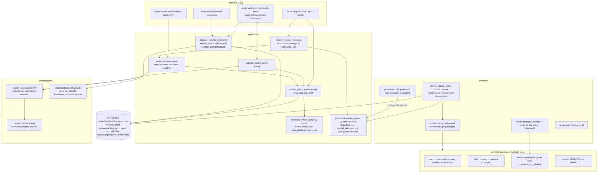

# Container view: where the change sits in Orqlet

The layers keep ORQLET-ARCH-001 (interface, adapters, application, domain; imports point inward). New or changed parts are marked.

## Dependency notes

- `domain/model_resolution.py` takes plain values (tuples and dataclasses), as `derive_independence` does; the application layer maps the Pydantic contract into them. The domain imports nothing from the application (ORQLET-ARCH-002).
- Client adapters stay unchanged and independent: they already pass `ClientRole` and `ClientSkill` to `render/roles.py` and `render/skills.py`, and the selection travels on those two objects; the pin spelling for each client lives in the per-client functions there (ORQLET-ARCH-003). The selection type is defined in the ports module that holds `ClientRole`.
- The one adapter change outside rendering is the git adapter: `diff_patch` takes a path exclusion so the review packet's diff carries no earlier review record.
- The workflow package stays data: the two new roles, the changed skill text and the seed are files; the adapters and the interface read them.
- No container is added and none starts a process or opens a network connection.
