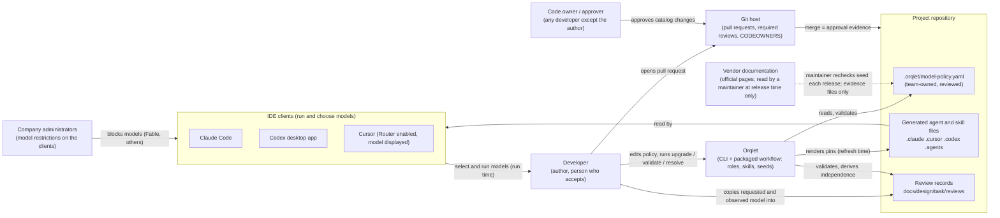

# Context view: Orqlet, the clients and the people around model selection

Orqlet stays a tool that writes files and checks records. The three clients choose and run models. Nothing in this design adds a call from Orqlet to a model, a client or a vendor.

## Trust boundaries

- No new trust boundary of Orqlet's runtime and no new integration. A trust path does exist into the shipped seed: a person or an agent with web access reads vendor pages at release time (ADR-004); its controls are the seed tests and the review of the seed, and page text is evidence, never an instruction. Orqlet gains no network path: the vendor pages are read by a person or an agent with web access during the release step, and what reaches Orqlet is a reviewed edit of a file.
- `.orqlet/model-policy.yaml` and the review records are untrusted input to Orqlet (ORQLET-SEC-002): read through the `FileSystem` port, strict YAML, size limit, no value echoed in findings.
- The company's restrictions on the clients are outside Orqlet and are not generated or observed; Orqlet sees their effect only in a record's observed model (ADR-007).
