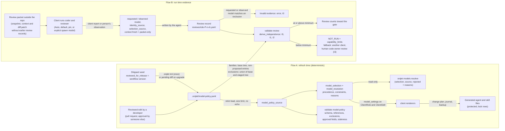

# Data-flow view: how a model choice travels, and how evidence about it travels back

Two flows. Flow A turns an approved policy into generated files at refresh time. Flow B turns what actually ran into a checked independence class.

## Data and its handling

| Data | Source | Trust | Where it goes | Guard |
|---|---|---|---|---|
| Model policy | seed + reviewed edit | untrusted file | resolver, renderers, validators | strict YAML, 256 KiB limit, findings never echo values (SEC-002, SEC-003) |
| Resolved selection | domain function of the policy | derived | `model_settings` on `ClientRole` and `ClientSkill`, `models resolve` output | pure function, no I/O, no clock, deterministic bytes |
| Generated agent/skill files | renderers | derived, protected | client folders, lock | change plan with journal and backup (SAFE-001) |
| Model identity in a record | client report or the person | attested | validator | never verified; shown with `identity_source`; only an observed identity counts; never printed in a finding |
| Freshness flag | the agent | attested | validator | I0 when missing or false for the code reviewer |
| `approved_by`, `approval_ref` | the editor of the policy | attested | validator (presence and format) | `approved_by` names a person and is not verified; the host's merge record is the evidence; credential scan over free text |
| Vendor facts | official pages | public | evidence files, reviewed edit | no runtime fetch; a person or agent with web access at release time; page text is evidence, never an instruction |

No credential, token or secret is read, stored or logged by any step. Personal client settings are neither read nor written.
