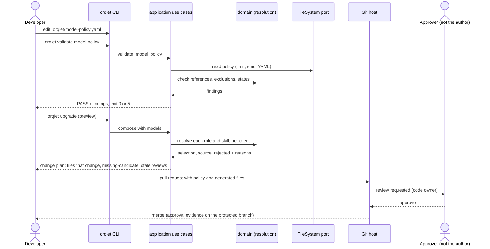
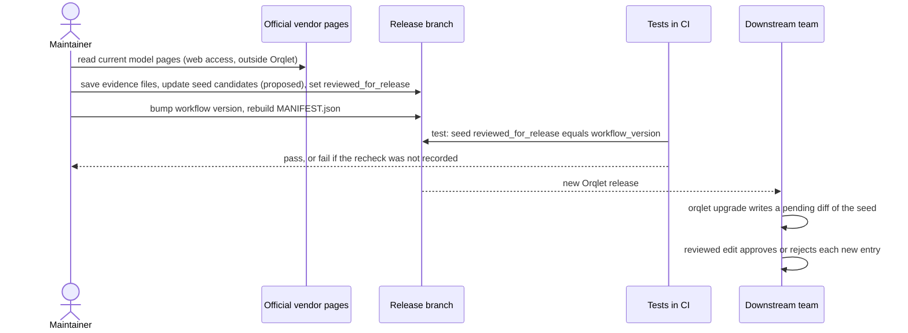

# Sequence views

Three sequences: a policy change reaching the generated files, a code review that needs a different family from the coder, and a release-time recheck of the shipped seed.

## S1. A policy change, from edit to generated files



## S2. A code review that must differ from the coder

```mermaid
sequenceDiagram
    actor Dev as Developer
    participant Skill as /orqlet-review (IDE agent)
    participant CLI as orqlet CLI
    participant Sub as orqlet-code-reviewer (typed subagent)
    participant Client as Client (Cursor, Claude Code or Codex)

    Dev->>Skill: run review for task and phase
    Skill->>CLI: orqlet review prepare task phase
    CLI-->>Skill: packet path (no earlier review notes), review_input blocks
    Skill->>Client: read the coder's model (requested, observed, source)
    Skill->>CLI: orqlet models resolve --role code-reviewer --client C --different-family-from coder-model
    CLI-->>Skill: eligible candidates in order, or none with reasons
    alt a candidate qualifies and the client lets a spawn name a model
        Skill->>Sub: start with the packet path, explicit model
        Sub-->>Skill: findings, self-check
        Skill->>Client: read the reviewer's observed model
        Skill->>CLI: orqlet validate review record
        CLI-->>Skill: independence I0..I2, warnings (requested differs from observed, identity-unknown), NOT_RUN if below I2
    else none qualifies
        Skill-->>Dev: NOT_RUN with reasons; run in another client, or take a human code-owner review (I3)
    end
```

## S3. Release-time recheck of the shipped seed


