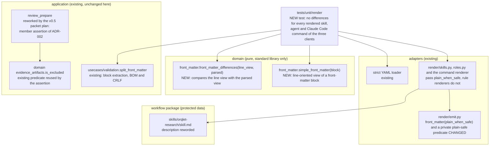

# Component view: the new and changed components

| Component | Responsibility | Depends on |
|---|---|---|
| `domain/front_matter.simple_front_matter(block)` | Given the text between the two `---` lines, return the key and value pairs that a reader taking one `key: value` line at a time sees, with quote characters kept as characters. Never raises. Pure; no YAML library | standard library only |
| `domain/front_matter.front_matter_differences(line_view, parsed)` | Given that view and the parsed mapping (values of any type), return one message per key whose two values differ, per key in one view only and per key whose parsed value is not a one-line scalar. Messages name keys, never values. Never raises | standard library only |
| `adapters/render/emit.front_matter` (changed) | With `plain_when_safe=True` write a string without quotes when it matches the allow-list of ADR-001, with quotes otherwise; booleans and integers as today. Default `False` keeps today's output for the rule renderers | a private predicate in the same module |
| `tests/unit/render` (new test) | For every skill, agent and Claude Code command that the renderers produce for the three clients (chosen by path, so a missing block is a failure): split the block with the existing splitter, parse it with the existing strict loader, and assert that the block exists, that it parses and that `front_matter_differences` is empty. A second test checks the predicate against the strict loader and PyYAML's default safe loader | renderers, `split_front_matter`, strict loader, the two domain functions |
| `review_prepare` (changed by the v0.5 packet plan, not by this task) | Leave valid review records out of every list and out of the `diff`; return `NOT_RUN` naming the path for a path that matches the review-record pattern exactly but is not a valid record; the `design` component takes the manifest's `artifacts` and `as_is_ref` only | `evidence_artifacts` (`is_excluded`, `parse_evidence_path`), `CanonicalPath` |

EC-1 and EC-2 in the manifest declare the two new public functions, and EC-3 the changed signature of `front_matter`.

Layer check (ORQLET-ARCH-001, -002, -003): the domain module imports only the standard library; the application layer is not changed; the emitter stays inside the renderer helpers and imports no other client adapter; the test is the only place that joins the layers, as tests do.
