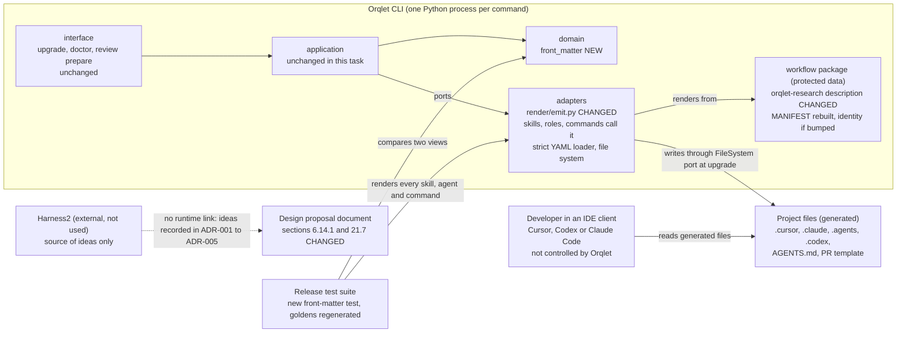

# Container view: what the change touches

Scope: the part of Orqlet that this task changes. Nothing here starts an agent or calls a model (R-01, ORQLET-NOMODEL-001).

What changes in each container:

| Container | Change |
|---|---|
| domain | one new pure module, `front_matter`, with a line-oriented reader of a front-matter block and a comparison of that view with the parsed YAML view (ADR-001) |
| application | none in this task; the packet assertion of ADR-002 lands with the v0.5 packet plan, in `review_prepare` |
| adapters | `render/emit.py`: `front_matter` gains a keyword-only `plain_when_safe` that writes plain-safe strings without quotes and keeps quotes for the rest; the skill, role and command renderers pass it, the rule renderers do not (ADR-001, EC-3) |
| workflow package | the `description` line of the `orqlet-research` skill is reworded; `MANIFEST.json` is rebuilt and `identity.json` is bumped (ORQLET-DET-002); `releases.json` is written at release time and not by this change; no other workflow text changes (ADR-003) |
| interface | none; `doctor` is not changed (ADR-001, decision 6) |
| release tests and goldens | one new test over every rendered skill, agent and Claude Code command; two tests that pin quoted forms rewritten; golden files of the three clients regenerated on purpose (32 skill, agent and command files change by the emitter, and six more by the version marker) |
| project files | regenerated by `orqlet upgrade` for adopters (the skill, agent and command files change bytes; `AGENTS.md` and the PR template carry the workflow version in their markers), with the effect on approved artifacts that the compatibility consideration states |
| proposal document | Section 6.14.1 gains the packet assertion (ADR-002); a new Section 21.7 records the evaluation-harness shape (ADR-004) |
