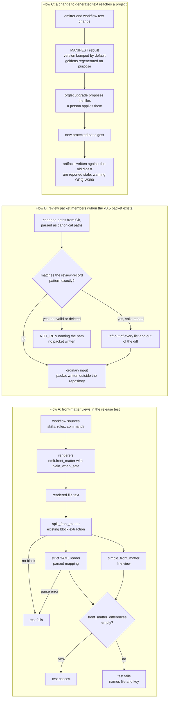

# Data-flow view

Three flows change. No flow carries a secret. No flow adds a trust boundary: flow A reads text that Orqlet's own renderers produced in the test process; flow B reads paths that the packet builder already reads from Git (the proposal treats repository files as untrusted input, ORQLET-SEC-002, and the builder already parses each path with `CanonicalPath`); flow C moves Orqlet's own protected text through the existing upgrade path. `trust_boundaries` in the manifest therefore stays empty.

| Flow | Data in | Data out | Where it stops |
|---|---|---|---|
| A | the rendered text of each skill, agent and Claude Code command, chosen by path (32 files in the golden set) | a pass, or a failure that names the file and the key | the test report; nothing is written |
| B | the list of changed paths of one review | a packet or one `NOT_RUN` finding | nothing is written on refusal |
| C | two text sources and the emitter | new generated bytes, a new manifest hash, a new protected-set digest | an upgrade proposal that a person applies; staleness is reported by `gate status` |
