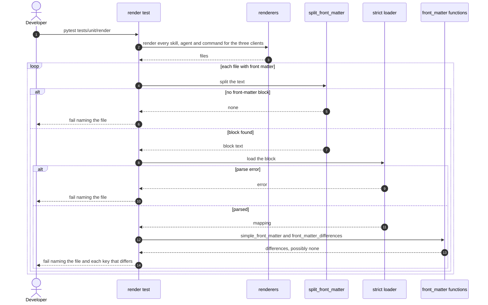
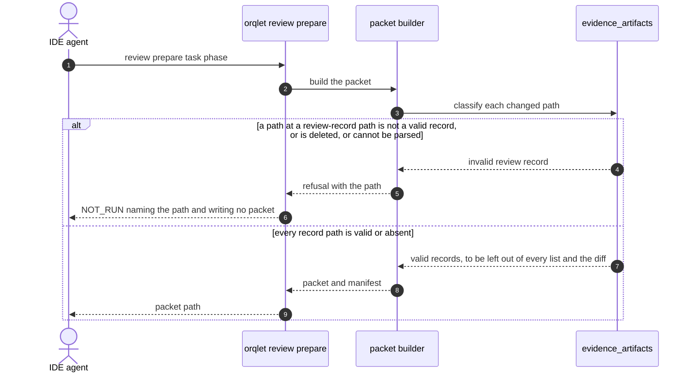
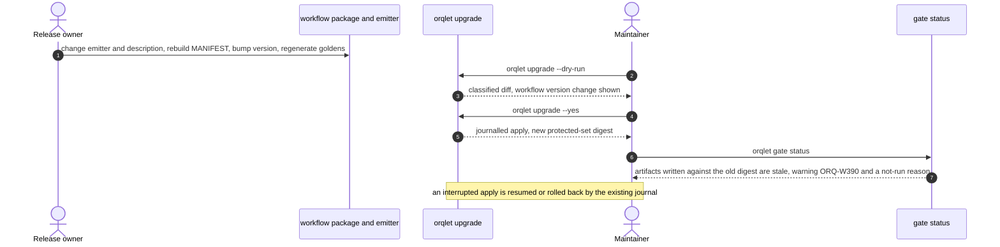

# Sequence diagrams

## Sequence 1: Release test over every rendered file (with failure paths)

## Sequence 2: Packet assertion (lands with the v0.5 packet plan)

## Sequence 3: A change to generated text reaches a project

