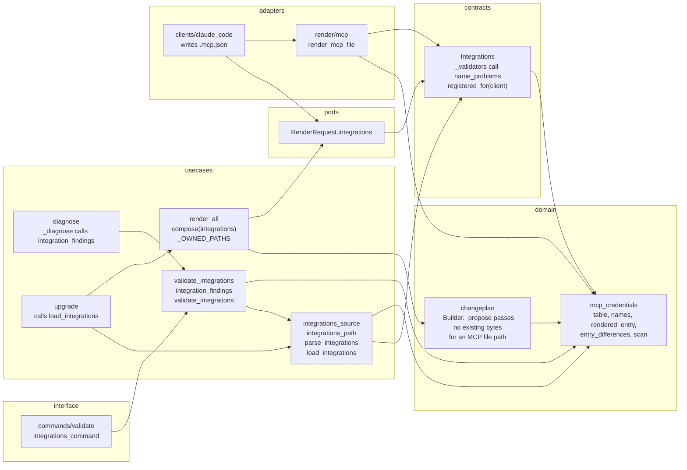

# Component view

The new and changed components, with the layer each sits in and what it may call. The pure rules already exist in `src/orqlet/domain/mcp_credentials.py` on `main` (eight public names: `CredentialFinding`, `name_problems`, `allowed_auth_modes`, `mcp_file_path`, `rendered_entry`, `entry_differences`, `referenced_variables`, `find_literal_credentials`). This change calls them and does not change them.

`compose` sets `RenderRequest.integrations` with `dataclasses.replace` after `build_render_request`, so the request builder is not changed.

## Layer rules for the new components

- `integrations_source`, `validate_integrations` and the `compose` parameter import no file, process or network module. They reach the repository only through the `FileSystem` port and the strict loader through the `DocumentLoader` port (ORQLET-ARCH-002, ORQLET-SEC-002).
- `render_mcp_file` is an adapter helper. It imports the domain and the contract, never another client adapter (ORQLET-ARCH-003).
- The Claude Code adapter writes `.mcp.json` only when `RenderRequest.integrations` has a server registered for it. The Codex and Cursor adapters do not read the field.
- The entry that the renderer writes and the entry that the validator compares come from one function, `rendered_entry`, so the pin has one source (ADR-002 decision 5).
- In every module that this change edits, the only public names added are the ones listed below; every other new name starts with an underscore (the contract validators, the closed key list, the helpers), so the public-API extractor sees exactly the listed names. The modules are `contracts/integrations.py`, `render_all.py`, `diagnose.py`, `upgrade.py`, `claude_code.py`, `commands/validate.py` and `changeplan.py`, as well as the new ones.

## Public names added or changed

| Id | Name | Signature | Notes |
|---|---|---|---|
| EC-1 | `orqlet.application.usecases.integrations_source.integrations_path` | `def integrations_path() -> CanonicalPath` | Where the declaration lives, `.orqlet/integrations.yaml`, as a function like `resources_path` |
| EC-2 | `...integrations_source.parse_integrations` | `def parse_integrations(loader: DocumentLoader, raw: bytes, source: str) -> tuple[Integrations \| None, tuple[Finding, ...]]` | Strict load, contract, closed table, scan |
| EC-3 | `...integrations_source.load_integrations` | `def load_integrations(project: FileSystem, loader: DocumentLoader, path: str) -> tuple[Integrations \| None, tuple[Finding, ...]]` | Absent: `(None, ())`; invalid: `(None, findings)`; valid: the declaration |
| EC-4 | `...validate_integrations.validate_integrations` | `def validate_integrations(services: ValidateServices, raw_path: str) -> ValidationResult` | The `validate integrations` use case |
| EC-5 | `...validate_integrations.integration_findings` | `def integration_findings(project: FileSystem, loader: DocumentLoader, path: str) -> tuple[Finding, ...]` | Shared by the use case and `doctor` and `sync` |
| EC-6 | `orqlet.interface.cli.commands.validate.integrations_command` | `def integrations_command(file, root, json_output) -> None` | One subcommand, defaults like `resources_command` |
| EC-7 | `orqlet.adapters.render.mcp.render_mcp_file` | `def render_mcp_file(servers: Sequence[McpServer], client: str) -> str` | One client's file text |
| EC-8 | `orqlet.application.contracts.integrations.Integrations.registered_for` | `def registered_for(self, client: str) -> tuple[McpServer, ...]` | The servers whose `per_client[client].register` is true |
| EC-9 | `orqlet.application.usecases.render_all.compose` | the signature gains `integrations: Integrations \| None=None` | A keyword-only parameter, between `resources_bytes` and `orqlet_owned` |
| EC-10 | `orqlet.application.ports.instruction_adapter.RenderRequest` | one optional field `integrations` | The class line does not change, so the extractor cannot see it (manual) |
| EC-11 | `orqlet.application.usecases.capabilities.IMPLEMENTED_COMMANDS` | gains `validate integrations` | The extractor reads an assignment by name only (manual) |

Behaviour and persisted shape, listed in the manifest as manual changes: the contract rules (EC-12), the generated `.mcp.json` (EC-13), the proposal files for the three MCP paths (EC-14), the trust boundaries (EC-15). The guard in `_Builder._propose` is private and has no public name.

Not public and therefore not listed: `_OWNED_PATHS` (gains `.mcp.json`), the closed key list of the validator, the contract validators, the constant of client ids in `changeplan.py`, and every helper of the new modules.
