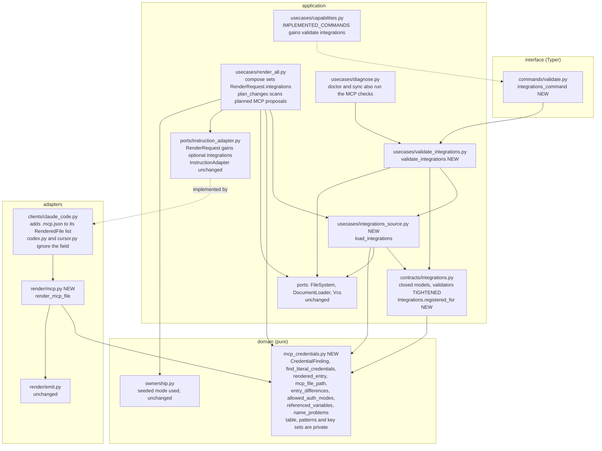

# Component view: the new and changed parts inside Orqlet

The application layer reaches an adapter only through the `InstructionAdapter` port; `render_all.py` hands the loaded declaration to it by the new optional `RenderRequest.integrations` field, and every adapter that does not use the field keeps its output. The entry that the renderer writes and the entry that the validator compares are both built by `rendered_entry` in the domain, so the pin has one source.

Layer rules that the new code must keep (import-linter contracts of `pyproject.toml`, ORQLET-QA-001, ORQLET-ARCH-001, ORQLET-ARCH-002, ORQLET-ARCH-003):

- `domain.mcp_credentials` takes and returns plain values (strings, mappings, tuples). It imports only the standard library (`re`, `collections.abc`, `typing`, `dataclasses`); the domain contract forbids `os`, `pathlib`, `pydantic`, `yaml` and process, network and file modules. It holds the closed table of addresses, modes and clients, the name patterns and the closed key sets as private names; each function is deterministic on its inputs (ORQLET-DET-001) and uses no clock, random number or environment.
- `application.usecases.integrations_source.load_integrations` reads the declaration through the `FileSystem` port and the `DocumentLoader` and owns the contract check, the table check and the scan of the declaration; `validate_integrations` calls it and reads the MCP files through the `FileSystem` port (the committed-assignment check, built later, reads tracked files through `Vcs.read_committed`), parses with a duplicate-key-rejecting JSON reader and `tomllib`, then passes plain mappings to the domain.
- `adapters.render.mcp` writes no file; it returns text, as the other renderers do, and the existing apply path writes it. Adapters do not import the application's use cases. The three client adapters never import one another (ORQLET-ARCH-003).

## Public names the change adds

| Name | Module | Purpose |
|---|---|---|
| `CredentialFinding` | `orqlet.domain.mcp_credentials` | A line number and a rule name; never a value |
| `find_literal_credentials` | `orqlet.domain.mcp_credentials` | Finds token-shaped strings, URL user information and query secrets, a literal `Authorization` value and credential-named fields in text |
| `rendered_entry` | `orqlet.domain.mcp_credentials` | Builds the one entry of a server for a client; the renderer and the validator both use it |
| `mcp_file_path` | `orqlet.domain.mcp_credentials` | The path of a client's MCP file |
| `entry_differences` | `orqlet.domain.mcp_credentials` | Names the fields in which a parsed entry differs from the built one; never prints a value |
| `allowed_auth_modes` | `orqlet.domain.mcp_credentials` | The modes that this release enables for an exact address and a client; empty for an unknown combination |
| `referenced_variables` | `orqlet.domain.mcp_credentials` | The variable names that an entry refers to; empty when the entry holds none |
| `name_problems` | `orqlet.domain.mcp_credentials` | Rule names broken by a server id, an address or a variable name; used by the contract |
| `Integrations.registered_for` | `orqlet.application.contracts.integrations` | The servers registered for one client; used by the renderer, the validator and the plan |
| `load_integrations` | `orqlet.application.usecases.integrations_source` | Owns the three declaration checks (contract, closed table, scan); returns the declaration and its findings |
| `DECLARATION_PATH` | `orqlet.application.usecases.integrations_source` | The path `.orqlet/integrations.yaml`, passed by compose, `_diagnose` and `validate_integrations` |
| `validate_integrations` | `orqlet.application.usecases.validate_integrations` | The `validate integrations` use case |
| `integrations_command` | `orqlet.interface.cli.commands.validate` | The CLI wiring |
| `render_mcp_file` | `orqlet.adapters.render.mcp` | One file's text for one client |

`RenderRequest` gains one optional field, `integrations`, and `IMPLEMENTED_COMMANDS` gains one entry. The extractor cannot see either edit (the class line does not change and the assignment is read by name only), so both are manual expected changes (EC-12, EC-19). Everything else in the new and edited modules is private (leading underscore, including the validators of the contract), so that the public-API extractor sees exactly these names (expected changes EC-1 to EC-11, EC-17, EC-18, EC-20). Release 1 enables one combination only; the other client shapes are specified in ADR-002 and built by the release that enables them.
