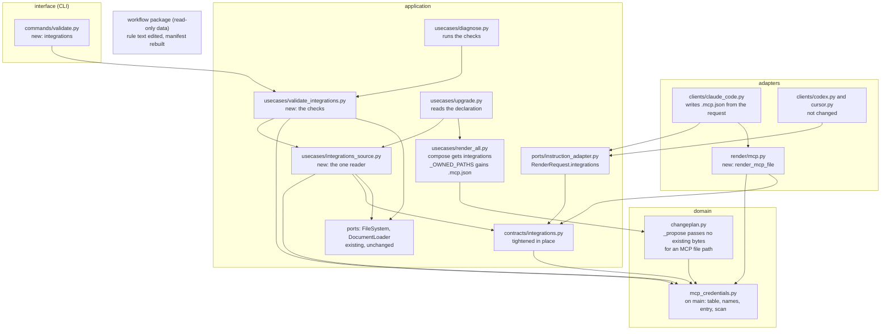

# Container view

The containers of Orqlet that this change touches. Arrows are imports, and dependencies point inward: interface to adapters to application to domain (ORQLET-ARCH-001). The workflow package is read-only data used by adapters and the interface (ORQLET-ARCH-003); the Claude Code adapter reaches it through the existing workflow-package adapter, not directly.

## What changes in each container

| Container | Change |
|---|---|
| domain | `mcp_credentials.py` is on `main` and stays as it is. `changeplan.py`: the one place that builds a proposal, `_Builder._propose`, passes no existing bytes when the path is the MCP file of a client. |
| application contracts | `orqlet.integrations/v1` is tightened by validators that call the domain module; one new method `Integrations.registered_for`; the committed JSON Schema is unchanged. |
| application use cases | New `integrations_source` (the one reader, after `resources_source`) and `validate_integrations` (the checks, after `validate_resources`). `upgrade` reads the declaration and passes it to `compose`, which gets one keyword parameter and a new entry in `_OWNED_PATHS`. `diagnose` runs the checks. `capabilities` lists the new command. `init` composes without a declaration and `explain` is not changed. |
| application ports | `RenderRequest` gets one optional field `integrations`. |
| adapters | New `render/mcp.py`. The Claude Code adapter writes `.mcp.json` when the request holds a declaration with a server registered for it. The Codex and Cursor adapters are not changed. |
| interface | One new subcommand, `validate integrations`. |
| workflow package | The rule text and its meta file are edited so they stop calling `.mcp.json` a generated file of Orqlet; the manifest is rebuilt and the version is bumped in the same step. |
| tests, docs | Tests for each unit and for the fault cases (ORQLET-TEST-001, ORQLET-TEST-002); README section; architecture document corrections; check records. |
