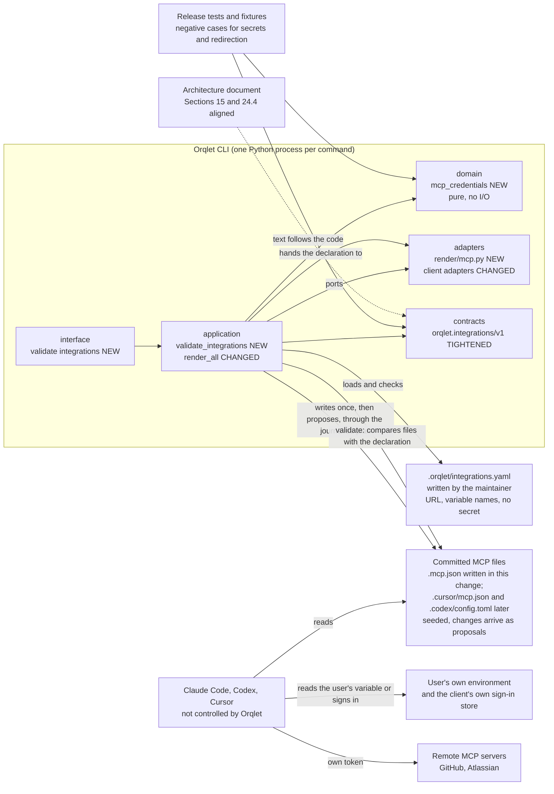

# Container view: what the change touches

Scope: the part of Orqlet that this task changes, with the files and clients around it. Nothing here starts an agent or calls a model.

What changes in each container:

| Container | Change |
|---|---|
| domain | One new pure module, `mcp_credentials`: a scan that finds literal credentials in decoded text without returning their values, a comparison of a pinned entry with a parsed one, the closed table of addresses, modes and clients, and the name patterns (ADR-002) |
| contracts | `orqlet.integrations/v1` is tightened in place by validators that call the domain module: `id` and variable-name patterns, uniqueness, https-only addresses without user information, query or variable, `env_refs` that holds one bare variable name (the rendered entry holds the `${NAME}` reference), one mode per server, `backend_identity` tied to the mode, cross-field rules; the committed JSON Schema does not change. No module reads the contract (AS-IS A-13); the person decided to keep the identifier (Q-13) |
| application | New use cases `load_integrations` and `validate_integrations`; `render_all` sets the new optional `RenderRequest.integrations` when a declaration exists, so the adapters add the MCP files to the files of `init`, `upgrade` and `explain`; `doctor` also runs the MCP file checks |
| adapters | New `render/mcp.py` that writes an MCP file as text (in this change only `.mcp.json`); the Claude Code adapter calls it when the request carries a declaration; the other two ignore the field in this change |
| interface | New subcommand `orqlet validate integrations`, listed in `IMPLEMENTED_COMMANDS` |
| committed files | Seeded files written once when a declaration exists; in this change only `.mcp.json` with one Atlassian OAuth entry; later changes arrive as `.orqlet/proposals/*.diff`, never as silent edits (ADR-003) |
| workflow package (protected data) | The rule text `orqlet-workflow.md` and its meta file stop calling `.mcp.json` Orqlet-owned; `MANIFEST.json` is rebuilt, `identity.json` is bumped and a release is recorded when the person decides (ADR-003, decision 8) |
| tests and fixtures | New unit and contract tests; negative fixtures for each rule; the existing valid integrations fixture is updated; a new golden for `.mcp.json`; the goldens whose markers carry the workflow version are regenerated on purpose |
| architecture document | Section 15 and the Section 24.4 example are aligned with the built contract (AS-IS C-6) |

No container is added outside Orqlet. No plugin manifest, marketplace file or dashboard value is produced (ADR-001).
