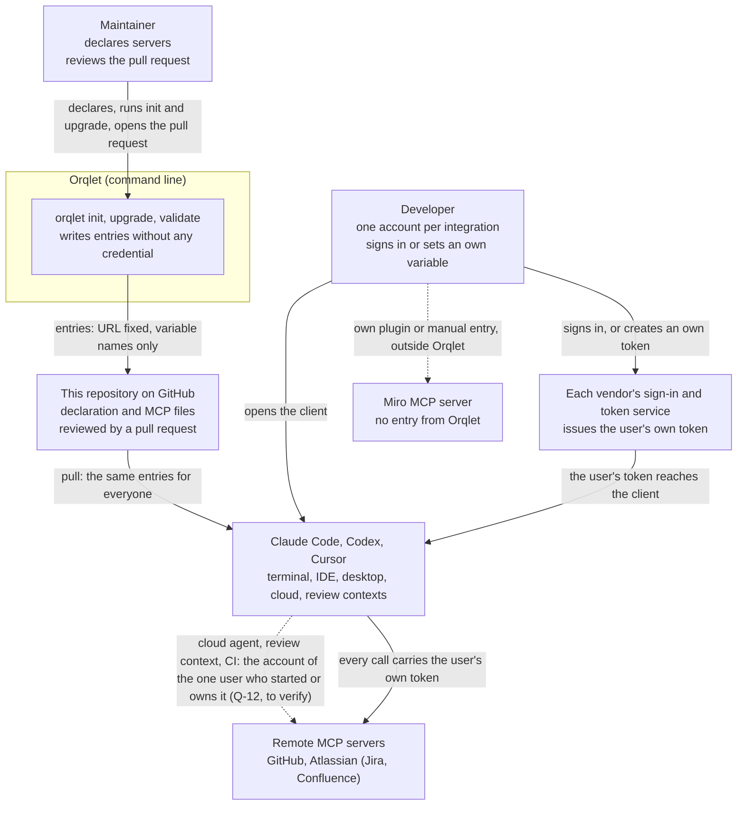

# Context view: who and what the change touches

Scope: how an MCP server entry gets from this repository to each developer's client, and where the developer's own credential comes from. Orqlet never calls a model and never starts an agent (ORQLET-NOMODEL-001); it never reads a client's credential store and never stores a secret in Git, prompts, Markdown, indexes or logs (AS-IS A-53).

## Trust boundaries

| Boundary | What crosses it | Who decides | What this design does about it |
|---|---|---|---|
| B-1 repository to client | A server address and the names of variables that a client expands | The pull request that changes the committed file (Q-11: reviewed by this repository's code owners; a changed file-and-declaration pair passes the offline check, so only review catches it) | The address is a literal on a closed table in the tool, in the declaration and in the file; `validate integrations` compares the file with the entry that the tool builds; a changed address with an unchanged variable name is an error (ADR-002) |
| B-2 user environment to client | The user's own token, read from a variable or obtained by sign-in | The user | Orqlet writes only the variable name or nothing and reads no credential store (AS-IS A-53); it reads the MCP files and the declaration as text |
| B-3 client to remote server | The user's token in an `Authorization` header or an OAuth exchange | The vendor and the user's account | The entry holds no credential or one reference, and the connection and the token belong to the client and the vendor; no shared identity can be named in the declaration (Q-9, ADR-002); an unattended surface uses the account of the one user who started or owns it (Q-12), which V-12 verifies |

The accepted facts behind the picture: project MCP files are shared through version control and each user supplies the credential (AS-IS A-55, A-58, A-61, A-108, A-110); a client stores an OAuth sign-in for the user who signed in (Claude Code per endpoint, A-69; Codex in a keyring or a file, A-98; where Cursor stores it is not stated), and an unattended surface is to use the account of the one user who started or owns it (the person's answer to Q-12; no vendor text says whether the surfaces can do that, V-12); the design's own rule is that credentials are never copied between clients (A-37).
