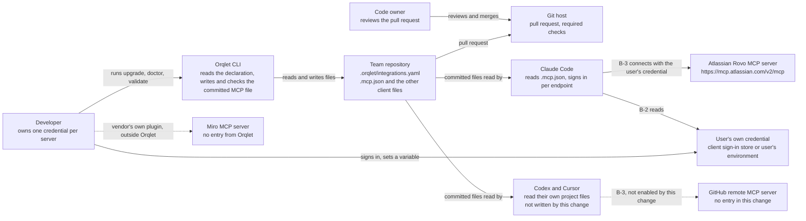

# Context view

Who and what the change touches. Orqlet prepares and checks files; it opens no network connection and starts no client. It never reads a credential store and its own output never carries a credential value (A-53); it does read repository files that may hold a pasted credential, in order to scan them. The credential lives between the developer, the client and the remote server, outside Orqlet.

## Trust boundaries

| Id | Boundary | What crosses it | What holds it |
|---|---|---|---|
| B-1 | Repository to client | A server address and, in a later release, a variable name, in committed files that every client reads. Both reach every developer who pulls the file | The contract and the closed table (ADR-002 decisions 2 to 5), the scan (decision 7), the pin comparison (decision 6), the pull request review (Q-11) |
| B-2 | User environment to client | The sign-in the user completes (this change) or, in a later release, the user's own token from a variable. Orqlet's own output never carries either | The client's own handling; the README instruction; the check records V-5 and V-9 for the sign-in in this change, and V-2 and V-8 for a variable in a later release |
| B-3 | Client to remote server | The user's own credential, sent to an address that the closed table fixed | The table (the address is a literal on an exact-string list); OAuth consent; the vendor's access control (A-128) |

## Neighbours that this change must not disturb

- The registry of team links (`.orqlet/resources.yaml`, `docs/resources/**`) and the team conventions block of `AGENTS.md` are on `main`. They share no field with the declaration and no code path except `compose`, `doctor` and the CODEOWNERS notice (ADR-003 decisions 8 and 9).
- The three client adapters never import one another (ORQLET-ARCH-003). The change reaches them through the existing request object.
- A project with no declaration keeps its files unchanged.
