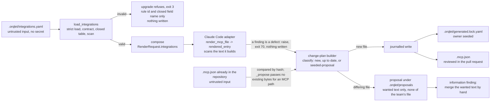
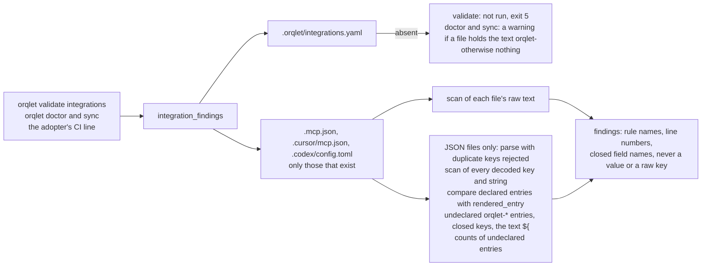
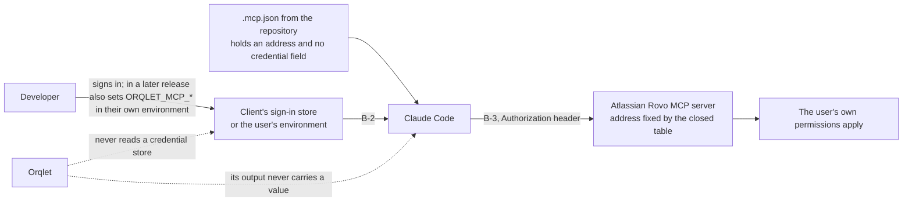

# Data-flow diagram

Three flows. Orqlet never reads a credential store and its own output never carries a credential value. It does read repository files that may hold a pasted credential, in order to scan them, and it reports only rule names and positions. The one route by which existing file text could be copied into a new file, a proposal, is closed by not copying it (flow 1).

## Flow 1: declaration to committed file

| Data | Where it is trusted | Check |
|---|---|---|
| The declaration | Not trusted | Strict YAML load, size cap, contract validators, closed table, scan |
| An existing `.mcp.json` | Not trusted | Compared by hash only; its text is never put into a proposal |
| The rendered file | Built from the table and the declaration | One function, `rendered_entry`; scanned before it is written |

## Flow 2: checking the files

## Flow 3: the credential, outside Orqlet

An unattended surface (a cloud agent, a review context, CI) is outside this flow: it uses the account of the one user who started or owns it (Q-12), which check V-10 asks about. Where that fails, ADR-002 decision 12 says the standard is not met there.
