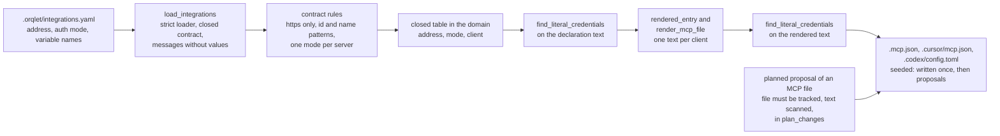
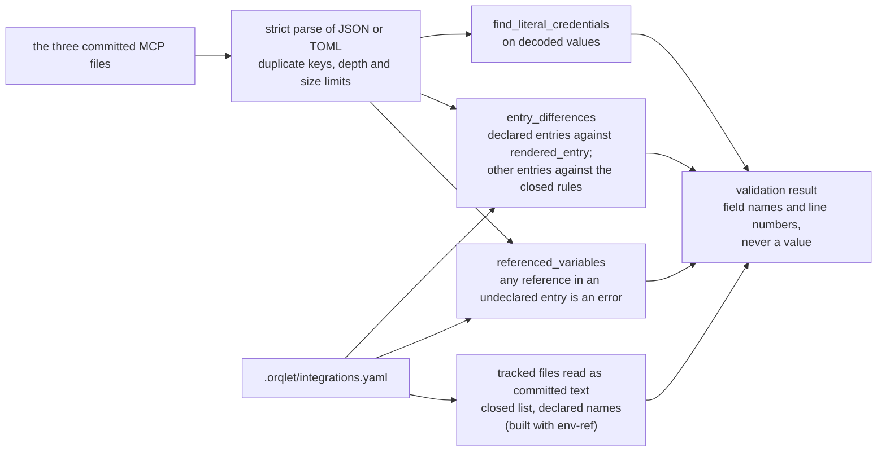
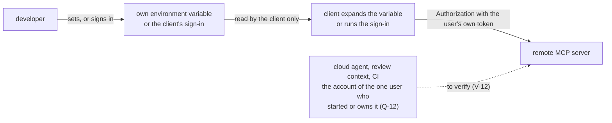

# Data flow: three flows, and where a credential is allowed to be

## Flow 1: from the declaration to the committed files

Data that crosses: an address, an authentication mode and one variable name per server. No credential value exists on this path. A rule that fails stops the flow before any text is rendered. A planned proposal for an MCP file that comes from an untracked file, or whose text holds a credential-shaped value, stops the whole command (exit 3) before the plan is returned, so nothing is written or previewed, and the finding names a rule and a line, never a value; a file that Orqlet wrote or that equals the render produces no proposal (ADR-002 decisions 7 to 9; ADR-003 decision 3).

## Flow 2: checking the committed files

The rule for entries is the same everywhere (ADR-002 decision 6): a declared entry must equal the built one; an undeclared `orqlet-*` entry is an error; an undeclared entry that holds a variable reference, a credential-bearing field or a literal credential is an error; any other undeclared entry (a team's public or stdio server) is left alone, and that is a stated limit. A pull request that changes only a file, or only a declaration, is caught. A pull request that changes both in step passes this offline check: only review catches it, and the comparison against the target branch needs `orqlet ci check`, which is not built (AS-IS A-14, A-15; ADR-003). The same checks run in `doctor` and `sync`, because the files are seeded and hash drift skips them (`diagnose.py:72-73`).

## Flow 3: the credential, outside Orqlet

Orqlet is not on this path. It reads no credential store and prints no variable value. The committed file holds only `${VAR}` or `${env:VAR}`, or `bearer_token_env_var = "NAME"` for Codex (AS-IS A-62, A-91, A-110). The dotted edge is the person's answer to Q-12 (the account of the one user who started or owns the surface), which no check can yet confirm: V-12 asks whether each surface can be bound to one user, and a surface that cannot is a written gap.

| Data | Where it may be | Where it must not be |
|---|---|---|
| Server address | Declaration, committed file | A variable, a user name, a query or a fragment |
| Variable name | Declaration, committed file, only as one `${NAME}` reference | Anywhere as a value; in a committed file as an assignment (reported) |
| Token value | The user's environment, the client's own store, the vendor | The repository, a log, a validation message, a fixture other than an obvious placeholder (ORQLET-SEC-003) |
