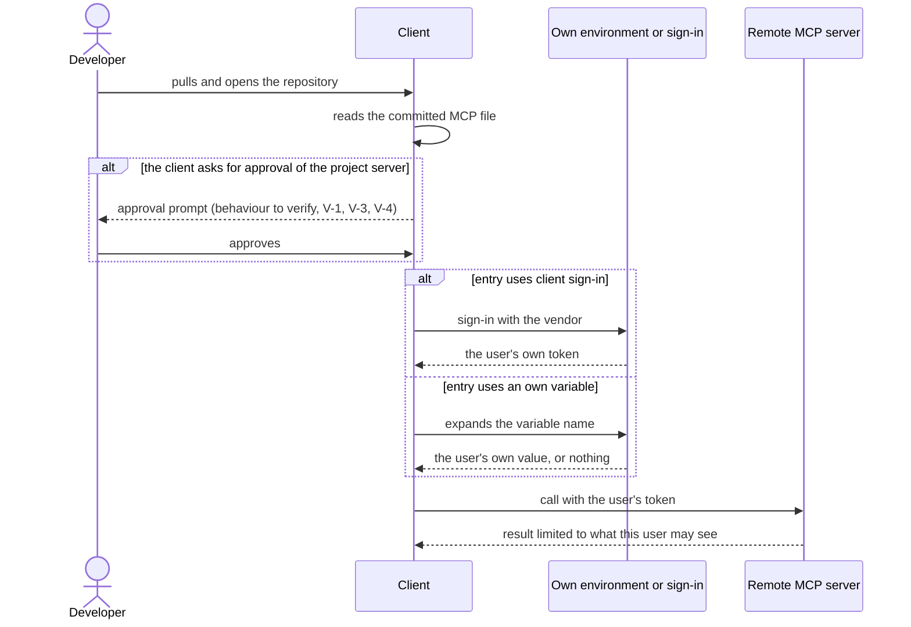

# Sequences with their failure paths

## Sequence 1: the maintainer declares a server and generates the files

```mermaid
sequenceDiagram
  actor M as Maintainer
  participant O as orqlet init or upgrade
  participant L as load_integrations
  participant R as render_mcp_file
  participant FS as FileSystem port
  M->>M: writes .orqlet/integrations.yaml
  M->>O: orqlet upgrade --dry-run
  O->>L: load and check the declaration
  alt a rule fails (literal secret, http address, bad name, mode not enabled)
    L-->>O: errors with line numbers and rule names
    O-->>M: exit 3; nothing is rendered, nothing is written
  else the declaration is valid
    O->>R: render for each enabled client
    R-->>O: text of the files
    O->>FS: plan_changes reads each existing MCP file and checks each planned proposal
    alt a planned proposal comes from an untracked file or holds a credential-shaped value
      O-->>M: exit 3 with rule names and lines; the plan is discarded, nothing is written or previewed
    else
      O-->>M: preview of new files and proposals
      M->>O: approves
      O->>FS: write absent files, write proposals for changed ones
    end
  end
  M->>M: opens the pull request; code owners review
```

## Sequence 2: a developer starts a client



Failure path: the variable is unset. For Codex the text says "If no credential source resolves, Codex can connect to the server without authentication" (AS-IS A-94). For Claude Code and Cursor the accepted evidence does not say what an unset variable becomes; V-2 and V-3 record it (ADR-004). The committed entry never carries another user's value; Orqlet cannot see a value that the user took from somebody else (considerations, Security).

## Sequence 3: a pull request changes an address or a name

```mermaid
sequenceDiagram
  actor A as Author of the pull request
  participant PR as Pull request
  participant CO as Code owners
  participant VC as orqlet validate integrations
  A->>PR: changes a URL, keeps the variable name
  PR->>VC: run in the adopter's CI on the changed tree
  alt only the file changed
    VC-->>PR: exit 5: the address or entry differs from the one built from the declaration
  else the address is not on the closed table
    VC-->>PR: exit 5: unknown address or mode
  else declaration and file changed together
    VC-->>PR: pass (same tree)
    PR->>CO: review decides; the target-branch check is not built
  end
```

The last branch is a stated limit. It is also a limit of the host: branch protection and rulesets were refused with HTTP 403 for this repository on its plan at capture time (open-items evidence, `github-state.yaml:26-31`), so a required code-owner review cannot be enforced there today (considerations). This repository's own CI does not run the command on adopters' trees; an adopter adds it to its own CI (README).

## Sequence 4: an unattended surface

```mermaid
sequenceDiagram
  participant Surf as Cloud agent or review context
  participant Cl as Client on that surface
  participant S as Remote MCP server
  Surf->>Cl: starts with the repository checked out
  Cl->>Cl: reads the committed MCP file (to verify, V-7)
  alt the surface holds one signed-in user
    Cl->>S: calls with that user's token
  else the surface uses an environment that several people share
    Cl-->>Surf: not allowed by Q-12; the surface gets no entry (V-12)
  end
```

Q-12 is answered: an unattended surface uses the account of the one user who started or owns it. V-12 checks whether each surface can do that. On a surface where it cannot, or where the environment is shared by several people, Q-6 and Q-9 are not met for any mode, OAuth included, and the surface is a written gap.
