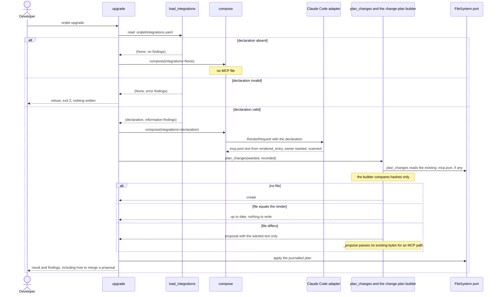
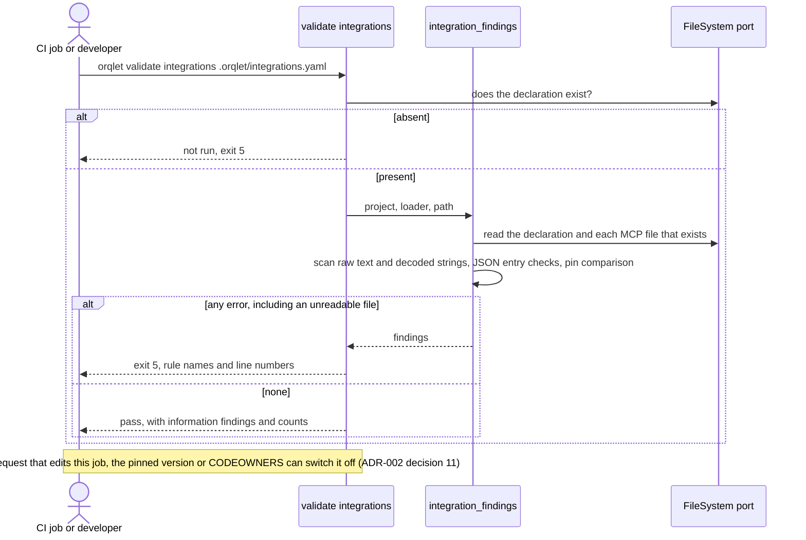
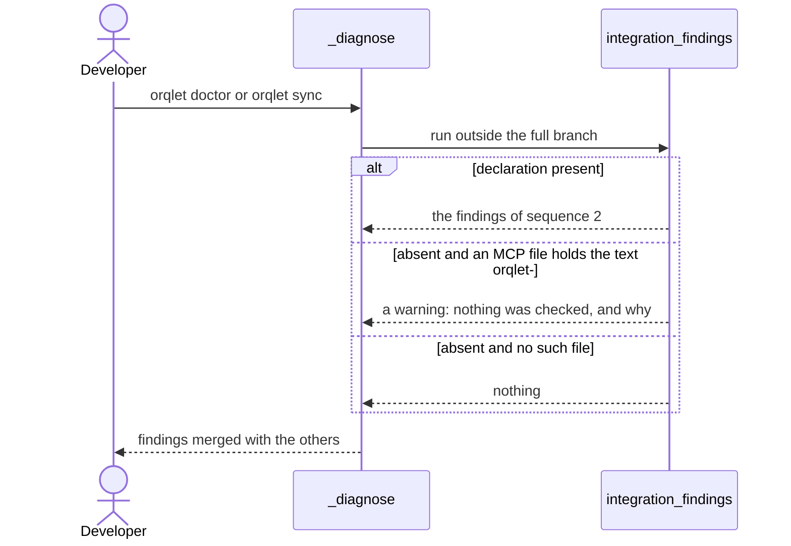
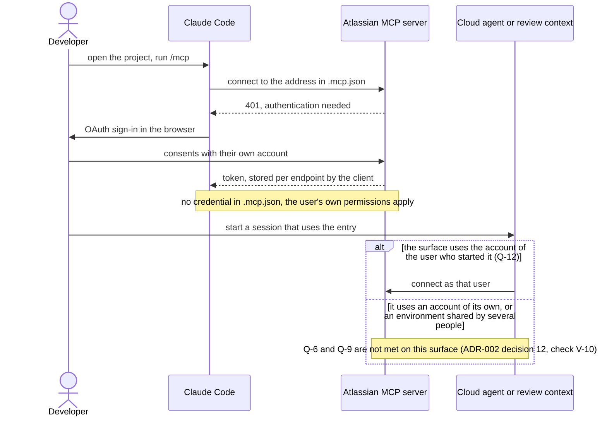

# Sequence diagrams

Four interactions, each with its failure paths. Every message that carries a finding carries a rule id, a line number or a closed field name, and never a value or a raw key (ADR-002 decision 9).

## 1. `upgrade` with a declaration

## 2. `validate integrations` and the CI line

## 3. `doctor` and `sync`

## 4. The developer's first connection, and an unattended surface

