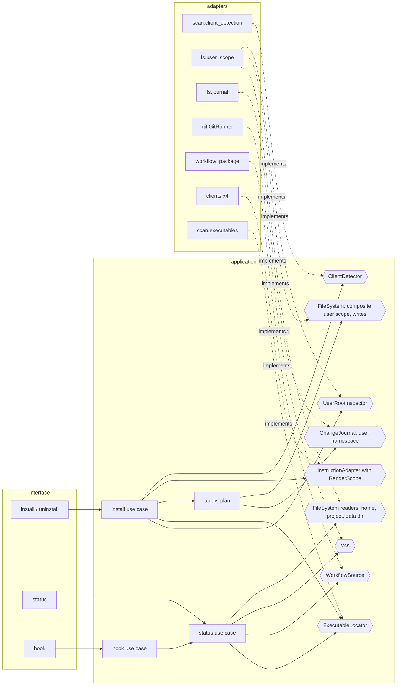

# One-command setup: design brief and components

Task `one-command-setup`. Class D3. Reads the accepted AS-IS file `docs/design/one-command-setup/as-is.md` and the ledger `docs/design/one-command-setup/questions.yaml` (Q-1 to Q-44, and Q-60). The `status` contract in section 3 follows the answers given while it was implemented (Q-63 to Q-66, Q-69, Q-70, Q-72 to Q-76, Q-79 and Q-80), as Q-78 asks, and the hook registration rule follows Q-79 and Q-82.

## 1. Summary

A developer installs the CLI once (`uv tool install orqlet` or `pipx install orqlet`) and runs `orqlet install` once in a terminal. That command detects every supported assistant on the machine, writes Orqlet's skills, agents, guidance and hooks into each assistant's documented user-level folders. It prepares no tool and uses no network. From then on the developer works in the assistant. The person-started entry skill `orqlet` (`/orqlet .`, Codex `$orqlet .`) initializes or upgrades a repository and is the help and recovery route. A session-start hook shows a short status, and an advisory post-edit hook warns when an Orqlet-generated file is edited by hand.

Recommended approach:

- One new terminal command, `install`, with `uninstall` as its undo. A read-only `status` command serves both the entry skill and the session-start hook.
- A second, allow-listed write root for user-level client folders, with its own journal, backups and manifest. This depends on an amended ORQLET-SAFE-001 (Q-32).
- A fourth, independent client adapter for GitHub Copilot in VS Code. This depends on an amended ORQLET-ARCH-003 (Q-33).
- Advisory hooks only. They are cheap and bounded, never block, start no process, and are registered once per client.
- The phase skills stay person-started, and every STOP, approval, review and NOT_RUN rule is unchanged (Q-22, Q-34, Q-36).

## 2. Requirements

| Id | Requirement | Source |
|---|---|---|
| R-1 | Install the CLI user-wide with `uv tool install orqlet`, or `pipx install orqlet`. Keep the pinned Git-source route documented until publication is verified. | Q-10, Q-18, Q-25 |
| R-2 | `orqlet install` detects the supported assistants and registers every one it detects without asking. It never chooses a default when none is detected. | Q-10, Q-12, Q-21 |
| R-3 | Supported surfaces are Claude Code, Cursor, Codex (CLI and VS Code extension) and GitHub Copilot Agent mode in VS Code, for individual and admin-restricted accounts. | Q-13, Q-19, Q-21, Q-33 |
| R-4 | The entry skill is named `orqlet` and is invoked with the target directory: `/orqlet .`, or `$orqlet .` in Codex. Outside a Git repository it ensures global setup only. In a repository without Orqlet it initializes the repository; in an initialized one it upgrades it and reports status. | Q-1, Q-10, Q-11 |
| R-5 | Global configuration holds Orqlet's skills, rules and agents for every supported client, including phase skills and agents. A global copy may shadow the project copy. One guided Cursor User Rules step is allowed. | Q-7, Q-9, Q-38 |
| R-6 | All six Ponytail skills reach every project that Orqlet initializes or upgrades, and the global folders. | Q-1, Q-3, Q-38, Q-60 |
| R-7 | Git stays a prerequisite. Orqlet's Python requirement stays as it is. | Q-4, Q-23, Q-60 |
| R-8 | Native hooks automate startup guidance and lightweight tool-event checks, within the cost limits of Q-26. | Q-14, Q-16, Q-26 |
| R-9 | Phase skills stay person-started. Approvals, independent reviews, model policy and NOT_RUN reporting are unchanged. | Q-22, Q-34 |
| R-10 | There is one behavioural foundation, with no vendored Karpathy text: Orqlet's own wording plus an attribution link. Simplicity keeps validation, error handling, accessibility and approvals. | Q-27, Q-28 |
| R-11 | The terminal presentation of `orqlet install` follows Q-29. | Q-29 |
| R-12 | ORQLET-SAFE-001 and ORQLET-ARCH-003 change only through separate reviewed standards changes. | Q-32, Q-33 |
| R-13 | Qualification writes only to temporary scoped roots and approved disposable sessions. Nothing is published. | Q-24, Q-25 |
| R-14 | The four-phase ceremony is unchanged. | Q-30, Q-31, Q-36 |

## 3. Behaviour

### Command line

**`orqlet install [--client C]... [--allow-weaker] [--yes] [--dry-run] [--json]`**. The options have the meaning they have on `init` (`--client` repeats; the default is every detected client). `--allow-weaker` has the meaning it has on `upgrade` (item 9).

1. Detection reads a fixed set of indicators: an executable on `PATH`, or the presence of a documented client folder or VS Code extension folder. It lists names only and reads no file contents, except Orqlet's own managed entries.

   | Client id | Indicators |
   |---|---|
   | `claude-code` | `claude` on `PATH`, `~/.claude/` |
   | `cursor` | `cursor` on `PATH`, `~/.cursor/` |
   | `codex` | `codex` on `PATH`, `$CODEX_HOME` or `~/.codex/`, or an OpenAI Codex extension folder under `~/.vscode/extensions/` |
   | `copilot` | a GitHub Copilot Chat extension folder under `~/.vscode/extensions/`, `$COPILOT_HOME` or `~/.copilot/` |

2. A preview lists, per client, each file and entry to create, update or leave alone. Without `--yes`, an interactive terminal asks once. A non-interactive run without `--yes` exits 4.
3. Apply writes the user scope through one journalled change (ADR-002). `install` prepares no tool and uses no network (Q-60).
4. Output is a result line per client, in one of these states: `detected`, `already configured`, `installed`, `registered`, `host step` (a trust prompt, the Cursor User Rules step, an unverified surface or a documented gap), `conflict` and `failed`. The last two carry a recovery action. Then comes the invocation for each registered client.
5. Exit status: 0 when everything is done; 1 when at least one client failed and the rest were applied; 3 when it refused because of a conflict on an owned or edited file, or an invalid root; 4 when it needs input (no supported assistant detected, or non-interactive without `--yes`); 2 for a usage error; 70 for an internal error. When a run both refuses and fails, 3 wins.
6. `--dry-run` writes nothing, in the user scope, a project or the data directory. It creates no folder, changes no mode and starts no process. Missing roots and folders appear as `will create`, and wide folder modes as `will tighten` (ADR-002 decision 1a). A declined interactive preview behaves the same. `--json` prints the existing envelope (A-14) with no banner, colour or icons.
7. The preview and the result name each root's resolved path (ADR-002 decision 1a), and the `orqlet` that `PATH` resolves to, flagged when it is not the running executable, when an unsafe `PATH` element is searched before it or holds it, or when it is absent (ADR-004 decision 7).
8. Unfinished user-scope changes from interrupted runs (every journal later than the change recorded in the manifest) are named in the preview. Their recorded writes are adopted, oldest first, when their hashes match, whether or not they were marked done, and the run plans again. Planning reads these journals read-only; only the consented apply marks them superseded (ADR-002 decision 4). The preview also names the backups that retention will prune (Q-40).
9. When `user/manifest.json` holds a workflow version above the running Orqlet's, `install` refuses with exit 3 unless `--allow-weaker` is given, as `upgrade` does (ADR-002 decision 2).

**`orqlet uninstall [--client C]... [--yes] [--dry-run] [--json]`** removes each named client from the owner set of its user-scope entries. With no `--client`, it acts on every owner recorded in `user/manifest.json`, detected or not. It deletes an entry only when no owner remains and the entry's content still matches the manifest. An edited entry is reported as a conflict and kept. The exit statuses are those of `install`, except that exit 4 for "no supported assistant detected" does not apply. With no recorded owner, it reports `nothing to remove` and exits 0.

**`orqlet rollback --user <change-id> [--allow-weaker] [--yes] [--dry-run] [--json]`** undoes one user-scope change. It works from any directory, and `--user` with `--root` or `--project-id` is a usage error (exit 2). It writes `user/manifest.json` last. Otherwise it behaves as today's `rollback`, with the same exit statuses (ADR-002 decision 5).

**`orqlet status [--root DIR] [--json]`** reads only. It creates nothing, not even the data directory (K-11). The JSON `data` has this shape, and every value is from a closed set or follows the representability rules (Q-63 to Q-66, Q-79, Q-80):

```json
{
  "global": {"clients": {"claude-code": "…", "codex": "…", "cursor": "…", "copilot": "…"}, "host_steps": ["…"]},
  "orqlet_on_path": "…",
  "location": "…",
  "top_level": "…",
  "top_level_reason": null,
  "versions": {"installed": "…", "project": null},
  "next": "…"
}
```

| Field | Values |
|---|---|
| `global.clients` | one key per render client id, each `missing`, `configured`, `outdated` or `newer`, read from `user/manifest.json` (schema `orqlet.user-manifest/v1`). A client that owns no entry is `missing`. Otherwise it is `newer` when any owned entry's workflow version is above the installed one (for example after a downgrade), else `outdated` when any is below, else `configured`. A manifest that does not parse or validate, is a link or exceeds 1 MiB, or a data directory that exists but cannot be checked, gives `missing` for every client and a check not run (Q-65, Q-74) |
| `global.host_steps` | a list of closed codes. `status` emits only `unsafe-path-element`: an empty, `.` or relative `PATH` element, or on POSIX a folder writable by others, that is searched before the resolved `orqlet` or holds it (Q-66, Q-79). Later commands may add codes |
| `orqlet_on_path` | `same`, `different` or `absent`. `different` also covers a running program that cannot be identified, such as `python -m orqlet`, so it does not prove that another `orqlet` is installed (Q-76) |
| `location` | `not-a-repository`, `repository`, `initialized-project`, `linked-worktree` or `home-is-work-tree` (the top level of the work tree is the home folder or one of its ancestors). Anything at `.orqlet` that is not a folder gives `initialized-project` with a null project version and a check not run (Q-75) |
| `top_level` | the real path, or null |
| `top_level_reason` | `path-not-representable` when the real path breaks the rules of ADR-001 decision 3, which also refuse the invisible characters of Q-69 and Q-70 (variation selectors, Hangul fillers, the Braille blank and unassigned code points, among others), otherwise null. A top folder name that Git output cannot carry (a line feed, or bytes that are not UTF-8) gives `not-a-repository`, a null `top_level`, a null reason and a check not run (Q-80) |
| `versions` | `installed`, the packaged workflow release version, and `project`, the workflow version of `.orqlet/workflow.lock` or null |
| `next` | one value of a closed set, chosen by the first rule that matches (Q-64): `refuse-newer-global` when any client is `newer` (the entry skill stops and tells the person to update the CLI); `refuse-linked-worktree`; `refuse-home-is-work-tree`; `install-global` when every client is `missing` or any is `outdated`; `none` outside a repository; `init` in a repository; in an initialized project, `upgrade` when the project version is null or below the installed one, otherwise `none` |

The top level and a linked worktree are found with `GitRunner` (`rev-parse --show-toplevel`, `--git-dir`, `--git-common-dir`). When `PATH` searches an unsafe element before `git` is found, its own element included, or anywhere when `git` is not found, Git is not run: the location is `not-a-repository` and the check is not run (Q-73). `status` exits 0, or 5 when a check could not run (A-30); the envelope then has `ok: false`, the reasons under `not_run`, and a `next` computed from the fallback location. On Windows, whether the process launch also searches the current folder before `PATH` is unknown, so this skip does not cover that case (Q-73). A consumer, the entry skill or the session-start hook, stops when a check did not run (exit 5 or `ok: false`) and does not act on `next` then (Q-72). The human output prints the same fields as plain lines. The shape and the values above are the output of the command; the hook's own mode has no `PATH` check and prints only its fixed template (ADR-004).

**`orqlet hook <event> --client C`** has the events `session-start` and `post-edit`. The client starts it, not a person. It reads one JSON payload from standard input, capped at 1 MiB, and writes the client's documented output object to standard output. It always exits 0, except 2 for a usage error, so a hook never blocks. It starts no process (ADR-004).

### Files and data written

User scope, through the composite user-scope file system (ADR-002). The files are those the project adapters already render, from a user-scope render request with no model settings (ADR-002 decision 7), written to each client's documented user location:

| Client | Skills (phase, `orqlet`, six `ponytail*`) | Agents | Guidance | Hooks |
|---|---|---|---|---|
| Claude Code | `~/.claude/skills/<name>/` | `~/.claude/agents/` | `~/.claude/rules/orqlet-foundation.md` | entries in `~/.claude/settings.json` |
| Cursor | `~/.agents/skills/<name>/`, one shared render with Codex including `agents/openai.yaml`, like `.agents/skills` in a project (A-4) | `~/.cursor/agents/` | guided User Rules step; the text is saved under the data directory | entries in `~/.cursor/hooks.json` (session start only, ADR-004) |
| Codex | the same shared `~/.agents/skills/<name>/` | `$CODEX_HOME/agents/` | managed block in `$CODEX_HOME/AGENTS.md` | entries in `$CODEX_HOME/hooks.json` (session start only, ADR-004) |
| Copilot | `~/.copilot/skills/<name>/` | not written until a documented location is cited (section 8) | session-start `additionalContext` | `~/.copilot/hooks/orqlet.json` |

Data directory (A-27), created 0700: `user/manifest.json`, `user/apply.lock`, `user/journal/<change-id>.json`, `user/backups/<change-id>/…` (files 0600) and `user/cursor-user-rules.md`.

Project scope: `init` and `upgrade` also render the six `ponytail*` skills, and the `copilot` adapter's project files when the profile lists `copilot`. No project hook or settings file is written (ADR-004).

### Logs and output

Human output of `install` and `uninstall` follows ADR-007. All other commands keep the plain renderer (A-50). Hooks print nothing to the terminal.

There is no graphical interface. Behaviour inside the assistants is the entry skill's text and the hook context, described above.

## 4. Responsibilities and interfaces

Application code reaches adapters only through ports.



| Component | Layer | Responsibility |
|---|---|---|
| `install`, `uninstall`, `status`, `hook` commands | interface | Parse options and wire services, including the injected `UserHome`. Render human output (Rich, ADR-007) or JSON. |
| Install use case | application | Detect clients, then build the user-scope change plan from user-scope render requests. Merge the hook entries that the adapters render into `settings.json` and `hooks.json` through a pure entry-merge helper (ADR-002 decision 3). Preview, then apply through `apply_plan`. |
| Status use case | application | Two modes. `full` (the `status` command) reads the user manifest, uses `Vcs` for the top level and worktree, and reads `.orqlet/` and versions. `hook` (session start) finds the root by an upward `.orqlet/` search through the FileSystem port and starts no process. |
| Hook use case | application | Validate the payload (`hook_payload` contract: fields and sizes only), resolve and confine paths through the FileSystem port, apply the duplicate-run filter, and fill the fixed templates. |
| Client detection | adapters | Report the fixed indicators, names only. |
| Executable locator | adapters | Resolve a bare name on `PATH`, compare the match with the running executable, and tell whether an unsafe `PATH` element (empty, `.` or relative, or on POSIX writable by others) is searched before the match or holds it. It starts no process. |
| Composite user-scope file system | adapters | Map prefixes to validated roots, enforce the per-root writable sub-paths and refuse links. Supplied by the `UserRootInspector` port: read-only while planning, writable only from `prepare` after consent. |
| User journal and backup store | adapters | Implement `ChangeJournal` and `BackupStore` in the `user` namespace, recording owner sets and JSON entry hashes, and create every journal and backup file with mode 0600. |
| Client adapters (four) | adapters | Render the same skills, agents and guidance for `RenderScope.project` and `RenderScope.user`, and, in user scope, their own hook entries as entry objects. They stay independent of each other (ARCH-003 as amended). |
| Workflow package | data | Adds the `orqlet` entry skill, the reviewed `ponytail*` snapshots with provenance and licences, the foundation text and the hook context templates. |

Interfaces:

- `UserHome`: an application contract value holding the home directory as a string, with no `pathlib` or `os` import (`pyproject.toml:105-112`). The interface fills it from `Path.home()`.
- `ClientDetector.detect(home: UserHome) -> tuple[DetectedClient, ...]`
- `UserRootInspector.inspect(home: UserHome) -> Mapping[prefix, RootState]`, where `RootState` holds the resolved real path, whether it exists, any refusal reason, whether it needs tightening, and any platform warning. The port's `planning_fs(states) -> FileSystem` gives the read-only composite used to plan. Its `prepare(states) -> FileSystem`, called by the use case only after consent, creates and tightens folders, validates again, opens each root, refuses when an opened root differs from its pinned path, and returns the writable composite that `apply_plan` receives as P2 (ADR-002 decision 1a). The user-scope adapter implements the port.
- `ExecutableLocator.locate(name) -> ExecutableLookup` (`on_path`: `same`, `different` or `absent`, and `unsafe_element_searched`: whether an unsafe element is searched before the match or holds it), and `ExecutableLocator.searches_unsafe(name) -> bool` (whether an unsafe element is searched before `name` is found, its own element included, or anywhere when it is absent; Q-73, Q-79)
- `UserScopeFileSystem(roots: Mapping[prefix, validated root])`, which implements `FileSystem`
- `RenderRequest.scope: RenderScope`; a `user` request carries no model settings, conventions, integrations, scoped rules or resources
- `StatusReport`, shared by the status command and the hook
- Read-only file system instances, separate from the composite that `apply_plan` writes through: a home-rooted reader for the hook's upward `.orqlet/` search, a project-rooted reader for full `status`, and a data-directory reader for `user/manifest.json`. The data-directory reader works for an `ORQLET_DATA_DIR` outside home too, so `global` is reported in both modes. None of them creates anything (K-11).
- `RenderClientId` (four values), with `ClientId` (three values) unchanged (ADR-003)

The domain stays free of home paths, processes and terminal output (ARCH-001).

## 5. Failures

| Trigger | Observable result | Recovery |
|---|---|---|
| No supported assistant detected | exit 4; the indicators checked are listed | Install an assistant, or pass `--client` |
| A root is a link, lies outside the home directory, is owned by another user, or sits inside a Git work tree (including a home tracked as a dotfiles work tree, or client folders linked into one) | refused for that client, naming the root, the variable and the reason; exit 3 | Unset or correct `CODEX_HOME` or `COPILOT_HOME`, or replace the link; otherwise use the project scope (`orqlet init`) |
| `<data directory>/user`, `journal` or `backups` has group or world access | tightened to 0700; reported in the preview | None needed |
| The data directory or `user/` is a link or is owned by another user | refused; exit 3 | Correct `ORQLET_DATA_DIR` or the folder |
| An owned file in the user scope was edited, or an unowned file holds the target name | `conflict` for that entry; exit 3; nothing else in that client is written | Remove or rename the file, or leave it as is; rerun |
| A hook entry matches Orqlet's command but has no manifest record, or a different hash | `conflict` for that entry only; the client's other files and entries are still written; exit 3 | Remove the entry by hand, or leave it; rerun |
| `settings.json` or `hooks.json` is not strict JSON | `conflict` for the hook entry; the skills are still written | Fix the file; rerun |
| A path escapes its root, or is a link | refused write; exit 3 | Remove the link; rerun |
| `orqlet` is not on `PATH` | No hook registration for any client; `host step`: hooks cannot start (Q-82) | Add the uv or pipx tool directory to `PATH`; rerun |
| `PATH` resolves to another `orqlet` | `host step`: hooks would start another executable | Remove the other copy |
| Codex hook trust is not given yet | `host step`: review `/hooks` in the Codex CLI | Trust the hook in the client |
| Cursor User Rules not set | `host step`, with the saved text path | Paste the text in Customize, then Rules |
| Interrupted apply, once or several times in a row | The manifest is unwritten. The next `install` names every pending change id and warns that applying prunes them, adopts their earlier writes by recorded hash, plans again, marks them superseded only when it applies, converges and writes the manifest last | None needed. To undo the interrupted change instead, decline the preview and run `orqlet rollback --user <id>` first |
| An unsafe `PATH` element (empty, `.` or relative, or on POSIX writable by others) searched before the resolved `orqlet` or holding it | No hook registration; `host step` naming the risk (Q-79) | Remove the element from `PATH`, or tighten the folder; rerun |
| `user/manifest.json` holds a workflow version above the running Orqlet's | `install` refuses; exit 3; `status` shows the client as `newer` in `global.clients` | Update the Orqlet CLI, or pass `--allow-weaker` |
| A prefix with recorded entries now resolves to a different real root (for example `CODEX_HOME` changed) | `install`, `uninstall` and `rollback --user` refuse; exit 3; the variable is named | Run `uninstall --client C` with the old value, then `install` with the new one |
| `ORQLET_DATA_DIR` outside home on Windows | Allowed; the `install` and `uninstall` previews warn that its access is not checked, and `rollback --user` repeats it (Q-41) | Move the data directory under home, if wanted |
| A `status` path that holds a control, bidirectional or format character, or exceeds 200 characters | null with `path-not-representable`; the entry skill stops | Run the command in a terminal |
| Hook payload too large, malformed, without a working directory, or pointing outside the project; a working directory outside home; a lock over 1 MiB or not parsing | No context (Copilot still gets the packaged foundation); exit 0 | None needed; `orqlet status` shows state |
| A client resolves a bare hook command through the working directory on this system | No registration for that client; `host step` | None in this release |
| The global workflow version differs from the project's | `status` and the session-start context name both versions | Run `orqlet install` or `/orqlet .` to upgrade one side |

## 6. Acceptance criteria

- BC-1: The README quickstart shows `uv tool install orqlet`, `pipx install orqlet` and `orqlet install`, and keeps the pinned Git-source route (R-1, Q-25).
- BC-2: With fake indicators for zero, one and four clients, `install` registers exactly the detected clients. With zero it exits 4 and writes nothing (R-2, Q-12).
- BC-3: `--client` limits the run to the named clients. An unknown client id is a usage error, exit 2 (R-2).
- BC-4: For each client, the files and entries of the table in section 3 are written under a temporary home and match golden files. No absolute path appears in a rendered file (R-5, ORQLET-DET-001).
- BC-5: A rerun with no change writes nothing and reports `already configured` (R-2, ORQLET-SAFE-001).
- BC-6: Each of these gives `conflict` or a refusal. The conflicting file or entry stays byte-identical, and for a root refusal or an owned-file refusal, so does every file of the refused client. A hook-entry conflict or a non-strict JSON file keeps only that entry or file unchanged, and the client's other files are written. Other clients' writes go ahead, and the run exits 3 (failures table, ADR-002, ORQLET-SEC-002):
  - an edited owned file;
  - an unowned file of the same name;
  - a link below a root;
  - a root that is a link;
  - a root owned by another user (POSIX);
  - a root inside a Git work tree, found with no process;
  - a `CODEX_HOME` or `COPILOT_HOME` outside the home directory;
  - a missing root whose nearest existing ancestor is a link out of the home directory;
  - a non-strict JSON settings file, including one with a duplicate key, `NaN` or a non-object top level;
  - a prefix whose resolved real root differs from the one recorded in the manifest (for `install`, `uninstall` and `rollback --user`);
  - an Orqlet-looking hook entry without a manifest record.
- BC-7: On a home with missing `~/.agents` and `~/.copilot`, and a data directory whose `user/` folders have mode 0755, both `--dry-run` and a declined interactive preview leave every path and mode unchanged. They start no process, and the preview shows `will create` and `will tighten`. With a pending interrupted change, its journal stays byte-identical and is not marked superseded (section 3 items 6 and 8, ADR-002 decisions 1a and 4).
- BC-8: `uninstall` removes exactly the unchanged entries with no remaining owner, keeps edited and unrecorded ones, and leaves unrelated keys of `settings.json` and `hooks.json` unchanged (ADR-002).
- BC-9: Withdrawn (Q-60).
- BC-10: Withdrawn (Q-60).
- BC-11: `status` reports `location` and `next` correctly in each of these states, and creates no file or directory (R-4, Q-38, K-11):
  - global setup missing;
  - not a repository;
  - a repository without Orqlet;
  - a linked worktree;
  - a home folder inside a work tree;
  - initialized with the same version;
  - initialized with a different version;
  - something at `.orqlet` that is not a folder (a check not run, Q-75);
  - Git skipped because `PATH` searches an unsafe element first (a check not run, Q-73);
  - a data directory that exists but cannot be checked (every client `missing` and a check not run, Q-74).

  It also reports each client in `global.clients` as `missing`, `configured`, `outdated` or `newer`, and `orqlet_on_path` correctly, for each of these setups. With a client `newer`, `next` is `refuse-newer-global`; with one `outdated`, `install-global` (Q-64). With a hostile lock or path (instruction text in a version, control or bidirectional characters in a path, an over-long path), `status --json` gives null versions, and null paths with `path-not-representable`, never an altered path. With a lock over 1 MiB or a lock that is a link, it reports no project version. The entry skill stops on a null `top_level` (ADR-001 decision 3).
- BC-12: The entry skill `orqlet` is rendered person-started for every client (`disable-model-invocation`, `allow_implicit_invocation: false`). It uses `status`, then `install`, `init` or `upgrade` with `--dry-run`, and then `--yes` only after the person's yes. It never starts a phase skill (R-4, R-9, Q-34).
- BC-13: Phase skills keep their person-started rendering and their STOP and Next sections unchanged (R-9, Q-22, A-19, A-21).
- BC-14: `hook session-start` behaves as follows (R-8, Q-26, ADR-004):
  - it returns at most 1,200 characters of status for an initialized project, and no status outside one;
  - under `--client copilot` it adds the foundation text (BC-21) whenever the workspace's `AGENTS.md` lacks the Orqlet baseline block, including outside a repository;
  - with a hostile lock (instruction text in versions, paths with control or bidirectional characters, over-long paths), its output equals the fixed template with the offending fields left out;
  - with a lock over 1 MiB, or one that does not parse, it gives no status;
  - with a working directory outside the home directory, it reads no file there and gives no status, and under `--client copilot` it always adds the packaged foundation text;
  - it never exits non-zero for a payload error.
- BC-15: `hook post-edit` adds an advisory line only when the edited path is an Orqlet-owned file in the project lock. A path with a control, bidirectional or zero-width (format) character, or over 200 characters, gives no line, never an altered path (ADR-004 decision 1a). It never blocks, starts no process and creates no file (R-8, Q-26, K-11).
- BC-16: Under a payload with `cursor_version`, the `claude-code` registration returns nothing, so Cursor shows the context once (ADR-004, I-2, A-35).
- BC-17: Each hook finishes within 2 seconds on a repository with 10,000 tracked files and a 64-level directory depth, and starts no process (Q-26).
- BC-18: The `copilot` adapter renders its files. The amended independence contract over four client adapters passes. The existing three adapters' golden output is unchanged (R-3, Q-33, ORQLET-ARCH-003 as amended).
- BC-19: The six `ponytail*` skills render in the project and user scopes in the loader's format, with a provenance file holding the source revision, hash and licence. They contain no model name the policy did not assign, and no `graphify` skill is rendered (R-6, Q-3, Q-60, ORQLET-MODEL-001, A-9).
- BC-20: The foundation text contains the baseline principles and the three points the guidance overlap table lists as not stated, in Orqlet's own wording, with one attribution link. It contains none of the upstream text, and keeps explicit failure handling (R-10, Q-27, Q-28, C-6).
- BC-21: The foundation text is under 6,000 characters, and the Codex managed block stays under the 2,500-token default (A-34, A-37).
- BC-22: Human output of `install` behaves as follows (R-11, Q-29, A-53, A-54, ADR-007):
  - it shows the banner once, a label beside every icon, and the states of section 3;
  - with `NO_COLOR`, redirected output, `TERM=dumb` or a CI variable, it prints plain ASCII with no ANSI codes;
  - below 60 columns it prints a one-line title instead of the banner;
  - a file name or root path that contains escape codes or Rich markup is printed inert;
  - bidirectional and format characters are removed from all dynamic text, and file names and root paths lose newlines, so a forged `+ installed` line cannot appear at the start of a line;
  - `--json` holds no artwork.
- BC-23: Unit tests use temporary roots and fakes only, with sockets disabled. No test writes the real home or client configuration on any CI operating system (R-13, ORQLET-TEST-001, Q-24, K-4).
- BC-24: The workflow package manifest is rebuilt, and the package version is bumped (ORQLET-DET-002).
- BC-25: The import checks keep Rich out of `domain`, `application` and `adapters` (ORQLET-ARCH-001, ADR-007).
- BC-26: No user-scope file contains a model name, a model setting, a convention, an integration or a resource link (ADR-002 decision 7, ORQLET-MODEL-001).
- BC-27: After `install` for Cursor and Codex, `uninstall --client codex` keeps every shared `~/.agents/skills` entry and removes the Codex-only entries. A following `uninstall --client cursor` removes the shared entries (ADR-002 decisions 2 and 5). After `install --client cursor` alone, every workflow skill in `~/.agents/skills` has its `agents/openai.yaml` sidecar with `allow_implicit_invocation: false`, owned by {cursor}, byte-identical to the Codex user render (Q-34).
- BC-28: The Pydantic `ClientId` and the JSON schemas of model-policy v2, role-bindings, review-result and integrations still list exactly three clients. `RenderClientId` and the profile schema list four (ADR-003).
- BC-29: User-scope backups and journals, including a newly created backup file, have mode 0600 and `<data directory>/user` has mode 0700 on POSIX. No preview, conflict or `--json` output contains a shared file's content (ADR-002 decision 4). An existing `user/`, `user/journal` or `user/backups` with mode 0755 is reported as `will tighten` and tightened to 0700 only after consent. A data directory that is a link or owned by another user is refused with exit 3 (ADR-002 decision 1a).
- BC-30: An apply interrupted after writes in one root and before writes in another leaves `user/manifest.json` unwritten. The next `install` names its id in the preview with the warning that applying prunes it, and adopts the files and entries that the journal records, done or not, with a matching after-hash. A recorded delete whose file is already absent counts as applied. This holds even when an unrelated key of `settings.json` was edited, or the workflow version changed, between the interruption and the recovery, because entries are adopted by the canonical-JSON hash the journal recorded. It reports no conflict on them, marks the change superseded, converges to the render, writes the manifest last and exits 0. Afterwards, `rollback --user` on the superseded id reports that the change is no longer available. The same holds for:
  - a crash after a file was written and before its journal entry was marked done;
  - two interrupted runs in a row, the second of which planned no write for a file the first had written.

  In each case the next `install` exits 0 with no conflict (ADR-002 decision 4, ORQLET-SAFE-001 as amended, Q-40).
- BC-31: `orqlet rollback --user <id>`, run from a directory outside any repository, restores every root byte-identically from the 0600 backups and writes `user/manifest.json` last. For an interrupted change run before the recovering `install`, it restores the files and leaves `user/manifest.json` unchanged. It refuses a file touched since the change, and never reads or changes a `projects/<id>` journal. `--user` with `--root` or `--project-id` exits 2 (ADR-002 decision 5).
- BC-32: Two roots holding the same relative path (for example `skills/orqlet/SKILL.md` under `claude/` and `copilot/`) give distinct journal entries and backups (ADR-002 decision 1).
- BC-33: Uninstalling the last owned skill removes its folder but never removes a root, `~/.claude/skills`, `~/.agents/skills` or any other folder at or above a writable sub-path boundary. A root that `install` created stays in place (ADR-002, "Folder boundaries" and decision 1a).
- BC-34: `init` with no `--client` writes files for all four clients, including `.github/skills` for `copilot`. `upgrade` of a profile that lists three clients writes no Copilot file (ADR-003 decision 4).
- BC-35: When one client is refused (exit 3) and another client fails (exit 1), `install` exits 3 (section 3).
- BC-36: `uninstall` with no `--client` acts on every owner recorded in `user/manifest.json`, including a client no longer detected. With no recorded owner, it reports `nothing to remove` and exits 0 (ADR-002 decision 5).
- BC-37: After a fourth successful user-scope change, only the backups and journals of the last 3 remain, and superseded ones are pruned. The preview named them (Q-40).
- BC-38: With an unsafe `PATH` element (empty, `.` or relative, or on POSIX writable by others) searched before the resolved `orqlet` or holding it, `install` registers no hook and reports a `host step`, and `status` reports `unsafe-path-element`. With no `orqlet` on `PATH`, `install` registers no hook and reports a `host step`, and `status` reports `orqlet_on_path: absent` (ADR-004 decision 7, Q-79, Q-82).
- BC-39: With a fake Windows platform and an `ORQLET_DATA_DIR` outside home, `install` and `uninstall` proceed, and their previews carry the unchecked-access warning, including its integrity part (Q-41).
- BC-40: Exit statuses not covered above:
  - `install` and `uninstall`, non-interactive without `--yes`, exit 4 and write nothing;
  - `status` exits 5 when a check could not run (a fake Vcs failure);
  - `hook` with an unknown event or client exits 2.
- BC-41: `install` writes no file in any project, and `init` and `upgrade` write nothing in the user scope or under `<data directory>/user` (ADR-002 decision 6).
- BC-42: `uninstall --dry-run` writes nothing and starts no process. `uninstall` with an edited owned entry exits 3 and keeps it (section 3).
- BC-43: When a client's hook or post-edit registration is left out (K-12, ADR-004 decision 1), `install` reports a `host step` that names the client and the reason.
- BC-44: An interrupted `install`, then `uninstall`, then `install` ends with exit 0 and no conflict. The `uninstall` names the pending id, adopts its recorded writes whose hashes match (done or not, a delete with the file absent counting as applied) with the owner sets its journal records, and removes them (ADR-002 decision 4).
- BC-45: Withdrawn (Q-60).
- BC-46: With a fake Windows platform and an `ORQLET_DATA_DIR` outside home, `rollback --user` shows the unchecked-access warning, including its integrity part, before it applies. A `prepare` whose opened root resolves differently from the pinned root refuses with exit 3 (ADR-002 decision 1a, Q-41).
- BC-47: With a `user/manifest.json` whose workflow version is above the running Orqlet's, `install` exits 3 and writes nothing; with `--allow-weaker` it proceeds. With `CODEX_HOME` changed after an install, `install` exits 3, names the variable and writes nothing (ADR-002 decisions 1a and 2).
- BC-48: With a fake process runner and sockets disabled, a consented `install` for every detected client succeeds and starts no process (Q-60).

## 7. Decisions

- ADR-001: Terminal `install`, the person-started entry skill `orqlet`, and a read-only `status`.
- ADR-002: The user-scope write root, root validation, journal, manifest and user-scope render request.
- ADR-003: A fourth client adapter for GitHub Copilot in VS Code, as a rendering target only.
- ADR-004: Advisory native hooks for session start and post-edit, from fixed templates, registered once per client.
- ADR-005: One behavioural foundation, and its delivery per client.
- ADR-006: Bundled Ponytail skills. Graphify and tool preparation moved to a separate task (Q-60).
- ADR-007: Terminal presentation of `install`.

## 8. Unresolved decisions

No consequential decision is open; Q-32 to Q-44 and Q-60 are answered. The items below are facts to qualify. Each has a fixed behaviour until it is qualified:

- U-1: Codex VS Code extension hooks (Q-20). Until a disposable session confirms them, `install` reports the Codex hook as `host step: not verified in the IDE extension`. Skills reach the extension through `~/.agents/skills` (A-38).
- U-2 and U-5: Copilot and Codex extension availability, and whether the current-page contracts match the installed client versions (Q-24). The plan qualifies each client in a disposable session under a temporary home.
- U-3: Not needed. No Cursor plugin is written, so ADR-001 of `mcp-or-plugins` stands (A-23).
- U-4: Linked worktrees. `status` detects them. Until a test shows that `init` and `upgrade` behave in a linked worktree, the entry skill refuses there (`next: refuse-linked-worktree`) and points to the main checkout.
- U-6 and U-7: Glyphs and the narrow width. ADR-007 fixes an ASCII fallback and a 60-column threshold; qualification confirms them on bash, zsh and PowerShell.
- U-8: Not changed by this design. No project `CLAUDE.md` or `.claude-plugin` is added.
- Copilot personal agents and personal instruction files: no official page in the evidence names a user-level location. Until one is cited, they are not written, and `install` reports the gap.
- Post-tool context return in Cursor and Codex: not cited. Until it is (K-12), those clients get no post-edit registration, and `install` reports the gap.
- Per-client hook command schema and working-directory payload field: cited only for Claude Code. K-12 requires a citation per client before that client's hook is registered.

## 9. Constraints for the plan

- K-1: The amendments of ORQLET-SAFE-001 and ORQLET-ARCH-003 merge before any change that writes the user scope or adds the `copilot` adapter. The amendment change owns the edit to the import-linter independence contract in `pyproject.toml`; this task does not edit that contract. The proposed amendment text is the "Proposed amendment text" block of ADR-002 and the one under ADR-003 decision 2. The plan confirms whether import-linter, at the locked version, accepts an independence contract that names a module that does not exist yet. If it does not, the amendment change adds an empty `orqlet.adapters.clients.copilot` module so that its contract passes. Reason: these are MUST rules. Their merge changes `standards_lock_hash`, and the plan then runs the impact review of the phase contract.
- K-2: Module names on the security globs are fixed so the security extractor can compare them (manifest EC-6):
  - `src/orqlet/adapters/fs/user_scope.py`
  - `src/orqlet/application/contracts/hook_payload.py`
  - `src/orqlet/application/usecases/install.py`
  - `src/orqlet/application/usecases/hook_event.py`
- K-3: The Ponytail snapshot is pinned to revision 96608e0 (A-58), and the plan cites it from the official source. The tool and Graphify pins are withdrawn (Q-60).
- K-4: Every test injects a temporary `UserHome`, and sets `HOME`, `USERPROFILE`, `CODEX_HOME`, `COPILOT_HOME` and `ORQLET_DATA_DIR` to temporary folders (Q-24).
- K-5: Native-client qualification happens in disposable sessions approved by the person. Its result is recorded as run or NOT_RUN, never assumed (Q-24, baseline).
- K-6: The README is updated in the same change: quickstart, `install`, `uninstall`, `status`, the supported clients, host steps, documented gaps (including the undetected bare-repository dotfiles home, Q-44) and the retained Git-source route (baseline, Q-25).
- K-7: Nothing is published to PyPI (Q-25).
- K-8: Hook entries call the bare `orqlet` executable, never an absolute path (ORQLET-DET-001).
- K-9: Rich is imported only in `orqlet.interface`, and is declared as a direct dependency at the locked version (ADR-007).
- K-10: Contradictions C-1, C-2 and C-3 are documentation mismatches outside this change and are not fixed here. The new `status` and hook paths must not inherit C-3 (K-11).
- K-11: `status` and the hooks resolve the data directory without creating it. A missing directory reads as no global setup.
- K-12: Before a client's hooks are registered, the plan cites from that client's official page: its hook command schema, its working-directory payload field, its post-tool context field, and, for each operating system, how it launches and resolves the hook command and with which `PATH`, where the documentation states it. A missing citation, or a resolution that searches the working directory before `PATH`, leaves that registration out, and `install` reports the gap.
