# Container view

Where the change sits in Orqlet's layers. Imports point inward only (ORQLET-ARCH-001).

```mermaid
flowchart TB
    subgraph interface[orqlet.interface.cli]
        cmd_install[install / uninstall commands]
        cmd_status[status command]
        cmd_hook[hook command]
        rich_out[Rich console renderer<br/>install and uninstall only]
        plain[plain renderer and JSON envelope]
    end
    subgraph application[orqlet.application]
        uc_install[install use case]
        uc_status[status use case]
        uc_hook[hook use case]
        apply[apply_plan<br/>lock · verify · backup · journal · manifest last]
        ports[ports: FileSystem · ChangeJournal · BackupStore · ProcessRunner · Vcs · ClientDetector · ExecutableLocator · UserRootInspector · AncestorFinder · WorkflowSource · InstructionAdapter]
        merge[shared JSON entry merge · pure]
        hook_contract[hook payload contract]
    end
    subgraph domain[orqlet.domain]
        own[ownership and change plan]
        paths[canonical paths]
    end
    subgraph adapters[orqlet.adapters]
        cl_cc[clients.claude_code]
        cl_cu[clients.cursor]
        cl_cx[clients.codex]
        cl_cp[clients.copilot · new]
        userfs[fs.user_scope · new<br/>composite over one LocalFileSystem per root]
        journal[fs.journal · user namespace]
        git[git.GitRunner]
        detect[scan.client_detection · new]
        exe[scan.executables · new]
        wp[workflow_package source]
    end
    workflow[(orqlet.workflow package<br/>phase skills · orqlet entry skill · ponytail* · foundation)]

    cmd_install --> uc_install
    cmd_status --> uc_status
    cmd_hook --> uc_hook
    cmd_install --> rich_out
    cmd_status --> plain
    uc_hook --> uc_status
    uc_hook --> hook_contract
    uc_install --> apply
    uc_install --> ports
    uc_install --> merge
    uc_status --> ports
    apply --> own
    own --> paths
    userfs -. implements .-> ports
    journal -. implements .-> ports
    git -. implements .-> ports
    detect -. implements .-> ports
    exe -. implements .-> ports
    wp -. implements .-> ports
    cl_cc -. implements .-> ports
    cl_cu -. implements .-> ports
    cl_cx -. implements .-> ports
    cl_cp -. implements .-> ports
    wp --> workflow
    cl_cc --> workflow
    cl_cu --> workflow
    cl_cx --> workflow
    cl_cp --> workflow
```

Rules that hold:

- The four client adapters do not import one another (ARCH-003, as amended under Q-33).
- `domain` and `application` do not import `orqlet.workflow`, Rich or process modules (`pyproject.toml` import contracts).
- `git` stays the only process starter, through `ProcessRunner` (SEC-001); this design adds no other. The hook path starts no process (ADR-004 decision 5).
- Clients are typed twice: `RenderClientId` (four values) for rendering, and `ClientId` (three values, unchanged) for model policy, role bindings, review results and integrations (ADR-003).
- The user-scope file system is one composite `FileSystem` that `apply_plan` receives. `fs.user_scope` implements `UserRootInspector`: it supplies the composite read-only for planning, and writable only from `prepare` after consent (ADR-002 decision 1a). The work-tree check is internal to `fs.user_scope` and starts no process. It maps each prefix to its own `LocalFileSystem` over one allow-listed root (ADR-002 decision 1), and never shares a root with a project. `status` and the hook read through separate read-only instances: home-rooted, project-rooted and data-directory-rooted (component.md section 4).
