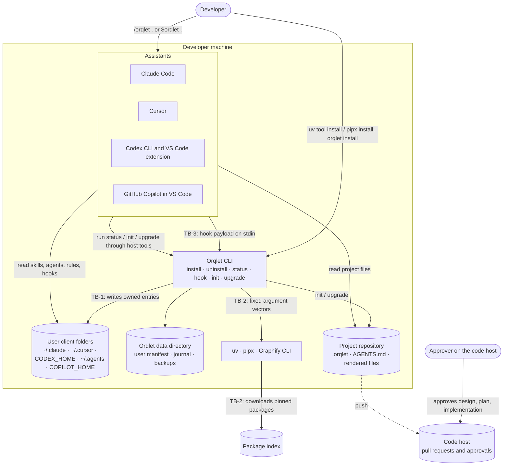

# Context view

Orqlet, the people and the systems around one-command setup. New trust boundaries are marked with a `TB-` id.

| Boundary | What crosses it | Control |
|---|---|---|
| TB-1: user client folders | Orqlet writes into folders shared with the person and other tools | Allow-listed roots and sub-paths, ownership hashes, strict JSON, journal and backups (ADR-002) |
| TB-1 (root validation) | `CODEX_HOME` and `COPILOT_HOME` choose a root | Roots must resolve under the real home directory, must not be links, must be owned by the user, and must not lie in a Git work tree (ADR-002 decision 1a) |
| TB-2: package index and managed Python | `install` downloads graphifyy and its dependencies, a uv-managed Python 3.12 when missing, and, on the pipx route, uv | Fixed vectors; pinned top-level versions, with transitive dependencies resolved at install; private working folder; scrubbed environment plus the person's proxy and certificate variables; timeout (ADR-006) |
| TB-3: hook payloads and repository content | Client-provided JSON, and the project lock, reach Orqlet at every session start and edit, in any repository | Size cap, strict parser, path confinement through an upward `.orqlet/` search, no process, no writes, no network, fixed templates with validated fields only, exit 0 (ADR-004) |

Unchanged:

- Project files are untrusted input (ORQLET-SEC-002).
- Approvals stay on the code host (A-21).
- Orqlet calls no model and starts no agent (ORQLET-NOMODEL-001).
