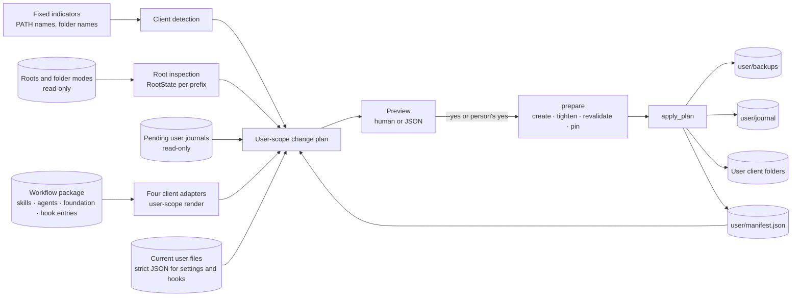
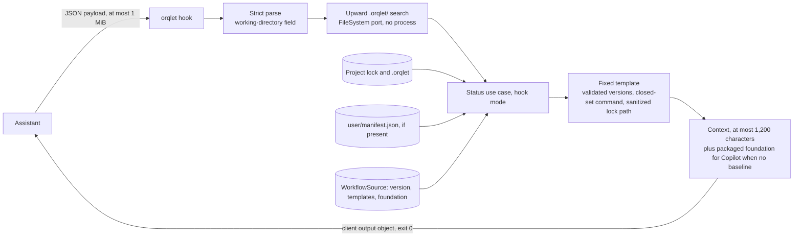

# Data-flow view

## Install time

No data flows from `install` to a process or the network (Q-60).

## Session time

No data flows from a hook to a file, a process, the network or a model. Repository content reaches the context only as a validated field of a fixed template (ORQLET-SEC-002, ADR-004 decision 1a).
