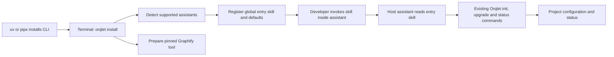

# Install the CLI, register the assistant skill, invoke it in the assistant

Status: design draft for human review. No product implementation, native-client qualification, approved plan or validated formal design set is claimed. The research is also a draft awaiting human acceptance.

## Latest scope revision: intuitive native integration

The person confirmed both GitHub Copilot Agent mode in VS Code and the Codex VS Code extension (Q-13). They also confirmed that routine startup guidance and lightweight checks should run through native client hooks without repeated manual skill commands (Q-14, Q-16). Official documentation was approved as the fallback for unavailable Context7 access (Q-15). See evidence/web/client-hooks.md.

The desired everyday experience is install once, open the supported assistant and describe the task normally. Keep the explicit `orqlet` entry skill for setup, help and recovery. Skills remain reusable instructions, hooks are native lifecycle triggers, and plugins are optional client-supported distribution mechanisms. The core validators remain deterministic. This revision supersedes any implication below that repeatedly invoking separate skills is the desired daily interaction or that plugin/hook delivery is categorically excluded.

Research and design must distinguish required human approval from accidental command/record-management work. Propose reviewed changes to current explicit-invocation contracts where necessary; do not bypass them through a startup hook. Preserve facts-only research, design/plan approval, approved implementation scope, independent review, model-policy controls and evidence-bound checks.

Each client needs a verified capability/event mapping. Use native plugins/hooks where supported and documented file-based integration where necessary. In particular, do not equate the separate Codex VS Code extension with VS Code's Copilot harness or assume plugin support in that extension. Installation/trust prompts belong to the host and must not be bypassed.

Keep startup output/context small. Scope checks to relevant changed inputs; do not run full test suites, build a complete graph, download packages, call models or nag the user at every tool event. Define deduplication, loop prevention, time/output limits, input validation, failure behavior, version handling and a safe way to disable or remove only Orqlet's hooks. No new generic plugin framework, background daemon or upstream runtime is justified merely to connect existing checks.

This is an expanded draft scope. The detailed lifecycle design, AS-IS refresh, formal design/reviews and implementation plan remain incomplete; the following earlier sections must be reconciled with this revision before approval.

## Scope and requirements

Use the three-step experience the person requested:

**In the terminal:**

```sh
uv tool install orqlet       # alternative: pipx install orqlet
orqlet install
```

**Then, inside the AI assistant:**

```text
/orqlet .
```

These are target quickstart examples. The official package's publication/ownership has not been verified, and the new installer/entry skill do not exist yet. Retain the documented pinned Git-source installation until the package distribution is established. Orqlet currently requires Python 3.12+, not Graphify's Python 3.11+ floor.

| Requirement | Confirmed source |
|---|---|
| R-1 Install Orqlet user-wide with uv, with pipx as an alternative | Q-10 |
| R-2 `orqlet install` detects supported assistants and registers the entry skill | Q-10 |
| R-3 Register all detected supported assistants if several are present | Q-12 |
| R-4 Invoke the skill as `/orqlet .` inside the assistant | Q-11 |
| R-5 Supply missing global defaults and project-specific configuration in their confirmed scopes | Q-1, Q-7, Q-10 |
| R-6 Include Graphify and all six Ponytail skills | Q-1, Q-3 |
| R-7 Keep Git as a prerequisite; retain the separately requested missing-uv/Python bootstrap | Q-2, Q-4 |
| R-8 Provide a terminal graphic and allow one guided Cursor User Rules step | Q-5's graphic requirement, Q-9 |

Q-10 supersedes the earlier terminal-dot-command interpretation in Q-5/Q-6. Support remains Cursor, Codex and Claude Code. Installation does not install editors, sign into services, run graph analysis, start an agent or install Ponytail's executable plugin runtime.

## Observable behaviour

### CLI package installation

uv/pipx installs the CLI in its normal isolated, user-wide tool environment. No project configuration or assistant session is launched as a package-install side effect. The optional prerequisite bootstrap is an additional route for a machine missing uv/Python, not the primary quickstart.

### Terminal: `orqlet install`

Show the Orqlet terminal banner, detect supported assistants from documented configuration locations and installed-client indicators, and report the evidence for each detection. Register the entry skill and applicable packaged global skills, agents and rules for every detected supported client. A directory is a detection signal, not proof that a native client is usable. No detected client produces an explicit needs-input result, not a silently chosen default assistant.

Create missing global Orqlet components, preserve existing personal files and unrelated instruction text, and refuse unowned/edited collisions. Add only a missing managed block after preview; do not silently replace an existing global block. Reruns do not duplicate registrations or reinstall compatible tools. Running this command inside a repository still performs global registration; the assistant invocation is the project-setup entry point.

Ensure the pinned Graphify executable is available through a separate uv tool installation when needed. Installing a package's dependency alone does not expose its executable (evidence/web/global-setup.md). A pipx installation of Orqlet must reach the same usable Graphify state through the approved tool-preparation path, including preparation of missing uv under Q-2. Never mutate the user's project environment or install Graphify into Orqlet's tool environment using pip. Graphify's proposed runtime is managed Python 3.12, which fits both inspected projects without reducing Orqlet's own supported range.

Use documented global client destinations and an explicitly scoped writer/journal. The accepted Cursor exception generates the reviewed User Rules text and guides the person to Customize / Rules; no internal settings database or undocumented global rules folder is written. Report that step as outstanding until the person acknowledges it. An acknowledgement is not automated native-client verification.

Finish by showing the native invocation for each registered client. Claude Code and Cursor use `/orqlet .`; Codex CLI/IDE skill invocation uses `$orqlet .` (or its skill picker). Keep the skill's name `orqlet` in every client; do not advertise an unsupported slash invocation as verified on Codex.

### Inside the assistant: `/orqlet .`

The registered entry skill resolves `.` in the assistant's current workspace, checks the installed CLI and inspects project state. It guides the developer and invokes existing deterministic CLI operations through the host client's tools. Orqlet itself still takes no prompt, calls no model and starts no agent.

| Target state | Entry skill behaviour |
|---|---|
| Outside a Git worktree | Ensure missing global setup through the installer when necessary; do not turn the current directory into a project |
| Git worktree without Orqlet | Ensure missing globals, then invoke the existing initialization flow for that repository |
| Initialized Git worktree | Ensure missing globals, then invoke the existing upgrade/status flow for that repository |

Nested directories and linked worktrees resolve through the hardened Git adapter. A Git error other than an ordinary non-repository result is an error, not a reason to guess global-only mode. Do not invent profile facts, target branches or approvals. After setup, report status and the relevant existing workflow entry points; do not automatically run research, design, plan and implementation past their human gates.

The public CLI addition is the ordinary named subcommand `install`, and the workflow addition is the assistant entry skill `orqlet`. No terminal `orqlet .` route or custom positional-argument parser is part of this design. Existing named CLI commands keep their behaviour.

### Terminal presentation

Show a compact banner and readable results during interactive `orqlet install`. Example appearance only:

```text
    o
   / \
  o---o   ORQLET
          AI development setup

  Claude Code           skill registered
  Codex                 skill registered
  Cursor User Rules     one setup step needed

  Next: open your assistant and invoke the Orqlet skill.
```

uv/pipx retain their own installation output. Reuse existing terminal facilities; add no graphics dependency. Keep JSON output free of banners/control codes and non-TTY output plain. `--dry-run`, `--json` and `--yes` follow current CLI conventions. Dry-run performs no download, package installation, global write or project write.

## Responsibilities and interfaces



- Interface code registers `install` and renders progress. Application use cases coordinate detection, scope and tool preparation. Adapters perform I/O; domain code remains independent of processes, terminal output and home paths.
- Detection uses a fixed, documented set of non-secret indicators. Do not scan arbitrary home content, read credential stores, launch clients or treat a project's files as executable discovery instructions.
- Global and project filesystem/journal roots are distinct and allowlisted. Reuse ownership, managed blocks and change planning. Global defaults do not require a fake project profile or unrestricted home access.
- Tool installation uses bounded `ProcessRunner` calls, fixed trusted package sources and a private working directory. Ignore target-project package-manager configuration. Git remains behind `GitRunner`. Direct `init`/`upgrade` remain offline.
- Global defaults come from packaged content, not a project's profile, company links, model assignments or credentials. Project outputs are rendered from that project's own reviewed inputs. Native-client precedence is not assumed identical: Codex documents that same-named skills can both appear in selectors.

## Packaged skill integration and compatibility

Add the entry skill `orqlet` alongside the existing phase skills. Preserve explicit invocation controls, protected ownership, workflow versioning, manifest hashes and model-policy checks.

Also bundle reviewed upstream snapshots named `graphify`, `ponytail`, `ponytail-review`, `ponytail-audit`, `ponytail-debt`, `ponytail-gain` and `ponytail-help`. Record source commits, hashes, attribution, licences/notices and local adaptations. Use the existing front-matter format rather than expanding its parser just to preserve upstream metadata.

The Graphify entry loads the appropriate client reference; shared Cursor/Codex files must not assume interchangeable agent tools. Replace automatic/unpinned dependency installation and system-pip fallbacks with checks of the tool prepared by `orqlet install`. Graph relationships remain navigation aids, with source verification for evidence. Installing a skill does not build a graph or call a model.

Ponytail cannot remove required tests, approvals, phase boundaries or independent review. Its audits/reviews supplement Orqlet's required review records. Adapt help to describe delivered skills accurately; the upstream band, hooks and persistent plugin configuration are separate features. Attribute benchmark results to their upstream source, never to the receiving repository.

Apply ORQLET-MODEL-001 to imported skill text: remove upstream operational model defaults and hard-coded model names unless assigned by the applicable policy. Preserve benchmark methodology/provenance through upstream links where verbatim metadata cannot be bundled under that rule.

Existing `init`/`upgrade` projects continue to receive reviewed project skill files without requiring a global installation on every teammate's machine. Global/project overlap and source selection need native-client evidence; directory documentation alone does not prove correct precedence or remove the need for project pins.

## Failure, recovery and acceptance criteria

Machine tool installation, global registration and project writes are separate transactions. Preflight known path/ownership conflicts; report completed scopes on a later failure. Project rollback does not uninstall shared tools or erase global defaults. Never remove pre-existing tools to hide a failed setup.

| Trigger | Result and recovery |
|---|---|
| Missing prerequisite or no supported assistant detected | Explicit needs-input result; name the missing condition, with no default guess |
| Failed download, unavailable platform binary or incompatible existing tool | Nonzero result naming the failed step and tool path; preserve prior installations |
| Unowned/edited file, escaping path or symlink collision | Refuse the affected write; report the conflict without broadening scope |
| Cursor User Rules step pending | Distinguish installed files from the outstanding guided action |
| Project facts, pin or approval missing | Preserve the existing CLI result and recovery instructions |
| Interrupted write | Recover within the correct global/project journal; do not claim cross-scope atomicity |

- BC-1 The documented uv and pipx quickstarts install a runnable user-wide CLI; `orqlet install` is the terminal registration command (R-1, R-2).
- BC-2 Detection covers supported clients, multiple detections, configured roots and no detections; all detected clients are registered without reading secrets or launching agents (R-3).
- BC-3 Each client discovers the entry skill and receives the correct native invocation instructions. The skill resolves `.` and reaches the existing CLI setup/status path through host tools (R-4, R-5).
- BC-4 Missing globals are supplied safely; outside a repository no project is created, and nested/linked worktree setup affects only its resolved repository (R-5).
- BC-5 Both scopes receive the applicable packaged skills, agents, references and attribution, including Graphify and all six Ponytail skills; model-policy isolation and source overlap are checked (R-6; ORQLET-MODEL-001).
- BC-6 Existing user content survives reruns and conflicts. Dry-run has no machine/home/project side effects. JSON remains parseable and the banner appears only in suitable human output (R-8; ORQLET-SEC-002).
- BC-7 The accepted Cursor step distinguishes user acknowledgement from automated verification; no model run, agent session or approval bypass is caused by CLI installation/registration (R-8; ORQLET-NOMODEL-001).

Use existing fake-backed unit tests, renderer/golden tests, CLI routing/output tests, lifecycle tests and wheel smoke tests. Test home writes only in temporary scoped roots. Add installer checks with stubbed downloads, separate clean-machine uv/pipx checks and real-client checks for discovery/invocation/precedence. Lint, typing, architecture, tests and build checks precede a ready PR.

## Review status

All sixteen ledger questions are answered. The native-hook usability scope is captured above and still requires a full artifact refresh. The current design remains a draft: official package publication/ownership, exact release/tool pins, scoped global recovery, formal D3 views/manifest, independent reviews and an approved exact-file plan remain outstanding. Network installation plus global home writes make this a D3 change. Preparing these documents changed no product code, installed package, assistant configuration or home setting.
