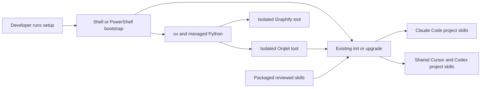

# One-command setup and bundled skills

Status: preliminary design for human review. This is not an approved plan or a validated Orqlet design set. No implementation is included. The AS-IS file remains a draft awaiting human acceptance.

## Scope and requirements

The proposed change adds a bootstrap installer and seven bundled skills, using the current project rendering and lifecycle operations. The installer prepares the machine and initializes or upgrades the current project in one invocation.

| Requirement | Confirmed source |
|---|---|
| R-1 One command installs Orqlet and prepares the project for Cursor, Codex and Claude Code | questions.yaml Q-1 |
| R-2 Install missing uv and a compatible Python, plus the Graphify CLI | Q-2 |
| R-3 Include Graphify and all six Ponytail skills in initialized/upgraded projects | Q-1, Q-3 |
| R-4 Require Git; do not install it | Q-4 |

The smallest proposed delivery supports macOS/Linux shell and Windows PowerShell entry points. It does not install editors, sign into services, run a graph build, install Graphify optional extras, or install Ponytail's executable plugin runtime. These are outside the confirmed skill-and-installer scope.

## Proposed behaviour

A published setup command downloads the installer from an immutable, approved Orqlet commit and passes that same revision to the installer. A checkout also offers the corresponding local script. The final command and its revision are published only after the implementation is tested; no installer URL in this document is a working installation claim.

The installer checks Git before changing the machine. It obtains missing uv from its official, version-pinned distribution, obtains Python 3.12 through uv, and installs Orqlet and Graphify in separate uv tool environments. Python 3.12 is a proposed shared runtime choice because it falls inside both inspected projects' declared ranges (AS-IS A-1, A-7, A-8). It does not reduce Orqlet's supported Python range.

The installer then runs existing project lifecycle commands: `init` for a project without an Orqlet installation, `upgrade` for an existing installation. It uses the CLI's normal validation, displays its changes and forwards its result. The installer may request the existing noninteractive apply behaviour because the user explicitly invoked setup; it never supplies invented project-profile answers or approves a profile, design or plan. Missing repository/branch information is reported through the existing CLI instead of guessed. Existing `init` options for new repositories remain the way to supply those choices.

Direct `orqlet init` and `orqlet upgrade` also distribute the new skills using packaged sources. They remain offline file operations. On another developer's machine, the same bootstrap command prepares the required executables; copying a project's skill files alone does not install software on that machine.

Running setup again must be safe. Compatible installed tools are reused; an incompatible existing installation is reported with its path and required version rather than silently replaced. The installer must not report success unless all tool checks and the project operation succeed. CLI/profile pins and owned project files retain their existing checks.

## Responsibilities and boundaries

- The bootstrap owns network installation and executable discovery. Installation runs from a private temporary directory and does not consume package-manager configuration or executable paths from the target repository. Package sources and tool pins come from the trusted release, not project files. Existing shell configuration is preserved when making user executables available.
- Orqlet's existing workflow package, skill loader, renderer and change planner own project files (A-3–A-5, A-11). No plugin marketplace, background updater, generic package manager, or new dependency framework is introduced.
- Installer code is a separate entry point outside `src/orqlet`. Any new process started inside Orqlet must use `ProcessRunner`; Git continues through `GitRunner`. No model SDK is added to Orqlet (ORQLET-SEC-001, ORQLET-NOMODEL-001).

## Skill integration

Bundle reviewed, fixed upstream snapshots with their original names: `graphify`, `ponytail`, `ponytail-review`, `ponytail-audit`, `ponytail-debt`, `ponytail-gain`, and `ponytail-help`. Record upstream commit, file hashes, licences, attribution and local modifications. Deliver the required licence/notice material with the skills. Normalize their front matter into the existing source format instead of broadening the parser merely to copy metadata (A-3, A-9).

Use one shared Graphify entry skill that selects the appropriate bundled client reference. This accommodates the current shared Cursor/Codex destination without pretending their agent tools are interchangeable (A-4, A-8). Retain the corresponding upstream reference material and adapt relative links. Review every adaptation against its pinned source.

Adapt Graphify's dependency-install step to check the installed pinned CLI and point to setup on failure. Remove automatic upgrades, system-pip fallbacks and instructions to override host-client policy. Client-specific extraction remains subject to available tools and the person's permissions. Graph results remain navigation aids: inferred/stale relationships do not replace source-line evidence. Installing a skill never builds a graph, calls a model, registers hooks or starts an agent.

Keep all seven skills available through explicit invocation, following current Orqlet skill behaviour. Ponytail's simplicity guidance cannot remove required tests, approvals, phase boundaries, output contracts or independent reviews. Its review and audit commands provide supplementary reports rather than satisfying Orqlet review records. Adapt help to describe the delivered skills accurately; identify the band, lifecycle hooks and persistent mode configuration as separate upstream-plugin features. Include the benchmark source used by `ponytail-gain`, clearly attributed as an upstream measurement, not an Orqlet result.

Skill files participate in the current workflow manifest, release identity, generated ownership, drift detection and rollback. Initialization or upgrade refuses a pre-existing, unowned skill at a conflicting path rather than silently taking it over. Existing projects receive the skills when upgraded; setup does not discover and change other repositories on the computer.

## Failure and recovery

| Trigger | Observable outcome and recovery |
|---|---|
| Git missing | Stop before installation; name Git as the prerequisite |
| Download, package verification or installation fails | Nonzero result; identify the failed step without exposing credentials; rerun after resolving it |
| Unsupported OS/architecture or no compatible binary package | Stop with the supported target information; do not install compilers or OS packages automatically |
| Existing tool is incompatible or belongs to another installation | Report its path and required version; preserve it; require an explicit repair/replacement choice |
| Project lifecycle operation refuses input or reports a conflict | Preserve the CLI's result and recovery instructions; do not call setup complete |
| Project write interrupted | Existing journal/resume/rollback behaviour applies; rerun through the existing CLI |

Machine installations and project writes are separate transactions. Project rollback does not uninstall shared user tools. On failure, report which tools were installed; do not remove pre-existing tools or shared uv/Python. The plan must specify verification of downloaded bootstrap artefacts, exact pins, the platform matrix and safe replacement behaviour before implementation.

## Acceptance criteria and validation

- BC-1 A supported clean machine with Git but without uv/Python completes one setup invocation and can run both CLIs (R-1, R-2, R-4).
- BC-2 New and upgraded projects receive all seven skills for their selected clients with complete references and attribution; the CLI-only install remains usable (R-1, R-3; A-4).
- BC-3 Reruns, tool conflicts, paths with spaces, interrupted/network-failed installs and an unowned skill collision preserve existing installations and user files (R-1; ORQLET-SEC-002).
- BC-4 Dry-run, deterministic rendering, rollback and seeded-file ownership retain their contracts. CLI-only init/upgrade make no new network calls (A-4–A-7, A-11).
- BC-5 Native-client checks demonstrate explicit skill discovery and invocation for all three clients, including Graphify tool dispatch and unavailable-agent capabilities. No automatic model run or approval bypass occurs (R-1; ORQLET-NOMODEL-001).
- BC-6 Tests cover every skill reference, source pin and licence; the packaged wheel contains the reviewed sources. Upstream updates require a reviewed Orqlet release (R-3; A-6, A-11).

Use the existing fake-backed unit tests, renderer/golden tests, lifecycle tests and wheel smoke tests. Add focused installer self-checks with stubbed downloads/executables and real clean-machine smoke checks on the supported OS matrix. Run the repository's lint, typing, architecture, test and build checks before a PR is ready. Native-client and real-download checks require separate evidence; passing renderer tests is not proof of client behaviour.

## Decisions for review and remaining work

The proposed choices are a separate bootstrap, isolated tool environments on Python 3.12, reviewed packaged skill copies, explicit skill invocation, and no executable upstream-plugin installation. The alternative of invoking upstream installers directly is rejected because their writes would bypass Orqlet's ownership/journal and their platform defaults do not cover Orqlet's client selection. Fetching moving upstream skills during every upgrade is rejected because it prevents reproducible, reviewed project output.

All four requirement questions are answered. Exact release/tool pins and download verification, installer failure details, formal D3 design views/manifest, independent architecture/security review, and an exact-file implementation plan remain to be completed. This draft introduces a network installation boundary and is D3 under Orqlet's design classification. This document does not claim that any of those checks or approvals has occurred.
