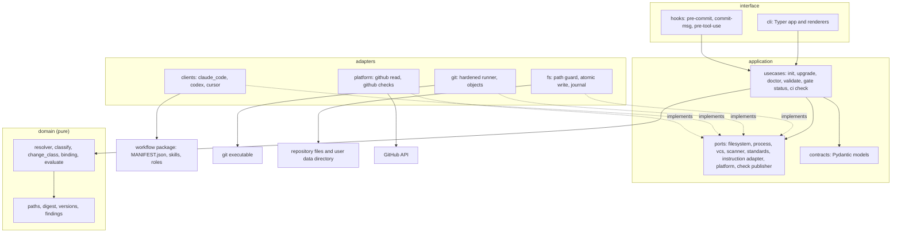
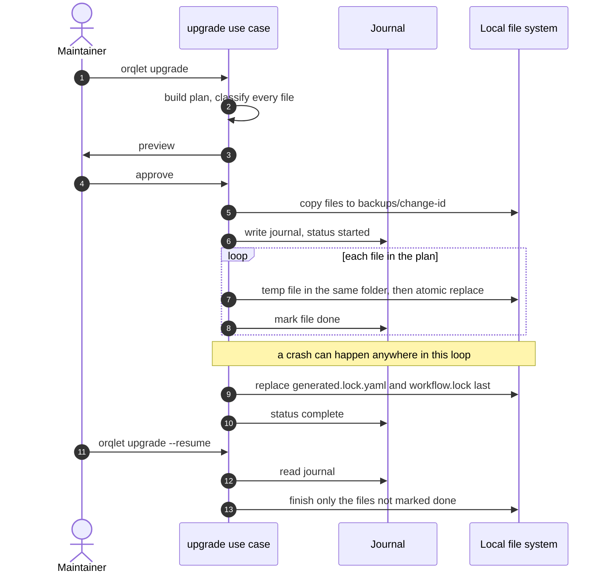
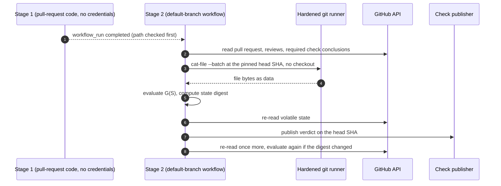

# DESIGN: implementing Orqlet MVP-1 (M1 and M2)

| Field | Value |
|---|---|
| Task | `orqlet-implementation` |
| Phase | 2, human-gated architecture. Nothing in this folder is approved, and no code may be written from it until it is |
| Inputs | `as-is.md` (facts A-01 to A-25, unknowns U-1 to U-14, discrepancies C-1 to C-4) and the architecture proposal v0.4 (`docs/design/orqlet-architecture-proposal.md`, SHA-256 `d9d5e675…b324d4`) |
| Change class | **D3 (full).** Orqlet adds a CI trust boundary, runs subprocesses on repository data, and writes files that other developers' agents load (proposal §17.4) |
| ADRs | `adr-001` layout and layering, `adr-002` deterministic data, `adr-003` hardened Git and process access, `adr-004` journalled apply, `adr-005` deterministic renderers |
| Status | Decisions D-1 to D-8 of section 11 approved as recommended (2026-10-21). Adjusted during Phase 3 planning, see section 10.1 |

This document says **how to build** what the proposal already specifies. It does not repeat the proposal's requirements, enforcement matrix or failure-mode matrix; it points to them.

## 1. Scope

**In scope.** One Python distribution, `orqlet`, that delivers milestones **M1** and **M2** of the proposal (§22):

- M1: the structure lifecycle (`init` for existing, new and empty projects, `upgrade`, `rollback`, `sync`, `doctor`, `explain`, `release`), the Python scanner and project profile, the standards resolver and lock, the protected workflow package, the ownership manifest, the three client generators, the `.prompts/` seed and the PR-template blocks.
- M2: the workflow validators, `gate status`, `review prepare`, the review, test and knowledge-impact records with the review-input binding, the approved-expected-change extractors, `knowledge impact`, Git hooks, `ci collect` and `ci check` with the two-stage event model, and per-role model pins rendered from an approved policy.

**Prerequisites, not built here.** The M0 spikes (S-02, S-10, S-14, S-19, S-21 to S-24, S-28, S-29) and the answers to Q-01, Q-03, Q-04 and Q-05. Code that depends on unverified client or host behaviour sits behind an adapter with a version gate (section 7).

**Out of scope.** The knowledge index and private store (M3), MCP reconciliation (M4), `models refresh`, `new`, external sources, administrator export and the platform audit (M5 to M7).

## 2. Goals

| ID | Goal |
|---|---|
| G-1 | Every acceptance criterion and fixture that the proposal assigns to M1 and M2 (§22, §21.6) passes |
| G-2 | Same inputs give byte-identical generated files and digests on macOS, Linux and Windows |
| G-3 | All decision logic runs in pure code that tests exercise with fakes and no I/O |
| G-4 | No local command calls a model or the network, except those the proposal lists (§23) |
| G-5 | Every command offers `--json` with one stable result envelope |
| G-6 | Work splits into slices that are reviewable and testable on their own (section 10) |

## 3. Non-goals

No search index or SQLite use in this release train. No plugin platform, long-running service, workflow-state database or Orqlet-run agent. No code host other than GitHub (Q-01). No decision on where the package is published (U-5); the build only has to produce a hash-pinnable wheel.

## 4. Constraints and assumptions

**Constraints (facts, from `as-is.md` and the proposal)**

| Constraint | Source |
|---|---|
| Python floor 3.12. Typer behind a thin adapter, Pydantic v2, exact-pinned dependencies | A-15 |
| `import-linter` and Ruff `TID251` enforce the layers | A-16 |
| Git is reached by running the `git` executable behind a port | A-17 |
| Five extension points and six test seams are built first | A-18 |
| Pydantic models reject unknown fields; Typer sub-apps need an explicit name | A-13, A-14 |
| No credentials in code or examples, SHA-256 for every digest, unit tests for new and changed code, CI must pass | A-06 |

**Assumptions (each changes the design if it is wrong)**

| ID | Assumption | Depends on |
|---|---|---|
| AS-1 | GitHub and GitHub Actions are the host and CI | Q-01 (open) |
| AS-2 | Approval is a pull-request merge with a non-author code owner | Q-03 (open) |
| AS-3 | Options A and B of the local guard are built (merge gate and a generated edit guard) | Q-04, Q-05 (open) |
| AS-4 | CI for Orqlet's own repository runs Python 3.12 to 3.15 on macOS, Linux and Windows | M1 acceptance |
| AS-5 | The supported Git versions are fixed by spike S-24. Until then 2.56.0 is the only verified version | A-09, U-8 |
| AS-6 | Until M2 ships, Orqlet's own pull requests are reviewed by humans only. After M2 the repository adopts its own workflow | bootstrap |
| AS-7 | A Git repository and a GitHub remote for Orqlet exist before the first code slice (today the directory is not a repository, A-02) | decision D-8 |

## 5. Proposed architecture

### 5.1 Repository layout (all paths relative to the repository root)

```text
pyproject.toml                 build metadata, exact pins, Ruff, mypy, pytest, import-linter contracts
uv.lock
src/orqlet/
  __main__.py                  python -m orqlet
  domain/                      pure code, standard library only
    paths.py                   CanonicalPath (NFC, case-fold key, reserved-name checks)
    digest.py                  canonical JSON subset, SHA-256 helpers (ADR-002)
    versions.py                workflow_version, workflow_digest, controls_level, floor comparison
    findings.py                Finding, Verdict (PASS, FAIL, NOT_RUN)
    facts.py                   Fact and Evidence (path, lines, hash)
    changeplan.py              pure change plan: files, owner modes, actions (added in Phase 3)
    resolver.py                monotone layer resolver (adds and tightens only)
    classify.py                three-way file classification (up to date, safe update, conflict, tampered, orphan)
    change_class.py            D1, D2, D3 computation
    binding.py                 review-input components and staleness table
    knowledge.py               knowledge-impact candidate rules (pure, no index)
    evaluate.py                G(S): the pure gate function over a repository state
  application/
    ports/                     filesystem.py clock.py ids.py prompter.py process.py vcs.py scanner.py
                               standards.py instruction_adapter.py change_journal.py platform.py check_publisher.py
    contracts/                 Pydantic models, one module per schema id (profile, policy, manifest,
                               lock, versions, role_bindings, as_is, design_set, plan, review_result,
                               test_record, knowledge_impact, review_input, cli_result)
    usecases/                  init_project.py upgrade.py rollback.py sync.py doctor.py explain.py
                               release.py standards_for.py validate_artifact.py gate_status.py
                               review_prepare.py knowledge_impact.py expected_change.py
                               ci_collect.py ci_check.py
  adapters/
    fs/                        local_fs.py (path guard, atomic write), backup.py, journal.py, yaml_loader.py
    process/                   subprocess_runner.py
    git/                       git_runner.py (ADR-003), vcs_git.py, objects.py
    scan/                      python_scanner.py
    standards/                 pack_source.py
    clients/                   claude_code.py codex.py cursor.py   (InstructionAdapter, ADR-005)
    render/                    skills.py roles.py rules.py instructions.py pr_template.py prompts_seed.py
    platform/                  github_read.py github_checks.py
    prompt/                    tty_prompter.py
  interface/
    cli/                       app.py commands/*.py render_human.py render_json.py exit_codes.py
    hooks/                     pre_commit.py commit_msg.py pre_tool_use.py
  workflow/                    protected package data (read-only at runtime)
    MANIFEST.json              every file with its SHA-256, workflow_version, controls_level
    skills/<name>/skill.md     canonical skill text, authored once
    roles/<name>.yaml          canonical role contracts
    rules/  exempt.yaml  schemas/
tests/
  unit/  contract/  golden/<client>/<min-version>/  fixtures/  integration/
```

### 5.2 Layer contracts (enforced in CI by `import-linter`, plus Ruff `TID251`)

| Contract | Rule |
|---|---|
| Layers | `interface` may import `application` and `domain`. `application` may import `domain`. `domain` imports nothing from Orqlet |
| Direction | `application` never imports `adapters`. `adapters` implement the ports and may import `application` and `domain`. Only `interface` wires adapters to use cases |
| Purity | `domain` and `application` may not import `subprocess`, `socket`, `sqlite3`, `http`, `urllib`, `shutil` or `tempfile`. `domain` also may not import `os` or `pathlib` file operations |
| Independence | `adapters.clients.claude_code`, `codex` and `cursor` do not import one another. `tests/unit` imports no `adapters` module |
| Model calls | No module imports a model or agent SDK. A release test fails the build if the dependency set contains one (E-27) |

### 5.3 Capability to module map

| Capability (proposal section) | Use case | Pure logic | Adapter |
|---|---|---|---|
| `init`, existing project (§9.2) | `init_project` | `resolver`, `classify` | `python_scanner`, `pack_source`, clients, `render/*`, `local_fs`, `journal` |
| `init`, new and empty project (§9.1) | `init_project` | state detection in `init_project` | `vcs_git`, `tty_prompter` |
| `upgrade`, `rollback`, `release` (§9.3, §9.5) | `upgrade`, `rollback`, `release` | `classify`, `versions` | `journal`, `backup`, `local_fs` |
| `sync`, `doctor`, `explain` (§9.4, §9.6) | one use case each | `classify`, `resolver` | `vcs_git`, `local_fs` |
| `standards for` (§12.7) | `standards_for` | `resolver` | `pack_source` |
| Protected workflow (§17.12) | `release` (digest check) | `versions` | `workflow/MANIFEST.json` |
| Validators (§17.3 to §17.11) | `validate_artifact` | `change_class`, `binding` | `local_fs`, `objects` |
| Approved expected change (§17.4.1) | `validate_artifact`, `ci_check` | extractors in `application/usecases/expected_change.py` | `objects` (reads the Python AST from Git blobs) |
| `knowledge impact` (§17.13) | `knowledge_impact` | `domain/knowledge.py` | `objects` |
| `gate status`, `ci check` (§19.8) | `gate_status`, `ci_check` | `evaluate` | `vcs_git`, `github_read`, `github_checks` |
| Hooks (§19.4) | called by `interface/hooks/*` | `evaluate` | `vcs_git` (index plumbing only) |

### 5.4 Contracts and data

- Every contract is a frozen Pydantic v2 model with `extra='forbid'` (A-14). Its JSON Schema is exported with `model_json_schema(mode='validation')` and committed under `src/orqlet/workflow/schemas/`. A contract test fails if the committed file differs from the generated one.
- Hashing uses the canonical JSON subset and SHA-256 only (ADR-002). YAML is read with a strict loader that rejects anchors, aliases and unknown tags, then validated by the Pydantic model.
- `--json` output has one envelope, `orqlet.cli-result/v1`: `ok`, `command`, `orqlet_version`, `data`, `findings`, `not_run`. Exit codes: 0 healthy, 1 warnings, 2 errors, matching the proposal's `sync` convention.

### 5.5 Workflow package and generators

`src/orqlet/workflow/MANIFEST.json` lists every protected file with its SHA-256. `workflow_digest` is the SHA-256 of its canonical form (proposal §17.12.2). The build computes it, a runtime check recomputes it, and a release test fails if the digest changes while `workflow_version` does not (FM-U05). Renderers turn canonical definitions into each client's files (ADR-005). Model pins come from the approved policy, not from the canonical text, so they are outside `workflow_digest` (proposal §14.9.2).

### 5.6 Applying changes

`init`, `upgrade` and `rollback` build a plan, show a preview and apply it through the journalled engine of ADR-004. The ownership manifest and `workflow.lock` are replaced last.

### 5.7 CI check

`ci collect` runs in the untrusted stage and emits one size-capped JSON file. `ci check` runs in the trusted stage, reads every pull-request file from Git objects with no working tree (ADR-003), and computes `G(S)` in the pure `evaluate` module. A separate narrow port, `CheckPublisher`, creates or updates the App-owned check. The signal workflow and the sweeper of proposal §19.8.7 call the same use case. **Decision D-5** covers where publication lives.

### 5.8 Command line

`interface/cli/app.py` creates one `typer.Typer()` and attaches each group with `add_typer(..., name="...")`, since Typer 0.14.0 and later require the name (A-13). A command parses arguments, calls one use case and hands the result to a renderer. Commands hold no logic.

## 6. Diagram set

**Structure of the package (C4 component view)**



**Data flow of `orqlet init`**


**Apply with a crash and resume (sequence)**



**Trusted evaluation (`ci check`, sequence)**



## 7. Compatibility and migration

| Area | Design |
|---|---|
| Python | Supported 3.12 to 3.15. The test matrix covers the same. 3.11 is below the floor and is not tested (C-2) |
| Operating systems | macOS development. Linux and Windows runners in CI. Path handling goes through `CanonicalPath` (proposal §17.5), and file semantics on Windows stay behind adapters until S-08 and S-25 report |
| Git | Verified only on 2.56.0. The minimum is set by S-24. Every Git call goes through the runner of ADR-003 |
| IDE clients | Each client adapter declares its supported versions. An unknown version produces a capability limit and no write. Golden files are kept per client version |
| Schemas | `orqlet.<kind>/v1` for all contracts. Additive changes are minor, breaking changes major with a migration (proposal §20.8). There is nothing to migrate: this is a new system |
| Existing repositories | The first consumer is Orqlet's own repository after M2 (AS-6). No existing repository depends on it |

## 8. Test strategy

| Layer | What it covers | Tools | Anchors |
|---|---|---|---|
| Unit | `domain` and `application` logic with fake ports. No network, no real file system, no subprocess | `pytest`, `pytest-socket`, `pyfakefs` | G-3, proposal §19.1 |
| Property | The monotone resolver (adding any layer never shrinks the requirement set), canonical JSON ordering, path canonicalisation | `hypothesis` | M1 acceptance |
| Contract | Each port has one suite that every adapter and every fake passes. Committed JSON Schemas equal generated ones | `pytest` | G-3 |
| Golden | Generated client files per client and version, byte for byte | `pytest`, files under `tests/golden/` | G-2, FM-U04 |
| Integration | Real `git` in temporary repositories: partial staging, worktrees, hostile `.git/config`, unborn and orphan HEAD; CLI end to end with Typer's `CliRunner` | `pytest`, `typer.testing.CliRunner` | FM-N, FM-C, hook conformance |
| Fault injection | Kill the apply engine after k of n files for every k, then `--resume` must converge | `pytest` with an injected failing file system | FM-U03 |
| CI-check fixtures | Fixture repositories as Git object sets: forged artifact, shared head SHA, old re-run, bypassed review, shadowing `CODEOWNERS` | `pytest` | M2 acceptance |
| Matrix | All of the above on Python 3.12 to 3.15 and three operating systems | GitHub Actions | AS-4 |

Rules: each slice ships its own tests, a fixture ID from the proposal names every acceptance test, and `import-linter` and Ruff run in CI. No numeric coverage threshold is set; fixture coverage by ID is the measure (decision D-7).

## 9. Rollback and failure handling

| Failure | Handling |
|---|---|
| Crash during `init`, `upgrade` or `rollback` | The journal and backups bring the tree to either the old or the complete new state (ADR-004). `doctor` reports an unfinished journal |
| A subprocess times out, exits non-zero or prints too much | A typed error. In CI the result is `NOT_RUN`, published as `failure`, never success |
| Unknown client or Git version | Capability limit reported. No file is written for that client |
| A bad Orqlet release | Teams pin exactly. Withdrawing a release is a policy pull request that lowers the pin, and it needs two approvals (proposal §20.8) |
| A bad slice of Orqlet's own code | Revert the pull request. Slices are independent (section 10) |
| Hostile repository content | All pull-request files are read as Git objects with a strict loader and size caps. No working tree is checked out in the trusted stage |

## 10. Build slices (input to Phase 3, not the plan)

| Slice | Content | Needs | Acceptance anchor |
|---|---|---|---|
| S0 | Repository bootstrap: Git, `pyproject.toml`, Ruff, mypy, import-linter, pytest, CI for Orqlet itself | D-8 | CI green on an empty package |
| S1 | `domain/paths`, `digest`, `versions`, `findings` with unit and property tests | S0 | canonical JSON vectors, path cases |
| S2 | Contracts for profile, policy, manifest, lock, versions, role bindings and the CLI envelope, and the JSON Schema check | S1 | schema equality test |
| S3 | `local_fs` with path guard and atomic write, `subprocess_runner`, `git_runner`, `vcs_git` | S1 | FM-M07 path cases, hostile-config fixtures |
| S4 | Python scanner, questionnaire, standards resolver and lock, `standards for` | S2, S3 | M1 scanner fixtures |
| S5 | Workflow package, renderers and the three client adapters with golden files | S2 | golden tests, FM-U05 |
| S6 | Journalled apply engine, then `init` for existing, new and empty projects, `.prompts/` seed, PR-template blocks, preview and plan | S4, S5 | FM-N01 to FM-N04, FM-P01 to FM-P04, FM-P06, kill-after-k |
| S7 | `upgrade`, `rollback`, `sync`, `doctor`, `explain`, `release`, opt-in names scan | S3, S6 | FM-U01, FM-U03, FM-U04, FM-U05, FM-U09, FM-W03 |
| S8 | Validators for as-is, design, plan and ledger, `gate status`, `review prepare` | S2, S3 | the 19 plan cases |
| S9 | Review, test and knowledge-impact records, binding, expected-change extractors, `knowledge impact` | S8 | FM-B, FM-A, FM-K |
| S10 | Git hooks and the optional edit guard | S8 | hook conformance |
| S11 | `ci collect`, `ci check`, event model, signal and sweeper workflows, check publisher | S9 | FM-E, E-01 to E-29 fixtures |
| S12 | Release gates and per-role model pins (the hash-pinnable wheel itself moved into M1) | S5, S11 | FM-O01, FM-O03, FM-O04 |

### 10.1 Adjustments made while planning M1 (Phase 3)

1. The journalled apply engine (ADR-004) is built with slice S6, before `init`, because `init` writes through it.
2. The hash-pinnable wheel and its reproducibility test are part of M1, as the proposal's M1 scope says. They no longer wait for S12.
3. `domain/changeplan.py`, `domain/facts.py` and the port `application/ports/change_journal.py` are added to the layout.
4. M1 ships the machinery, the baseline instruction block, the protected rule file, the `.prompts/` seeds and the PR-template blocks. The six workflow skills and five role definitions are M2 (S8 and S9), as the proposal's M2 scope says.
5. `init` writes no CI workflow files in M1, because they call `orqlet ci check` (M2). `sync` checks the structure but installs no Git hook until M2.

## 11. Decisions that need your approval

| ID | Decision | Recommendation | Why |
|---|---|---|---|
| D-1 | Plan M1 first (S0 to S7) and M2 second (S8 to S12) as two approvals | Yes | M2 depends on spikes S-14 and S-28 and on Q-01 to Q-05 |
| D-2 | Canonical JSON: write the small RFC 8785 subset in-tree (ADR-002) instead of using `rfc8785` | In-tree | U-9: the library was last released 2024-09-27 and has no license text in its metadata |
| D-3 | Build backend `hatchling` 1.32.4 (MIT) instead of `uv_build` 0.13.4 | `hatchling` | 1.x versus a pre-1.0 backend. `uv` itself stays the installer |
| D-4 | Type checker `mypy` 2.4.0 in strict mode instead of `pyright` | `mypy` | Python-native, no extra runtime |
| D-5 | Publish the check from Orqlet through the narrow `CheckPublisher` port, instead of a `gh api` step in the generated workflow | Port | One tested code path. It is a write to an external system, limited to checks and statuses, so it needs your approval |
| D-6 | `hypothesis` (MPL-2.0) as a development-only dependency, never shipped | Yes | The resolver property test needs it. The licence is file-level copyleft |
| D-7 | No numeric coverage threshold. Fixture coverage by ID is the gate | Yes | The proposal defines acceptance by fixtures |
| D-8 | Create a Git repository and GitHub remote for Orqlet (an external write that you do, or approve) | Yes | A-02, AS-7 |

## 12. Risks

| Risk | Mitigation in this design |
|---|---|
| Client behaviour differs from the documentation (U-7) | Adapters are version-gated and golden-tested. M0 spikes run first |
| Windows file semantics (U-8) | Isolated in `local_fs` and `journal`. A Windows runner is in the CI matrix from S0 |
| MVP-1 is large | Twelve slices, two approvals (D-1) |
| Publication semantics of a changing verdict (S-28) | `CheckPublisher` has three implementations behind one port (update, new run, commit status) |
| An unreviewed part of the proposal (A-04) | Slices S6 and S12 touch the `.prompts/` and model-pin additions last in their milestones |
