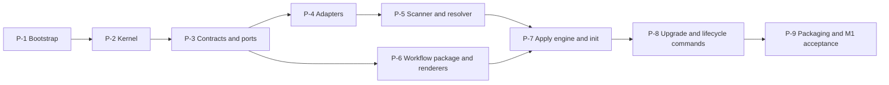

# Orqlet M1 implementation plan

Status: executed. The plan below is the approved Phase 3 text, copied unchanged except for
link paths. The section "Execution record" at the end says what was built, what was verified,
where the work departed from the plan and what still needs a person's decision.

## Basis

- Inputs: [as-is.md](as-is.md), [design.md](design.md), the five ADRs beside it, and the proposal [orqlet-architecture-proposal.md](../orqlet-architecture-proposal.md) (v0.4, section 22 for M1).
- Scope you chose: M1 only. M2 (validators, gates, hooks, CI check) gets its own plan once M1 is built.
- Decisions D-1 to D-8 as recommended: hatchling, mypy strict, in-tree canonical JSON, a `CheckPublisher` port (used in M2), `hypothesis` as a dev-only dependency, no coverage threshold, Git repository plus remote for Orqlet.

## Design adjustments this plan makes (applied to design.md first)

- The journalled apply engine (ADR-004) is built before `init`, because `init` writes through it. It moves from slice S7 into phase P-7.
- Packaging (hash-pinnable wheel) moves from slice S12 into M1, because the proposal's M1 scope includes it.
- A new pure module `src/orqlet/domain/changeplan.py` is added to the layout.
- M1 ships the machinery, the baseline instruction block, the protected rule file and the seeds. The six workflow skills and five role definitions are M2, as the proposal's M2 scope says.
- `init` writes no CI workflow files in M1, because they call `orqlet ci check` (M2). `sync` checks structure but installs no Git hook until M2.

## Prerequisites before P-1

- D-8: create the Git repository, choose the target branch name (never assumed to be `main`) and create the GitHub remote. Each is an external write that needs your explicit OK when the plan runs.
- Local tools: Python 3.12 to 3.15 are present. `uv` is 0.7.19 and the latest is 0.13.4, so decide whether to upgrade `uv` (a local tool change) or lock with the current one.
- Re-read PyPI on the day of P-1 and pin exactly. The versions in as-is section 3a date from 2026-10-21.
- GitHub Actions in the CI file are pinned by commit SHA. The SHAs are looked up and checked at execution, never invented.

## Phase order

Each phase is one pull request. Commits carry no AI co-author trailers. Every phase ships its own tests and passes Ruff, mypy, `lint-imports` and pytest before the next starts.

## P-1 Repository bootstrap (S0)

- Create: `.gitignore`, `.gitattributes` (LF endings, golden files never converted), `pyproject.toml`, `uv.lock`, `src/orqlet/__init__.py`, `src/orqlet/__main__.py`, `src/orqlet/py.typed`, `tests/unit/test_package.py`, `.github/workflows/ci.yml`.
- `pyproject.toml`: `requires-python = ">=3.12"`, build backend `hatchling`, runtime pins (Typer, Pydantic, PyYAML, filelock, platformdirs), a dev group (pytest, pytest-socket, pyfakefs, hypothesis, import-linter, ruff, mypy, types-PyYAML), strict mypy, Ruff rules including `TID251`, pytest markers `unit`, `contract`, `golden`, `integration`, `fault`, and the import-linter contracts of design section 5.2.
- `ci.yml`: top-level `permissions: {}`, a `contents: read` job each for lint, types, architecture, tests and build, matrix of three operating systems by Python 3.12 to 3.15.
- Commands: `git init -b <chosen>`, `uv lock`, `uv sync --all-groups`, `uv run ruff check .`, `uv run ruff format --check .`, `uv run mypy src tests`, `uv run lint-imports`, `uv run pytest`, `uv build`.
- Exit: all local gates green; building twice gives the same wheel SHA-256; CI green on the full matrix once the remote exists; no secrets in any file.

## P-2 Kernel (S1)

- Create under `src/orqlet/domain/`: `__init__.py`, `paths.py` (CanonicalPath: NFC, per-component case-fold key, reserved names, separators), `digest.py` (canonical JSON subset and SHA-256 helpers, ADR-002), `versions.py` (workflow version, floor, `controls_level`), `findings.py` (Finding and the PASS, FAIL, NOT_RUN verdict, where NOT_RUN is never success), `errors.py`.
- Tests: `tests/unit/domain/test_paths.py`, `test_digest.py`, `test_digest_properties.py` (key-order independence), `test_versions.py`, `test_findings.py`; vectors in `tests/fixtures/rfc8785/vectors.json` (UTF-16 key order, string escapes, floats and lone surrogates rejected).
- Exit: domain imports only the standard library (`lint-imports`); the RFC vectors and property tests pass on all three operating systems.

## P-3 Contracts, ports and fakes (S2)

- Create under `src/orqlet/application/ports/`: `filesystem.py`, `clock.py`, `ids.py`, `prompter.py`, `process.py`, `vcs.py`, `scanner.py`, `standards.py`, `instruction_adapter.py` (Protocols only).
- Create under `src/orqlet/application/contracts/`: `profile.py`, `policy.py`, `model_policy.py`, `integrations.py`, `generated_lock.py`, `versions_file.py`, `role_bindings.py`, `standards_lock.py`, `standards_pack.py`, `cli_result.py` (frozen models, `extra='forbid'`).
- Create `tools/export_schemas.py` and the committed schemas under `src/orqlet/workflow/schemas/`.
- Fakes in `tests/fakes/`: `memory_fs.py`, `fixed_clock.py`, `sequence_ids.py`, `scripted_prompter.py`, `fake_process.py`, `fake_vcs.py`.
- Tests: `tests/contract/test_schemas_committed.py`, `tests/unit/application/test_contracts_forbid_extra.py`, `tests/contract/test_filesystem_port.py`, `test_process_port.py`, `test_vcs_port.py`; valid fixtures per contract under `tests/fixtures/contracts/`.
- Exit: committed schemas equal generated ones; every contract rejects unknown fields; each port suite passes against its fake.

## P-4 Adapters: file system, process, Git (S3)

- Create under `src/orqlet/adapters/`: `fs/local_fs.py` (no-follow resolution, containment, atomic write, flush), `fs/yaml_loader.py` (anchors, aliases, duplicate keys, unknown tags and oversize input rejected), `process/subprocess_runner.py`, `git/git_runner.py` (subcommand allowlist and the `-c core.fsmonitor=false -c core.hooksPath=` prefix), `git/vcs_git.py` (root, state detection for empty, unborn and orphan HEAD, tree id, `ls-files`, `ls-tree`), `git/objects.py` (`cat-file --batch`).
- Tests: `tests/unit/adapters/test_local_fs.py` (pyfakefs), `test_yaml_loader.py`; `tests/integration/test_git_runner_hostile_config.py` (marker scripts for `core.fsmonitor`, `filter.*.clean`, `diff.external` must never run), `test_vcs_git_states.py`, `test_path_guard.py` (symlink, junction on Windows, case variants, `.git`, traversal, NFD); the P-3 port suites also run against these adapters.
- Exit: hostile-configuration fixtures leave the markers unrun; path-guard fixtures refuse every escape (FM-M07 cases); contract suites pass for fake and real adapters.

## P-5 Scanner, profile, resolver, CLI skeleton (S4)

- Create: `src/orqlet/domain/facts.py`, `domain/resolver.py` (monotone), `adapters/scan/python_scanner.py`, `adapters/scan/known_technologies.py`, `adapters/standards/pack_source.py`, `application/usecases/draft_profile.py`, `application/usecases/standards_for.py`, `interface/cli/app.py` (explicit `add_typer(..., name=...)`), `interface/cli/render_json.py`, `render_human.py`, `exit_codes.py`, `interface/cli/commands/standards.py`.
- Tests: fixture repositories under `tests/fixtures/repos/` (`uv_fastapi`, `pip_flask`, `empty`, `js_only`) and a neutral pack under `tests/fixtures/packs/sample/`; `tests/unit/adapters/test_python_scanner.py`, `tests/unit/domain/test_resolver.py`, `test_resolver_properties.py`, `tests/unit/application/test_draft_profile.py`, `tests/integration/test_cli_standards_for.py` (`CliRunner`).
- Exit: every detected fact carries a path, lines and hash that resolve; undetectable facts become questions; the JavaScript-only fixture yields a capability limit and no guess; adding any layer never shrinks the requirement set.

## P-6 Workflow package, renderers, client adapters (S5)

- Create: `src/orqlet/workflow/baseline/baseline.md`, `workflow/rules/orqlet-workflow.md`, `workflow/exempt.yaml`, `workflow/seeds/prompts/README.md`, `foundations.md`, `rules.yaml`, `workflow/MANIFEST.json` (generated by `tools/build_manifest.py`), `workflow/__init__.py`.
- Create under `src/orqlet/adapters/render/`: `emit.py` (fixed-order front matter and TOML emitters, ADR-005), `instructions.py` (`AGENTS.md` managed block, `.claude/CLAUDE.md` bridge), `rules.py`, `prompts_seed.py`, `pr_template.py` (the two owned blocks and marker rules); and `adapters/clients/claude_code.py`, `codex.py`, `cursor.py`.
- Tests: `tests/golden/<client>/<version-family>/` golden files with a `--update-golden` flag that CI refuses; `tests/unit/test_manifest.py`; `tests/contract/test_release_gate.py` (digest changed without a version change fails, FM-U05); marker-rule fixtures for the PR template (hostile bodies, CRLF, BOM).
- Exit: byte-identical output on all operating systems; the manifest digest recomputes; the golden files are labelled documentation-based until spike S-21 runs. The baseline text is new Orqlet text (the proposal drafted none), so it is flagged for your review.

## P-7 Apply engine and `init` (S6 plus the engine from S7)

- Create: `src/orqlet/domain/classify.py` (the three-way table of proposal 9.3), `domain/changeplan.py`, `adapters/fs/backup.py`, `adapters/fs/journal.py`, `application/usecases/apply_plan.py`, `application/usecases/init_project.py` (existing, new and empty projects, Git consent), `adapters/prompt/tty_prompter.py`, `interface/cli/commands/init.py`.
- Tests: `tests/unit/domain/test_classify.py`, `test_changeplan.py`, `tests/unit/application/test_init_project.py`, `tests/integration/test_init_cli.py`, `test_init_new_and_empty.py` (FM-N01 to FM-N04), `test_pr_template.py` (FM-P01 to FM-P04, FM-P06), `test_prompts_seed.py`, `tests/fault/test_apply_kill_after_k.py` (kill after k of n files, for every k, then resume converges).
- Exit: a second `init` is an empty plan; a user-edited generated file is a conflict and is never overwritten; personal files and an ancestor `CLAUDE.md` are byte-identical; no write lands outside the root; every kill point converges.

## P-8 Upgrade and lifecycle commands (rest of S7)

- Create under `src/orqlet/application/usecases/`: `upgrade.py`, `rollback.py`, `sync.py`, `doctor.py`, `explain.py`, `release.py`; `adapters/scan/personal_names.py` (opt-in names-only scan); `interface/cli/commands/` modules `upgrade.py`, `rollback.py`, `sync.py`, `doctor.py`, `explain.py`, `release.py`; extend `domain/versions.py` with floor and downgrade protection.
- Tests: FM-U01, FM-U03, FM-U04, FM-U05, FM-U09 and FM-W03 under `tests/integration/test_lifecycle_*.py`; `tests/fault/test_upgrade_resume.py`; a tampered protected file is reported and `release` refuses it; a rollback below the floor is refused.
- Exit: the M1 acceptance items of proposal section 22 that concern upgrade, rollback, `doctor`, `release` and reserved names pass on all three operating systems.

## P-9 Packaging and M1 acceptance

- Create: `tests/e2e/test_m1_acceptance.py` (existing repository, new project, empty project, upgrade, rollback), `tests/contract/test_reproducible_build.py`, `tests/e2e/test_install_smoke.py` (install the wheel into a clean environment and run `orqlet --version` and `orqlet doctor`).
- Modify: `pyproject.toml` (package data for `workflow/`), `.github/workflows/ci.yml` (add the wheel hash step).
- Exit: the M1 acceptance list is green on the full CI matrix including the Windows runner; the wheel has a recorded SHA-256 and builds reproducibly; `doctor` warns on a version that differs from the pin.

## Risks

- Client behaviour is documentation-based until the M0 spikes run, so golden files are labelled and version-gated.
- Windows file semantics (rename over an open file, junctions) are unverified; the apply engine retries a bounded number of times and the Windows runner is in the matrix from P-1.
- `hypothesis` is MPL-2.0; it stays a dev-only dependency and is not shipped.
- Scope creep from M2: skills, roles, validators, hooks and CI workflows are out of this plan.
- The `uv` version gap and the CI action SHAs are checked at execution, not assumed.

## After M1

Write the M2 plan (slices S8 to S12) once M1 is accepted and Q-01, Q-03, Q-04, Q-05 and the M0 spikes S-14 and S-28 have answers.

## Execution record

Written after P-9. It states what was run and what was not.

### Result

All nine phases are built, in the order of the plan. The gates that exist today pass:

| Gate | Result |
|---|---|
| `ruff check` and `ruff format --check` | pass |
| `mypy` (strict, Pydantic plugin) over `src`, `tests`, `tools` | pass |
| `lint-imports` | five contracts kept: layers, domain purity, application purity, workflow package, client independence |
| `tools/export_schemas.py --check` and `tools/build_manifest.py --check` | pass |
| `pytest` on Python 3.12, 3.13, 3.14 and 3.15 (macOS, Apple silicon) | 777 passed and 1 skipped on 3.13, 3.14 and 3.15; the same suite passes on 3.12. The skipped test needs a Windows junction |
| Two builds of the wheel | identical SHA-256 (`tests/contract/test_reproducible_build.py`) |
| Install into a clean environment, then `orqlet --version`, `init`, `doctor` | pass (`tests/e2e/test_install_smoke.py`) |

### Not verified

- **CI has not run.** There is no remote, as you decided in P-1, so the Linux and Windows
  jobs, the Windows junction test and the path, line-ending and symlink tests on Windows are
  written and unrun. Windows file semantics (replacing an open file, junctions) stay a risk.
- **No client was opened.** The golden files under `tests/golden/<client>/docs-2026-10/` are
  what each client is expected to read according to its published documentation. The Cursor
  `globs` format and the Claude Code import approval are unverified (spike S-21).
- **Git 2.56.0 is the only Git version tested.** The hostile-configuration test reproduces the
  reviewers' experiments on that version only.
- **No commit was made and no remote was created.** The directory is a Git repository with
  everything untracked.

### Departures from the plan

1. **Contracts and ports beyond the list.** Added: `orqlet.rules`, `orqlet.workflow-identity`,
   `-manifest`, `-releases`, `-lock`, `-rule`, `orqlet.exempt`, `orqlet.released` (schemas are
   committed and hashed in the manifest); ports `documents`, `renderers`, `workflow`,
   `change_journal`, `lock`, `ancestors`, `personal`. The proposal gives no example of
   `standards.lock.yaml`, so its shape was defined in P-3.
2. **Pure modules beyond the list.** `domain/blocks.py` (managed blocks and marker rules),
   `domain/ownership.py`, `domain/facts.py`, `domain/globs.py`, `application/usecases/render_all.py`
   (the one composition that `init` and `upgrade` share).
3. **A hand-written in-memory file system replaces `pyfakefs`.** `tests/fakes/memory_fs.py` follows
   the same port contract as the real adapter and is checked by the same suite. `pyfakefs` was
   removed from the dev group because nothing used it. the test table of `design.md` still names it.
4. **`filelock` is used**, for a per-project apply lock (`adapters/fs/apply_lock.py`), so two
   processes cannot apply a change at once. The plan listed the dependency without a use.
5. **Exit code 5** (`CHECK_FAILED`) is what `doctor` and `sync` return for errors. The proposal
   says 2 for `sync`, but 2 is the code Typer and Click use for a usage error.
6. **`init` re-run semantics.** A second run on an initialised project reports "already
   initialised" and writes nothing. A rerun after an interrupted first run reuses the profile
   that was written and converges. A journal of the interrupted change stays open until a rerun
   or `upgrade --resume` supersedes it, and `doctor` reports it.
7. **Windows retry.** `os.replace` is retried a bounded number of times on Windows only.
8. **Hash of manifest files** normalises CRLF to LF, so a Windows checkout gives the same digest.

### After P-9: technologies other than Python

You pointed out that teams use Go, Rust, databases and queues, and that M1 only read Python at the
repository root. Part one of the answer is built:

- The profile has a `technologies` list: kind (language, runtime, framework, library, database,
  queue, infrastructure, tool), name, version as written, the folder it belongs to, and evidence.
  A scanner or an agent must cite evidence; only the maintainer may state a technology without it.
- Scanner plug-ins read Python, Go (`go.mod`), Rust (`Cargo.toml`), Node (`package.json`), Dockerfiles,
  Compose files and Helm charts. Discovery walks the root and two levels of folders, so each service
  of a monorepo gets its own scope. It skips hidden, generated and third-party folders and links,
  and says in a note when a bound (1000 folders, 500 technologies) stops it.
- A version is recorded only when the source is the technology: `psycopg>=3.1` is a driver version, so
  the database carries none. Two files that disagree (`go.mod` says 1.24, the builder image 1.25) are
  both shown, not resolved.
- Standards packs match on `languages` and on any technology name (`applies_to.technologies`), so a Go
  pack or a PostgreSQL pack applies without a Python framework.
- Python questions are asked only when the root holds a Python manifest. A Dockerfile that builds
  from a Python image does not count.

Not built yet: the IDE onboarding agent skill (part two), the documentation importer, scanners for
Java, .NET, Ruby and PHP manifests, and evidence for technologies that only code shows (for example a
database reached through a URL in configuration).

### Findings that the tests produced, and the fixes

- **ADR-003 needed a narrower allow-list.** The hostile-configuration test showed that
  `git diff-index HEAD` runs a repository's `filter.*.clean` program on every modified file, and
  that `ls-files --modified` and `cat-file --filters` do the same. The runner now requires
  `--cached` for `diff-index` and refuses `--modified`, `--eol`, `--filters`, `--textconv` and
  `--ext-diff`. `git init` and `check-ref-format` are reachable only through `init_repository`.
  The ADR text itself was not edited.
- **`is_clean` became `has_staged_changes`**, because a clean working tree cannot be checked
  without a command that runs filters. The branch of an unborn HEAD is read from the HEAD file
  that `rev-parse --git-path` names, and remotes are read from `refs/remotes`.
- **A property test found** that a control character raised a YAML reader error outside the
  loader's error handling; fixed and covered. A fuzz test also made the Python scanner tolerant
  of any TOML shape.
- **Insertion after a heading** put the second block inside the first, because the heading of the
  workflow section is itself a heading. Headings inside blocks and code fences are now skipped.
- **Template discovery** crashed on `.git` and missed files inside `PULL_REQUEST_TEMPLATE/`.
- **An orphan HEAD with an empty working tree** was treated as an empty project; it now asks.
- **The seeded `.prompts/rules.yaml` was never read.** The seed README told teams to add rules there
  and said `orqlet standards for` would serve them, but only `.orqlet/rules.yaml` was loaded.
  Found when a real project was tried after P-9. The resolver now layers packs, then the standards
  folder named in the profile, then `.orqlet/rules.yaml`; tests cover serving and rendering.
- **The manifest file itself** was missing from the plan's view of the tree, so an unchanged
  upgrade planned a "create". Fixed.

### Needs your review or decision

- **New Orqlet text.** `src/orqlet/workflow/baseline/baseline.md`, `rules/orqlet-workflow.md`,
  `pr_template/workflow-section.md` and `seeds/prompts/*` are written by this work, not taken from
  the proposal. They govern what agents read, so they need a person's review. Any edit changes the
  workflow digest and needs a `workflow_version` bump once a release is recorded in `releases.json`.
- **`releases.json` is empty.** No release has been recorded, so the release gate has nothing to
  compare with yet. Record `0.1.0` when you decide to release it.
- **ADR and design text.** ADR-003 (allow-list), the design's test table (`pyfakefs`) and the
  exit-code table were not edited. They should be updated to match the items above.
- **Packaging source.** The wheel is hash-pinnable; where it is published is still an open input (proposal section 25.2).
- **Remote and commits.** Create the remote and make the first commit when you want CI to run.
