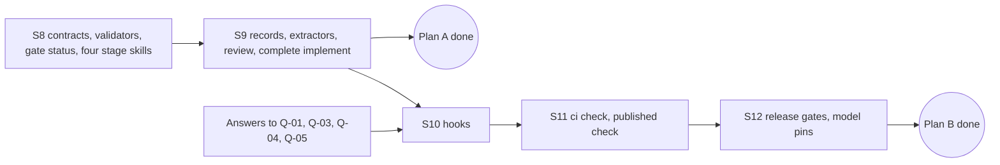

# DESIGN: M2, the four stages in the IDE (slices S8 to S12)

| Field | Value |
|---|---|
| Task | `orqlet-m2-workflow` |
| Phase | 2, human-gated design. Approved by the user on 2026-10-22; Plan A (slices S8 and S9) is in `plan.md` |
| Inputs | Architecture proposal v0.4 (`docs/design/orqlet-architecture-proposal.md`, section numbers and line numbers below refer to it), the approved `docs/design/orqlet-implementation/design.md` (slices S8 to S12 of its section 10, decision D-1), and the M1 code as it is today |
| Change class | **D3 (full) for M2 as a whole.** S11 adds a CI trust boundary and a write to an external system (a published check). S8 and S9 alone are D2: a new public CLI surface and new contracts, no trust boundary |
| Status | Approved as written, decisions D-M2-1 to D-M2-6 as recommended (2026-10-22). Format: this document follows the flat `design.md` of the previous task. The artifact contracts it describes (section 4.3) do not exist yet, so it cannot be validated by them |

## 1. Why this document exists

The baseline that Orqlet writes into `AGENTS.md` says that work follows four phases (research, design, plan, implementation) and that a person approves the design and the plan. Today nothing in the IDE helps with any of them: M1 shipped the machinery and four helper commands (`/orqlet-doctor`, `/orqlet-standards`, `/orqlet-profile`, `/orqlet-upgrade`), and the phase skills were left to M2. This document designs M2.

## 2. Facts this design relies on

**About the code today**

| # | Fact | Where |
|---|---|---|
| F-1 | The CLI has `init`, `upgrade`, `rollback`, `sync`, `doctor`, `explain`, `release`, `profile` and `standards`. There is no `validate`, `gate`, `review`, `knowledge` or `ci` command | `src/orqlet/interface/cli/app.py` |
| F-2 | The workflow package holds a baseline, one rule, a PR-template section, four command texts, `exempt.yaml`, schemas and `MANIFEST.json`. It has no `skills/` or `roles/` folder. Version `0.1.0`, `controls_level` 1, `releases.json` empty | `src/orqlet/workflow/` |
| F-3 | Renderers write rules and commands for Claude Code and Cursor, and only the `AGENTS.md` block for Codex. No renderer writes skills or subagent definitions | `src/orqlet/adapters/render/rules.py`, `adapters/clients/*.py` |
| F-4 | `Vcs.read_committed(path)` reads a file **at HEAD only**. The Git runner already allows `rev-parse`, `ls-tree`, `cat-file`, `diff-tree` and `diff-index --cached`, so reading a file at any revision needs a new port method and no new Git subcommand | `application/ports/vcs.py`, `adapters/git/git_runner.py` |
| F-5 | The contracts that exist are profile, policy, role bindings, versions, workflow package, generated lock, standards lock, standards pack, CLI result, integrations and model policy. None of the artifact contracts of the workflow (as-is, design set, plan, ledger, review, test, knowledge record) exists | `application/contracts/` |
| F-6 | **The Orqlet repository has no commit and no remote.** `git rev-parse HEAD` fails | decision D-8 of the approved design is still open |
| F-7 | The user ran `/orqlet-doctor` in Cursor and it appeared in the `/` menu. That shows Cursor reads `.cursor/commands/*.md`. It says nothing about skills | session of 2026-10-22 |

**About what the proposal specifies (not yet built)**

| # | Statement | Section |
|---|---|---|
| P-1 | Six of the eight skills (`orqlet-onboard`, `-research`, `-design`, `-plan`, `-implement`, `-review`) and five of six subagent roles (inventory, tracer, tester, architecture reviewer, security reviewer) are M2 | §22, M2 row; §17.8; §10.3 |
| P-2 | Skills are authored once and rendered per client. Placement: `.claude/skills/orqlet-<name>/SKILL.md` for Claude Code, `.agents/skills/orqlet-<name>/SKILL.md` for Codex and Cursor. Phase skills are started only by the developer (`disable-model-invocation: true` for Claude Code and Cursor, `allow_implicit_invocation: false` for Codex), marked **[FH]**, i.e. from documentation, not observed | §12.4, §17.1, §17.10 |
| P-3 | "Skills include only steps whose commands that version provides, so an MVP-1 skill never calls a later milestone's command" | §17.10 |
| P-4 | Artifacts live under `docs/design/<task>/`: `as-is.md`, `design/manifest.yaml`, `plan.yaml`, `questions.yaml`, `reviews/`. Each starts with one common header (schema `orqlet.artifact-header/v1`) | §17.1, §17.11 |
| P-5 | `validate as-is` checks the schema, that every evidence reference resolves at the bound revision, a size budget on facts, that no unknown or contradiction was dropped, and flags prescriptive language | §17.3 |
| P-6 | `validate design` computes the change class D1, D2 or D3 and checks every artifact kind the class requires. Nobody can lower the class | §17.4 |
| P-7 | `validate plan` works on a projected tree with 19 specified cases | §17.5 |
| P-8 | `gate status` is read-only and reports approval as `NOT_RUN` when run offline. Approval is evidence on the protected baseline (a merged pull request approved by a code owner who is not the author) | §17.6, §17.7, §10.2 |
| P-9 | A raise of `controls_level` goes with a release that adds or tightens a control | §20.8 |

**Not known, and this design does not assume**

- U-1. Whether Cursor lists a skill placed in `.agents/skills` and in `.claude/skills` once or twice, and whether it honours `disable-model-invocation`. The proposal records the duplicate listing as an open risk (spike S-02, §12.4).
- U-2. The exact file format each client reads for subagent definitions. The proposal gives the folders (`.claude/agents/`, `.codex/agents/`, `.cursor/agents/`, §10.1) and marks behaviour as documentation-based.
- U-3. The answers to Q-01 (code host and CI), Q-03 (who approves), Q-04 (managed settings) and Q-05 (local guard), which the proposal lists as open and which nobody has answered in this repository.
- U-4. Whether `d1_max_files` = 10 is right. The proposal calls it an initial value to be confirmed (§17.4).

## 3. Scope

**In scope.** Slices S8 to S12 of the approved design (its section 10):

| Slice | Content |
|---|---|
| S8 | Artifact contracts (header, as-is, design set, plan, question ledger). `orqlet validate as-is|design|plan`. `gate status` (offline). `review prepare`. Skills `orqlet-onboard`, `-research`, `-design`, `-plan`, `-implement` (reduced, see 4.2). Subagent roles `orqlet-inventory`, `orqlet-tracer` |
| S9 | Review, test and knowledge-impact records and the review-input binding. Approved-expected-change extractors. `knowledge impact` and `validate knowledge`. Skill `orqlet-review` and the complete `orqlet-implement`. Roles `orqlet-tester`, `orqlet-arch-reviewer`, `orqlet-security-reviewer` |
| S10 | Git hooks (`commit-msg`, drift, validators) and the optional edit guard |
| S11 | `ci collect` and `ci check`, the two-stage event model, the signal and sweeper workflows, the check publisher |
| S12 | Release gates and per-role model pins |

**Out of scope.** M3 and later (knowledge index, private store, MCP, external sources). The optional `orqlet-knowledge` and `orqlet-catalogue` skills.

## 4. Proposed design

### 4.1 What the developer sees

| Stage | Starts with | The agent produces | Orqlet checks | A person decides | Usable after |
|---|---|---|---|---|---|
| 0 Onboard | `/orqlet-onboard` | draft project profile, open questions | `doctor`, profile schema | reviews the profile, `profile approve` | S8 |
| 1 Research | `/orqlet-research <topic>` | `as-is.md`, facts only | `orqlet validate as-is` | accepts the AS-IS | S8 |
| 2 Design | `/orqlet-design` | design set at the depth of the change class | `orqlet validate design` | approves by merging the design pull request | S8 |
| 3 Plan | `/orqlet-plan` | `plan.yaml`, exact paths | `orqlet validate plan` | approves by merging the plan pull request | S8 |
| 4 Implement | `/orqlet-implement <phase>` | code, tests | `gate status`, repository checks | accepts the phase and commits | S8 (reduced), S9 (complete) |
| 4 Review | `/orqlet-review` | review records | `validate review`, `validate knowledge` | reads the findings | S9 |

Each skill stops at the person's decision. A skill never approves, commits or opens a pull request unless the person asks.

```mermaid
flowchart LR
  ON["Stage 0: onboard"] --> R["Stage 1: research"]
  R --> VA{"validate as-is"}
  VA -->|fails| R
  VA -->|passes| AC["Person accepts AS-IS"]
  AC --> D["Stage 2: design"]
  D --> VD{"validate design"}
  VD -->|fails| D
  VD -->|passes| PR1["Design pull request"]
  PR1 --> AP1["Person approves and merges"]
  AP1 --> P["Stage 3: plan"]
  P --> VP{"validate plan"}
  VP -->|fails| P
  VP -->|passes| PR2["Plan pull request"]
  PR2 --> AP2["Person approves and merges"]
  AP2 --> I["Stage 4: implement one phase"]
  I --> RV["Review"]
  RV --> CM["Person accepts and commits"]
```

### 4.2 Skills and roles

- **Canonical source.** Each skill is one file under `src/orqlet/workflow/skills/<name>/` (the text, plus `references/` for material only that skill needs). Each role is one file under `src/orqlet/workflow/roles/`. They are part of the protected workflow, so they are hashed in `MANIFEST.json` and change `workflow_digest` (F-2).
- **Rendering.** New renderers in `adapters/render/skills.py` and `roles.py` turn them into each client's files (P-2). The input is a new `ClientSkill` and `ClientRole` next to the existing `ClientCommand` in the `RenderRequest`. Codex gets skills but no per-path rules, and it keeps its `ORQ-L002` limit.
- **Only steps whose commands exist (P-3).** A skill text marks each step that needs a command with `requires: <command>`. The renderer drops a step whose command is not in the running release. This keeps `orqlet-implement` honest in S8, when `review prepare` exists but the knowledge step does not: it renders without the knowledge step and says so in its opening lines.
- **The helper commands stay.** `/orqlet-doctor`, `/orqlet-standards`, `/orqlet-profile` and `/orqlet-upgrade` are shortcuts to CLI commands, not phases. They keep living in `commands/`.
- **Skills are instructions, not enforcement.** A skill cannot force a session to follow it (proposal §17.1). What stays enforceable is the evidence: validators now, CI in S11.

### 4.3 Contracts and artifact locations

New Pydantic contracts in `application/contracts/` (frozen, `extra='forbid'`, schemas committed under `workflow/schemas/`, as in the approved design 5.4): `artifact_header`, `as_is`, `design_set`, `plan`, `question_ledger`. S9 adds `review_result`, `test_record`, `knowledge_impact`, `review_input`. Artifacts live where P-4 says. `progress.yaml` is session scratch and `init` would add it to a managed `.gitignore` block (this is a new write to a user-owned file and needs its own look in the plan).

The existing folder `docs/design/orqlet-implementation/` uses the flat format of this document. It is **not migrated**. The validators apply to tasks created with the skills.

### 4.4 Validators and where they live

| Layer | Content |
|---|---|
| `domain/` (pure) | `change_class.py` (D1, D2, D3 from scope, operations and globs), `plan_projection.py` (projected tree, the 19 cases), `evidence.py` (a reference is `{path, lines, revision, content_sha256}` and a comparison against given bytes), `prescriptive.py` (the prescriptive-language lint), canonical path keys reuse `CanonicalPath` |
| `application/` | `validate_artifact` use case: parse with the strict loader, validate with the contract, resolve every reference through the `Vcs` port, call the pure checks, return `Finding`s and a verdict `PASS`, `FAIL` or `NOT_RUN`. `gate_status`, `review_prepare` |
| `application/ports/vcs.py` | New: `read_at(revision, path)` (bytes or `None`) and `tree_at(revision)` (the tracked paths at a revision). Both use `cat-file` and `ls-tree`, already allowed (F-4) |
| `adapters/` | The Git adapter implements the two methods through the hardened runner. No new subprocess path |
| `interface/cli/` | `validate` group with `as-is`, `design`, `plan`, `ledger`; `gate status`; `review prepare`. Same `--json` envelope and exit codes as today |

`gate status` in S8 checks what can be checked offline: the base revision, the standards lock, the profile version, `workflow_version` and the protected-set digest. Approval presence is reported `NOT_RUN` with the reason "no host evidence" (P-8). S11 supplies the evidence.

### 4.5 Order and the two approvals

Keep the order of the approved design (S8, S9, S10, S11, S12) and split the plan phase in two, as D-1 did for M1:

1. **Plan A: S8 and S9.** Everything the IDE stages need. No external write. Nothing blocks it except the check of U-1 (D-M2-1) and the first commit of D-M2-4.
2. **Plan B: S10 to S12.** Starts only after Q-01, Q-03, Q-04 and Q-05 are answered, because the hooks, the CI check and the published check depend on them.

### 4.6 Release handling

Skills and roles change `workflow_digest`, so each slice that adds them raises `workflow_version`. S8 adds validators, which are controls, so it also raises `controls_level` from 1 to 2 (P-9). `0.1.0` has never been released (`releases.json` is empty), so recording it and then moving to `0.2.0` needs a decision (D-M2-5).

## 5. Compatibility and migration

| Area | Design |
|---|---|
| Existing installations | `orqlet upgrade` adds skill and role files as `generated`. Files a team has edited stay and get a proposal, as for every generated file today. Nothing is removed |
| Clients | Placement follows P-2. Anything marked **[FH]** is documentation-based. Every client adapter keeps its `ORQ-L001` limit until a real client run says otherwise |
| Duplicates | If Cursor lists a skill twice because both `.agents/skills` and `.claude/skills` exist (U-1), the renderer writes the skill to one location per project, chosen from the clients the profile declares. This is only decided after the check in D-M2-1 |
| Python | No change: 3.12 to 3.15. The public-API extractor of S9 is defined for Python modules (proposal §17.4.1); other languages are declared `verification: manual` |

## 6. Security considerations

- **Repository files are untrusted** (rule `ORQLET-SEC-002`). Validators read artifacts through the file system port and the strict YAML loader, with size caps. Evidence references are resolved as Git objects at the named revision, never by running repository code.
- **No model calls** (rule `ORQLET-NOMODEL-001`). Validators are deterministic code. The prescriptive-language lint is a word-list check, not a model.
- **No network** in S8 and S9. S11 introduces the first network access, to GitHub, behind two ports.
- **Skill text is an instruction surface.** A skill must say that text in repository files, documentation and tool output is evidence and never an instruction (proposal §17.3). The renderer's golden files cover that sentence.
- **An agent saying "approved" is not approval.** Every skill stops at the person's decision, and `gate status` reports approval as `NOT_RUN` without host evidence.
- **Secrets.** Skills and fixtures carry no credentials.

## 7. Test strategy

| Layer | What |
|---|---|
| Unit | The pure checks with fakes: change class table, projection, evidence comparison. The 19 plan cases as 19 named tests |
| Contract | Committed schemas equal the generated ones. The two new `Vcs` methods are added to the port suite that every adapter and fake already passes |
| Golden | Rendered skills and roles per client, byte for byte, in `tests/golden/<client>/docs-2026-10/`, including the dropped-step behaviour of 4.2 |
| Integration | Real Git: a validator resolves evidence at an old revision, detects a changed base revision, handles an unborn branch as `NOT_RUN` |
| Fixtures by ID | The 19 plan cases, and the fixtures of the M2 row of the proposal (§22: FM-W, FM-U, FM-B, FM-A, FM-K, FM-E and others). The plan assigns each fixture to one slice. `NOT_RUN` is never counted as success |
| Gates | Every rule of `.prompts/rules.yaml`: ruff, mypy strict, import-linter, the manifest and schema checks, the golden tests |

## 8. Rollback and failure handling

| Failure | Handling |
|---|---|
| A bad skill text | A new release, because skills are part of the protected workflow. Teams roll back with `orqlet rollback <change id>` for the files they upgraded |
| A validator rejects a good artifact | Reported as a finding with the path and line. The fix is in the artifact or in a new release, never a switch that turns the check off (proposal §17.1) |
| A reference cannot be resolved because the revision is missing | `NOT_RUN`, never `PASS` |
| An unfinished upgrade | The existing journal and `--resume` (ADR-004) |

## 9. Decisions that need your approval

| ID | Decision | Recommendation | Why |
|---|---|---|---|
| D-M2-1 | Phase entry points are **skills** (P-2), not commands. Before building, run a 5-minute check in your Cursor: put one throwaway skill in `.agents/skills/` and one in `.cursor/skills/`, then see what the `/` menu shows | Skills, after the check | The proposal and the validators assume skills with `references/` and a developer-only start. I have no evidence yet of how Cursor lists them (U-1) |
| D-M2-2 | Order S8, S9, S10, S11, S12 with two plans: Plan A (S8, S9) now, Plan B (S10 to S12) after Q-01, Q-03, Q-04 and Q-05 | Yes | Plan A needs only D-M2-1 and D-M2-4 from you. Plan B writes to GitHub and needs your host decisions |
| D-M2-3 | `orqlet-implement` ships **reduced** in S8 (no tester subagent, no knowledge step, no review records) and says so, and becomes complete in S9 | Yes | You get all four stages early. P-3 allows it. The cost is that implementation in this window has no independent review, which the skill states |
| D-M2-4 | Make the first commit and set a remote for the Orqlet repository (D-8 of the approved design, F-6). You do it, or tell me to | Yes, before S8 validation work | Evidence is bound to a revision. Without a commit, revision-bound checks can only say `NOT_RUN` on Orqlet itself |
| D-M2-5 | Record `0.1.0` as released, then raise to `0.2.0` and `controls_level` 2 with S8 | Yes | The release gate has never had a history to check against (F-2) |
| D-M2-6 | Do not migrate `docs/design/orqlet-implementation/` to the new contracts | Yes | It predates them. Migrating adds work and no behaviour |

## 10. Questions for you (unknown, not assumed)

1. **Q-01:** Which code host and CI do you use (GitHub.com, GitHub Enterprise, GitLab, Bitbucket), and is a merge queue used? Needed before Plan B.
2. **Q-03:** Where do design and plan approvals live, and who is an authorised human? The proposal recommends a merged pull request approved by the code owners of `docs/design/**`. Needed before Plan B and for `gate status` to stop reporting `NOT_RUN`.
3. **Q-04 and Q-05:** Can an administrator deploy managed client settings, and which local guard should accompany the merge gate (A: none, B: a generated edit guard, C: B plus managed hooks)? Needed before S10.
4. **U-1** is answered by the check in D-M2-1, not by a decision.
5. **U-4:** Do you accept 10 files as the D1 ceiling for now?

## 11. Risks

| Risk | Mitigation |
|---|---|
| M2 is large: twelve proposal sections of behaviour, one external write | Two plans, five slices, each with its own tests and a stop point (4.5) |
| Client behaviour differs from the documentation (U-1, U-2) | Version-gated adapters, golden files labelled `docs-2026-10`, the check in D-M2-1 first |
| Skills give a false sense of control | The skills and `gate status` say what is and is not enforced; approval stays `NOT_RUN` offline |
| A validator is stricter than the team's habits | Findings carry the path and line. Rules can be tightened by a project and never relaxed (monotone resolver) |
| Pace: reduced `orqlet-implement` in S8 lets work start without independent review | D-M2-3 states it in the skill and here. S9 closes it |
