# M2 Plan A: the four stages in the IDE (slices S8 and S9)

Based on the design you approved as written (`docs/design/orqlet-m2-workflow/design.md`, decisions D-M2-1 to D-M2-6) and on the proposal v0.4 sections it cites. Phases A-1 to A-6 are S8, phases A-7 to A-11 are S9. After A-6 I stop so you can try the skills in Cursor before S9 starts.

## Ground rules

- No commits or pushes unless you ask. No model call and no network in any new code (rules `ORQLET-NOMODEL-001`, `ORQLET-SEC-002`).
- Every phase ends with the gates: `ruff check`, `ruff format --check`, `mypy` (strict), `lint-imports`, `tools/build_manifest.py --check`, `tools/export_schemas.py --check`, and the full `pytest` run. The 3.12 to 3.15 matrix runs at A-6 and A-11.
- New Markdown files under `src/orqlet/workflow/skills/` and `roles/` are product files that you approved in the design. `plan.md` and the design status line are the only other Markdown edits.
- Client file formats (skills, subagents) are documentation-based. Before A-5 and A-10 I fetch the current formats with Context7 and the vendor docs, label goldens `docs-2026-10`, and keep each adapter's `ORQ-L001` limit.
- Proposal thresholds marked [R] (`d1_max_files` 10, `copy_max_lines` 10, `near_duplicate_threshold` 0.8) are initial values that a project can only tighten.

## Departures from the approved design (declared here, for your review)

1. `review prepare` moves from S8 to S9 (A-9). Its only consumer is `orqlet-review`, and half of its packet (test and knowledge-impact records) exists only in S9.
2. `orqlet knowledge impact` needs `.orqlet/knowledge.yaml`, which M1 never wrote. A-8 seeds a minimal one (empty `sources` and `write_scope`) as a team-owned file.
3. A failed or not-run validation both exit with code 5 (`CHECK_FAILED`). The JSON `verdict` field (`PASS`, `FAIL`, `NOT_RUN`) tells them apart. `NOT_RUN` is never exit 0.
4. A constant `IMPLEMENTED_COMMANDS` in `application/usecases/capabilities.py` drives the `requires:` filter of skill texts. A test compares it with the commands the Typer app registers, so it cannot drift.

## Your actions (I do not do these unless you ask)

- Before A-5: the 5-minute Cursor check of D-M2-1 (one throwaway skill in `.agents/skills/`, one in `.cursor/skills/`, report what the `/` menu shows). Default if you skip it: Claude Code skills in `.claude/skills/`, Cursor and Codex in `.agents/skills/`.
- Before A-6 acceptance: the first commit and a remote for the Orqlet repository (D-M2-4). Tests use temporary Git repositories, so nothing is blocked, but revision-bound checks cannot run on Orqlet itself until a commit exists.

## Phases

```mermaid
flowchart LR
  A0["A-0 housekeeping"] --> A1["A-1 domain kernel"]
  A1 --> A2["A-2 artifact contracts"]
  A2 --> A3["A-3 revision access"]
  A3 --> A4["A-4 validators, gate status"]
  A4 --> A5["A-5 skills, roles, rendering"]
  A5 --> A6["A-6 S8 acceptance, stop"]
  A6 --> A7["A-7 diff and binding"]
  A7 --> A8["A-8 S9 contracts"]
  A8 --> A9["A-9 records, extractors, knowledge impact, review prepare"]
  A9 --> A10["A-10 review skills and roles"]
  A10 --> A11["A-11 Plan A acceptance"]
```

### A-0 Housekeeping

- Set the Status line of `docs/design/orqlet-m2-workflow/design.md` to approved (decisions D-M2-1 to D-M2-6 as recommended). Save this plan as `docs/design/orqlet-m2-workflow/plan.md`.
- Record release `0.1.0` in `src/orqlet/workflow/releases.json` with the current digest and `controls_level` 1 (D-M2-5), so the release gate can catch any later silent change.
- Done when: `tests/contract/test_release_gate.py` passes and a deliberate edit of a workflow file without a version bump makes it fail (checked once, then reverted).

### A-1 Domain kernel (S8, pure code, standard library only)

- `src/orqlet/domain/evidence.py`: `EvidenceRef {path, lines, revision, sha256}` and a check of a reference against given bytes (the lines exist and the hash matches).
- `src/orqlet/domain/change_class.py`: D1, D2, D3 from a scope description and the `d1_max_files` parameter; the effective class is the maximum of trigger, declared and approver class, and a lower value is rejected (proposal 17.4).
- `src/orqlet/domain/plan_projection.py`: canonical path keys (reusing `CanonicalPath`), topological projection, per-operation checks, concurrent-phase conflicts, `moved_from` rules (proposal 17.5).
- `src/orqlet/domain/prescriptive.py`: deterministic word-list lint for prescriptive language in facts.
- Tests: `tests/unit/domain/test_evidence.py`, `test_change_class.py`, `test_plan_projection.py` (the 19 cases of proposal 17.5 as 19 named tests, plus a hypothesis property: result does not depend on phase order, conflict check is symmetric), `test_prescriptive.py`.
- Done when: `lint-imports` shows the domain still imports nothing outside the standard library.

### A-2 Artifact contracts (S8)

- New frozen Pydantic contracts in `src/orqlet/application/contracts/`: `artifact_header.py`, `as_is.py`, `design_set.py`, `plan.py`, `question_ledger.py`, `self_check.py`, with field lists taken from proposal 17.11 and 18.2 to 18.4 (unknown fields rejected).
- Register them in `contracts/schemas.py`; `tools/export_schemas.py` writes the schemas under `src/orqlet/workflow/schemas/`; valid and invalid fixtures under `tests/fixtures/contracts/`; cases in `tests/contract/test_contracts.py`.
- Done when: a schema file edited by hand fails `export_schemas.py --check`, and every contract rejects an unknown key, a YAML anchor and an unknown tag.

### A-3 Revision access (S8)

- `src/orqlet/application/ports/vcs.py`: add `read_at(revision, path) -> bytes | None` and `tree_at(revision) -> tuple[str, ...]`.
- `src/orqlet/adapters/git/vcs_git.py`: implement both with `cat-file` and `ls-tree`, which `git_runner.py` already allows. No new Git subcommand.
- `tests/fakes/vcs.py`: matching fake. Real-Git tests in `tests/integration/test_vcs_revisions.py`: an old revision, a missing path, an unborn branch (returns nothing, never raises a crash), and the hostile-configuration fixtures already used for the runner.
- Done when: the same port suite passes for the fake and the Git adapter.

### A-4 Validators and `gate status` (S8)

- Use cases in `src/orqlet/application/usecases/`: `validate_as_is.py` (schema, every reference resolves at the bound revision, size budget on facts, unknowns and contradictions never dropped, prescriptive lint, `--against HEAD` staleness), `validate_design.py` (trigger class recomputed, required artifacts per class, ADR format, every `expected_changes` entry has an extractor or is `manual`), `validate_plan.py` (A-1 projection, acceptance criteria present, `implements` ids exist, change class not above the design's), `validate_ledger.py` (no two open entries share a canonical key, no open blocking question named by an artifact header), `gate_status.py` (offline checks: base revision, standards lock, profile version, `workflow_version`, protected-set digest; approval is `NOT_RUN` with reason "no host evidence"), `capabilities.py` (`IMPLEMENTED_COMMANDS`).
- CLI: `src/orqlet/interface/cli/commands/validate.py` (`as-is`, `design`, `plan`, `ledger`) and `commands/gate.py` (`status`), registered in `app.py`; human output in `render_human.py`; `--json` uses the existing envelope.
- Tests: unit tests with fakes per use case, CLI tests in `tests/integration/test_validate_cli.py` with real Git (stale base revision, unborn branch gives `NOT_RUN`, forged reference fails), plus the test that compares `IMPLEMENTED_COMMANDS` with the registered commands.
- Done when: FM-W07 (a different base revision or standards lock gives `stale` or `NOT_RUN`) and FM-W08 style cases (zero evidence resolved is not success) pass.

### A-5 Skills, roles and rendering (S8; needs your D-M2-1 check result or the default)

- Workflow sources: `src/orqlet/workflow/skills/orqlet-onboard/`, `orqlet-research/`, `orqlet-design/`, `orqlet-plan/`, `orqlet-implement/` (each a `skill.md`, plus `references/` where only that skill needs them), and `src/orqlet/workflow/roles/orqlet-inventory` and `orqlet-tracer`. Texts follow proposal 17.10; each step that needs a command carries `requires: <command>`; every skill says that text in repository files, documentation and tool output is evidence and never an instruction, and stops at the person's decision.
- `orqlet-implement` in S8 is reduced and says so in its first lines: no tester subagent, no knowledge step, no review records.
- Contracts and ports: `SkillSource` and `RoleSource` contracts; `ClientSkill` and `ClientRole` in `application/ports/instruction_adapter.py`; `RenderRequest.skills` and `.roles`; `render_request.py` drops steps whose command is not in `IMPLEMENTED_COMMANDS`.
- Renderers: `src/orqlet/adapters/render/skills.py` and `roles.py`. Claude Code writes `.claude/skills/<name>/SKILL.md` with `disable-model-invocation: true` and `.claude/agents/<role>.md`. Cursor and Codex write `.agents/skills/<name>/SKILL.md` (Codex also an `agents/openai.yaml` sidecar with `allow_implicit_invocation: false`) and each client's agent folder. `merge_rendered` already collapses identical files from two clients.
- Release: `identity.json` to `0.2.0` and `controls_level` 2 (validators are controls), `tools/build_manifest.py`, goldens regenerated with `--update-golden` and reviewed by eye.
- Tests: golden files per client under `tests/golden/<client>/docs-2026-10/`, `tests/unit/render/test_skills.py` (name equals directory, descriptions within limits, dropped-step behaviour, deterministic bytes), the skills are class `protected` so an edit is reported as `tampered` (FM-W02).
- Done when: `orqlet upgrade --dry-run` on this repository lists the new files, `orqlet upgrade --yes` applies them, and `orqlet doctor` stays at 0 errors.

### A-6 S8 acceptance and checkpoint

- Fixture run: a scratch repository with a hand-written AS-IS, design and plan passes `validate`; broken variants fail with the right finding code. The 19 plan cases and FM-W02, FM-W07 pass.
- Wheel build, install smoke (`tests/e2e/test_install_smoke.py`) includes the new workflow files; matrix 3.12 to 3.15.
- I stop here. You try `/orqlet-research`, `/orqlet-design`, `/orqlet-plan` and the reduced `/orqlet-implement` in Cursor and tell me what the menu and the agent do. S9 starts only after that.

### A-7 Revision diff and review-input binding (S9)

- Port additions in `ports/vcs.py` and the Git adapter: `merge_base(a, b)` (several results means `NOT_RUN`), `diff_tree(base, head)` (path, status, mode, blob hash; renames as delete plus add), `staged_tree()` (through `write-tree`, failing on unmerged entries). All three subcommands are already allowed.
- Pure code: `src/orqlet/domain/binding.py` (components, digest over canonical JSON, staleness table of proposal 6.14.1), `evidence_artifacts.py` (the three-condition exclusion rule), `independence.py` (I0 to I3 from the recorded agent and coder binding).
- Tests: unit tests per module; real-Git tests for rename as delete plus add, symlink and gitlink entries, criss-cross history gives `NOT_RUN`. FM-B02, FM-B03 and FM-B04 (a source file placed where records live is not excluded).

### A-8 S9 contracts and the knowledge configuration

- Contracts: `review_input.py`, `review_result.py`, `test_record.py`, `knowledge_impact.py`, `module_card.py` (schema and read-only parser), `knowledge_config.py` (`orqlet.knowledge/v2`, sources, exclude, write_scope; the `index` block is accepted and ignored), `docs_map.py`; schemas exported as in A-2.
- `render_all.py` `data_files`: seed `.orqlet/knowledge.yaml` (empty sources and write_scope) as a seeded file. Existing installations get it on the next `orqlet upgrade`; nothing is overwritten.
- Done when: schema checks pass and `orqlet init` on a fixture creates the seed.

### A-9 Records, extractors, knowledge impact, review prepare (S9)

- `validate review|test|knowledge` in `validate_records.py` (path matches content, contiguous rounds, closed schema, 64 KiB and 2,000 character caps, self-check present, binding recomputed from Git objects, absence records, evidence kinds, `private` evidence always rejected, copy and near-duplicate lints).
- `src/orqlet/application/usecases/expected_change.py`: extractors that parse blobs and never run repository code. Public Python API by AST (rules of proposal 17.4.1), direct dependencies from `pyproject.toml` and package names from a TOML lockfile, contract and migration files by default globs (a new undeclared file is `additional`), security globs by path. Every other surface (schema languages, code-first HTTP routes) is `verification: manual`.
- `knowledge_impact.py` and the `orqlet knowledge impact <task> <phase>` command: candidates on the pre-draft tree (proposal 17.13.3), deterministic, no index, no model.
- `review_prepare.py` and `orqlet review prepare`: staged snapshot exported to a read-only packet outside the repository (diff, plan, standards, test and knowledge-impact records).
- Tests: unit tests with fakes; real-Git integration tests; fixtures FM-A01 to FM-A06 (the parts that need only local data), FM-K01 to FM-K04 and FM-K06 to FM-K08, FM-B01. Parts of those fixtures that need `ci check` stay for Plan B and are listed in the execution record.

### A-10 Review skills and roles (S9)

- `src/orqlet/workflow/skills/orqlet-review/`; `orqlet-implement` becomes complete (gate status, tester first, coder inside the file list, checks, knowledge step, review, stop); roles `orqlet-tester`, `orqlet-arch-reviewer`, `orqlet-security-reviewer` (typed subagents, read-only by instruction, fed only the packet).
- Extend the default `.orqlet/role-bindings.yaml` content with the generated `orqlet-*` reviewers (an existing seeded file, so existing installations get a proposal, not an overwrite).
- Release: `0.3.0` and `controls_level` 3 (the binding and record checks are controls); manifest, goldens, `upgrade` on this repository.
- Done when: `requires:` filtering renders `orqlet-implement` with all steps now that every command exists, and the test comparing `IMPLEMENTED_COMMANDS` with the app still passes.

### A-11 Plan A acceptance

- Fixture run of a full task on a scratch repository: research, design, plan and one implementation phase with records, all validators pass; broken variants fail; `NOT_RUN` is never exit 0.
- Wheel build, install smoke, matrix 3.12 to 3.15, `orqlet doctor` on this repository at 0 errors.
- Update `docs/design/orqlet-implementation/design.md` is not edited; departures and findings go in an "Execution record" section of `docs/design/orqlet-m2-workflow/plan.md`, as for M1.

## Out of scope for Plan A

Git hooks and the edit guard (S10), `ci collect` and `ci check`, the published check and approval evidence from the host (S11), per-role model pins and release gates beyond A-0 (S12), the `orqlet-knowledge` and `orqlet-catalogue` skills, the knowledge index and private store (M3), schema-language and OpenAPI content parsing for the expected-change extractors (those surfaces are `manual`).

## Risks

- Size: eleven phases. The checkpoint after A-6 limits the cost of a wrong turn.
- Skill and agent behaviour is unverified in real clients. Goldens are documentation-based and the limits say so.
- The expected-change extractors cover Python and dependency files only; other surfaces fall back to `manual`, as the proposal allows.
- Windows and Linux are not run locally (no CI yet), as in M1.

## Execution record

Written after A-11. It states what was run and what was not. Plan A is built as specified, with the departures below. The plan file under `.cursor/plans/` was not edited.

### Result

All twelve phases (A-0 to A-11) are built. The four stages of the workflow now run in the IDE: `/orqlet-research`, `/orqlet-design`, `/orqlet-plan` and `/orqlet-implement` (with the tester, the knowledge step and `/orqlet-review`), each backed by commands that read and check, and never write the team's files or call a model.

| Gate | Result |
|---|---|
| `ruff check` and `ruff format --check` | pass (377 files formatted) |
| `mypy` (strict, Pydantic plugin) | pass, 287 source files |
| `lint-imports` | five contracts kept |
| `tools/build_manifest.py --check` and `tools/export_schemas.py --check` | pass (33 committed schemas) |
| `pytest` on Python 3.12 and 3.13 (macOS, Apple silicon), final tree | 1504 passed, 1 skipped on each, about 9.5 min per run. The skipped test needs a Windows junction (`tests/integration/test_junction.py`) |
| `pytest` on Python 3.14 and 3.15 | 1504 passed, 1 skipped on each (run after the FM-K05 test was added; the first 3.13 run, 1503 passed, started before it, so 3.13 was rerun on the final tree with 3.12) |
| Two builds of the wheel | identical SHA-256 (`tests/contract/test_reproducible_build.py`, part of the suite) |
| Install into a clean environment, then `orqlet --version`, `init`, `doctor` with the workflow 0.3.0 files | pass (`tests/e2e/test_install_smoke.py`) |
| Full task on a scratch repository (`tests/e2e/test_full_task.py`) | research, design with two review notes, plan and one phase with the three records: every validator passes and exits 0; `gate status` agrees; a later change to the code turns the three records into `NOT_RUN` (exit 5) while the design and plan stay `PASS` |
| `orqlet upgrade --dry-run` on this repository | already up to date, workflow 0.3.0 |
| `orqlet doctor` on this repository | 0 errors, 2 warnings (ORQ-W180: the profile is a draft; ORQ-W181: `branch_naming` and `commit_convention` are unknown), 3 notes |

What exists now, by slice:

- **S8.** Artifact contracts (header, AS-IS, design set, plan, question ledger, self-check) with committed schemas; the pure kernel (evidence hashes, change class, plan projection with its 19 cases and property tests, prescriptive-text lint); revision reads in the Git adapter; `validate as-is|design|plan|ledger`, `gate status`, `evidence cite|hash`; six skills and five roles rendered for Claude Code, Cursor and Codex; the `requires:` filter against `IMPLEMENTED_COMMANDS`.
- **S9.** `merge_base`, `diff_tree` and `staged_tree` in the VCS port; the review-input binding with derived staleness and independence; contracts for review, test and knowledge-impact records and for knowledge cards and configuration; `validate review|test|knowledge`; expected-change extractors (public Python API by AST, direct dependencies and a TOML lockfile, security and migration paths); `knowledge impact`; `review prepare`; `orqlet-review`, the complete `orqlet-implement`, the tester and two reviewer roles; default role bindings; the seeded `.orqlet/knowledge.yaml`.
- **Releases.** Workflow `0.3.0`, `controls_level` 3 is applied to this repository (`.agents`, `.claude`, `.cursor`, `.codex`, `AGENTS.md`).

Acceptance cases covered by tests (the parts that need only local data): FM-A01, FM-A02, FM-A03, FM-A04 and FM-A06 (`tests/unit/application/test_expected_change.py`, `tests/e2e/test_s9_acceptance.py`); FM-B01 to FM-B04; FM-K01 to FM-K08 (`test_knowledge_impact.py`, `test_s9_acceptance.py`); FM-W02 and FM-W07 (offline part). FM-K05 is covered by the closed schema: evidence of kind `private` does not exist, so it fails with ORQ-E325 (`test_fm_k05_evidence_of_kind_private_is_refused`).

### Not verified

- **CI has not run, and there is no commit and no remote.** The directory is a Git repository on `main` with everything untracked. Linux and Windows are unrun; the Windows junction test is skipped. Because there is no commit, `gate status` and every revision-bound check cannot bind anything on Orqlet's own repository (`test_a_repository_without_a_commit_cannot_bind_anything`). Tests use temporary repositories.
- **No client was opened.** The skills, the subagents and the helper commands follow each client's published documentation of 2026-10. Not observed: whether Cursor lists a skill twice when both `.agents/skills` and `.claude/skills` exist (ORQ-L004), the Codex reading of `disable-model-invocation` (ORQ-L005), the Cursor `globs` format (ORQ-L001), and what any agent does when it follows a skill. The validators were run on hand-written artifacts, never on artifacts that an agent wrote.
- **The D-M2-1 check was not made.** The default placement is used: Claude Code in `.claude/skills/`; Cursor and Codex in `.agents/skills/`.
- **Offline limits of `gate status` and of the binding.**
  - Approval, the published check results and the identity of the reviewer are host evidence (S11). The commands answer `NOT_RUN` and say so; `NOT_RUN` is never exit 0.
  - The "baseline" of a review is the tree under review: the staged tree if anything is staged, otherwise `HEAD`; the base is the merge base with the target branch or `--base`. A design, plan or standards edit in the same tree is also a change of `code_tests`, so which component changed cannot be told apart offline (`test_fm_b03_a_design_edit_in_the_tree_is_a_change_of_code_and_of_design_alike`).
  - Independence level I3 is never derivable offline. A tester record is `claimed`.
- **Extractors and detectors are narrow.** Expected changes are extracted for the public Python API, direct dependencies, a TOML lockfile and security and migration paths. Every other surface is `verification: manual`. Knowledge candidates come from references, interface digests, public symbols, expected changes and the docs map; there is no index and no similarity search.
- **Only Git 2.56.0 and only macOS were used.**
- **The S9 acceptance test is slow** (about 210 s) because each Git process takes about 40 ms.

### Departures from the plan

1. **The A-6 checkpoint was not honoured.** The plan said to stop so that you could try the skills in Cursor before S9. You instructed me not to stop until all to-dos were done, so S9 was built on skills that nobody has yet tried in a client.
2. **Release `0.2.0` was set at A-2, not A-5.** The committed schemas are part of the manifest, and the release gate requires a version bump once `releases.json` holds `0.1.0`. `0.3.0` followed at A-10 as planned.
3. **`.orqlet/versions.yaml` and `.orqlet/role-bindings.yaml` of this repository were changed by hand** from the proposals that `orqlet upgrade` writes, because both are team-owned files. Each time the workflow digest changed, the pin was updated by hand.
4. **Modules beyond the list.** Pure: `domain/plan_projection.py` split from the change-class kernel. Application: `validation.py`, `staleness.py`, `design_scope.py`, `workflow_sources.py`, `binding_inputs.py`. Tests: `tests/fakes/workflow.py` with `PinnedWorkflow`, so lifecycle tests keep using release `0.1.0` while the packaged workflow moves on; `tests/support/artifacts.py` with the artifact builders.
5. **A second marker in skill text.** `<!-- unless: <command> -->` keeps a step only while a command is missing. It served the reduced `orqlet-implement` of S8; no skill uses it after A-10.
6. **`doctor` accepts skill folders.** A folder counts as listed when the manifest names files below it; before, each skill folder raised ORQ-E153.
7. **`validate` reports the record's own verdict as `record_verdict`**, because `verdict` is the verdict of the validation.
8. **The records must be written in the order of the workflow:** the tester and knowledge records, staged, then `review prepare`, then the review record, which binds the two records as `evidence_inputs`. `orqlet-implement` says so.
9. **Helper commands outside the plan.** At your request before this plan, `orqlet` was installed editable on `PATH` and slash commands for `doctor`, `standards`, `profile` and `upgrade` were added for Cursor and Claude Code. Codex has no commands in this release (ORQ-L003).

### Findings that the tests produced, and the fixes

- Adding schemas under the recorded release `0.1.0` failed the release gate; lifecycle tests that assumed the packaged release is `0.1.0` failed after the bump. `PinnedWorkflow` fixed the tests; the version bump fixed the gate.
- A record's own `verdict` overwrote the validation verdict in the command output (departure 7).
- The public-API extractor dropped the `:` before a body in a canonical signature, and mishandled a property and a member of the same name.
- A link-title pattern in the Markdown reader accepted only double quotes.
- The fake VCS did not validate reference names and merge bases like Git does.
- pytest collected helper functions whose names begin with `test`; they were renamed.
- A record that was written before the records it binds went stale at once (departure 8).
- The S9 acceptance test had to run on a branch other than `main`, otherwise the merge base is `HEAD` and the diff is empty.

### Needs your review or decision

- **New Orqlet text.** Everything under `src/orqlet/workflow/skills/`, `roles/`, `commands/` and `references/` is written by this work and governs what agents do. It needs a person's review. Any edit changes the workflow digest.
- **`releases.json` records only `0.1.0`.** `0.2.0` and `0.3.0` are not recorded, so the release gate cannot yet catch a silent edit of the current text. Record `0.3.0` when you decide to release it.
- **First commit and remote** (D-M2-4). Until they exist, `gate status` and the revision-bound validators cannot run on this repository, and CI cannot run at all.
- **Try the skills in Cursor.** The A-6 check that was skipped: run `/orqlet-research`, `/orqlet-design`, `/orqlet-plan` and `/orqlet-implement` and tell me what the menu and the agent do, then the D-M2-1 placement can be confirmed or changed.
- **Open facts of the profile** (ORQ-W180, ORQ-W181): approve it with `orqlet profile approve --reviewer NAME` and answer `repository.branch_naming` and `repository.commit_convention`.
- **CODEOWNERS** (ORQ-I030): add `/.prompts/ <owners>`.
- **Plan B** (not started): the published check and approval evidence from the host (S11), `ci collect` and `ci check`, hooks and the edit guard (S10), and the parts of FM-A05, FM-K04, FM-K06 and FM-W07 that need `ci check`.
