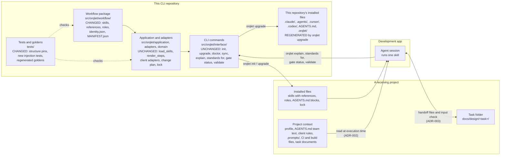

# Container view: what changes in each container

The containers are the ones `context.md` names, opened one level. Only the workflow package and the tests change in this repository; in a receiving project, the installed files change when it upgrades.

| Container | Change | Why |
|---|---|---|
| Workflow package | Six skill bodies get the contract sections; four phase skills get `references/phase-contract.md`; three format references change; five role prompts change; version 0.4.0 and a rebuilt manifest | ADR-001 to ADR-005; ORQLET-DET-002 |
| Application and adapters | None | The loader already attaches every reference (A-2) and the adapters render any skill (A-21, A-26); Q-3 |
| CLI commands | None | Q-4; the skills use only existing commands |
| Tests and goldens | Structure pins follow the new text; new tests for two projects, repeated upgrade, team text, local edits, formats and placeholders; goldens regenerated | ORQLET-TEST-001; R-12; U-12, U-13 |
| This repository's installed files | Regenerated by `orqlet upgrade` | Q-7; generated files are never edited by hand |
| README | The skill table and the count of files `init` writes | They describe the shipped skills |
| Receiving project | On its next `orqlet upgrade`: new skill and role texts and four new reference files per skills folder (eight with both `.claude/skills/` and `.agents/skills/`); its own files untouched | A-40, A-41 |
| Development app | None; it discovers the same skill folders under the same names | R-2; A-27 |
