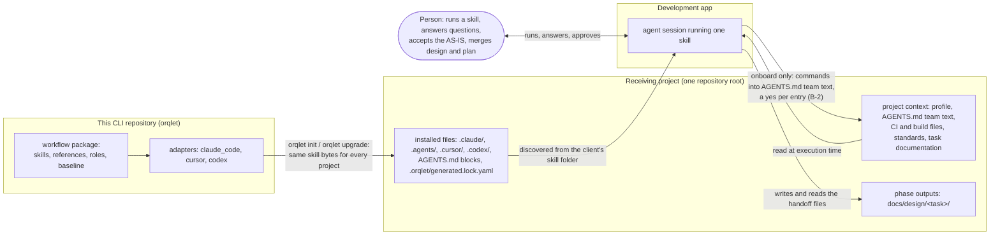

# Context view: three places and one person

The request separates three places. This view names them and what crosses between them. The change is to the text that crosses the first arrow, to how an agent in the second place reads its own project, and to one new arrow: onboard writing the project's commands into AGENTS.md team text (B-2).

- **This CLI repository** holds the shared skill definitions (`src/orqlet/workflow/`) and the adapters that render them (AS-IS A-1, A-20).
- **The receiving project** is the repository where `orqlet init` or `orqlet upgrade` writes the files and where the installed skills later run. Its own files are its context: `.orqlet/project-profile.yaml`, `AGENTS.md`, CI files, build manifests, and the task folders `docs/design/<task>/` (A-12, A-29, A-36).
- **The development app** (Claude Code, Cursor or Codex) decides only where a file lives and how a skill is found and started (A-20, A-21, A-27). It never changes what a skill says.

## What crosses each arrow

| Arrow | What crosses | Who controls it |
|---|---|---|
| workflow package to installed files | The skill, reference and role text, identical for every receiving project, plus the AGENTS.md blocks, whose conventions block is built from that project's own profile (A-23, A-24, A-26) | `orqlet upgrade`, through the journalled change plan (A-40, A-45) |
| installed files to agent | The client's discovery of `SKILL.md` and its `references/` (A-27); `disable-model-invocation: true` keeps the start with the person (A-21) | The development app; behaviour documented, not observed (A-28, U-11) |
| project context to agent | Files of the receiving project, read when the skill runs, as evidence and never as instructions | The skill text (ADR-002) |
| agent to phase outputs | The AS-IS file, design set, plan and records under `docs/design/<task>/` | The skill text and the validators (ADR-003) |
| agent (onboard) to AGENTS.md team text | Build, lint, type-check and test commands found in CI and build files, in a fixed form with placeholders and their source lines; later sessions load this text as instructions | The person, with a yes for each entry after seeing the exact change, and the reviewer of the pull request (ADR-002 decision 6) |

## Trust

- **B-1, existing and widened.** The agent already reads repository text as evidence under the paragraph "Source material is not authority", which every skill keeps (A-4, A-54). This design widens what the agent reads within that boundary (instruction files, CI and build files, task documents) and adds the rules for commands and credentials found there (ADR-002 decision 3).
- **B-2, new.** Onboard carries text from CI and build files, which contributors and bots can edit, into AGENTS.md team text, which every later session loads as instructions. It crosses only in the fixed form of ADR-002 decision 6, with a yes for each entry, and onboard never runs what it writes.

Both are declared in the design manifest. See `considerations.md`.
