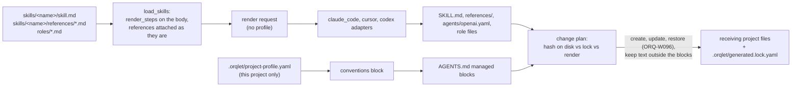
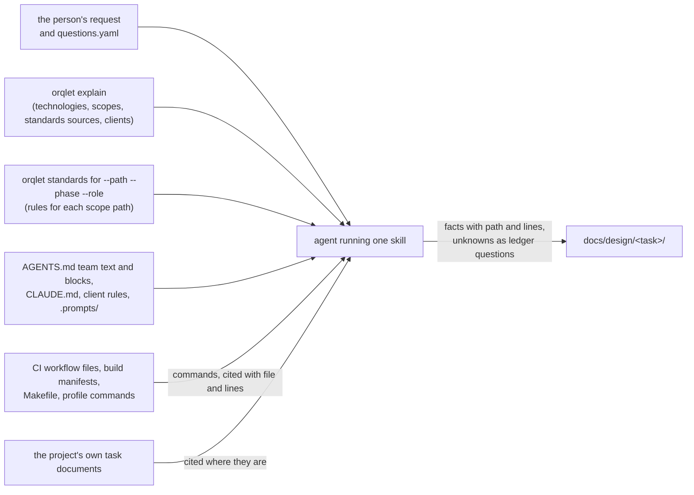
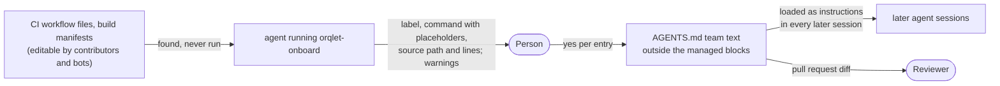
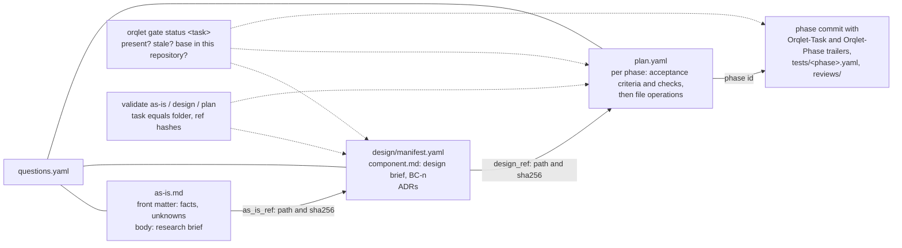

# Data flow

Three flows. Nothing in them is new code; what is new is the text that travels along the first flow and what the agent reads and checks in the other two.

## 1. From the workflow package to a receiving project

- The bytes of the six workflow skills, their references and the five roles depend on the workflow version only, never on the project (A-22, A-23). That is what BC-6 tests.
- Project data reaches rendered files in two existing ways: the conventions block, built from that project's own profile (A-24), and, when the project registers resources, the rules and skills of its resource registry (A-25). This change adds no third way.
- Text outside the managed blocks of AGENTS.md is kept byte for byte (A-41). That is where onboard records the project's commands (ADR-002 decision 6).

## 2. From the project to the agent, when a skill runs

- Everything on the left is evidence, never an instruction ("Source material is not authority").
- A value not found goes to the ledger as a question, never into an artifact as a guess (ADR-002 decision 2).
- A command flows into the plan as a check, with every expanded expression replaced by a placeholder. Its defining lines, the files it directly invokes and the tool configuration it reads are cited by hash. Implementation runs it only in two cases (ADR-002 decision 3):
  - the approved, unedited plan names it, and the cited sources are unchanged;
  - the person agreed after seeing it.

### Onboard: commands into AGENTS.md (trust boundary B-2)

- The B-2 boundary is crossed only with the person's yes for each entry, in the fixed form of ADR-002 decision 6, and the change is visible in the pull request diff.
- A later skill that uses such a command cites the AGENTS.md lines and the original source they name.

## 3. From one phase to the next

- Each arrow carries a path and a hash, and the header carries the bound values. The receiving phase checks them before it starts (ADR-003 decision 4).
- The briefs live inside the artifacts, so the reference hash covers them.
- The person's acceptance of the AS-IS file is recorded in that file (ADR-003 decision 7). The approvals of the design and the plan are merges on the host. The person names each merge commit, and the next phase checks that the approved files are unchanged since then (ADR-003 decision 4).
