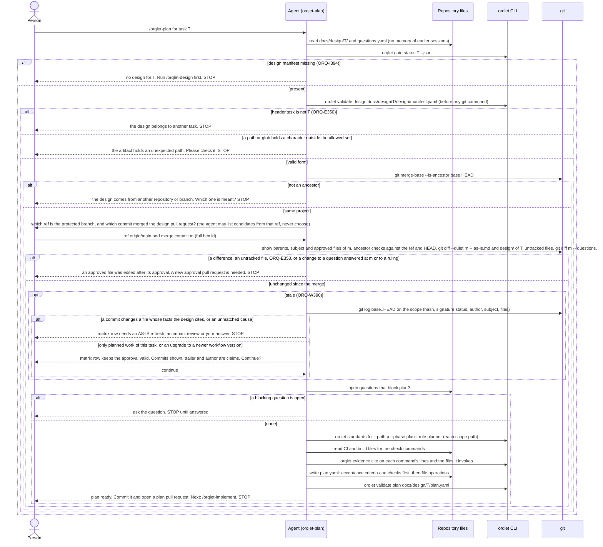
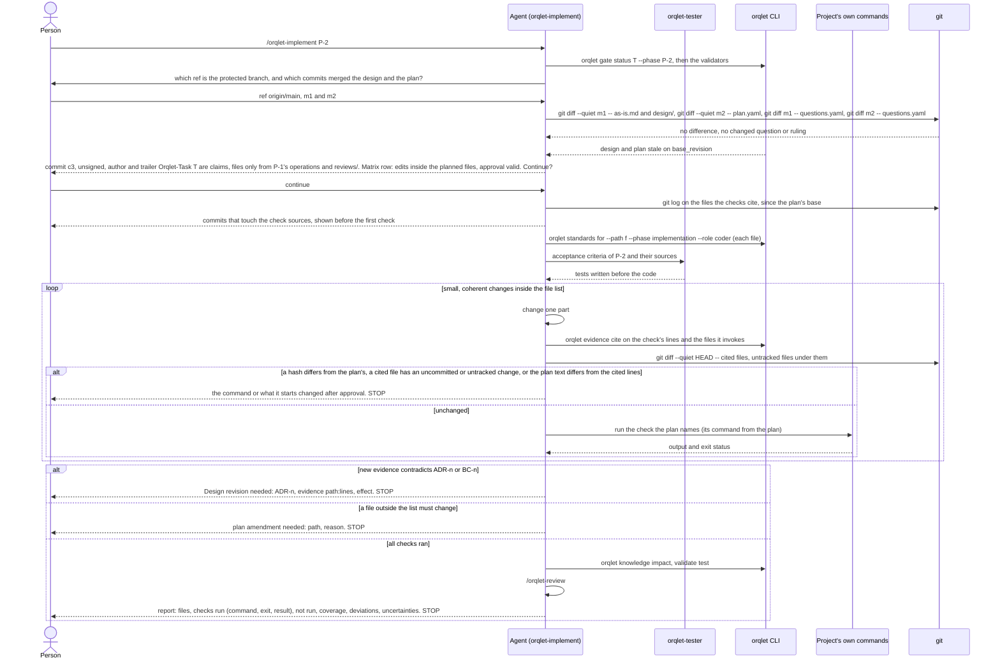
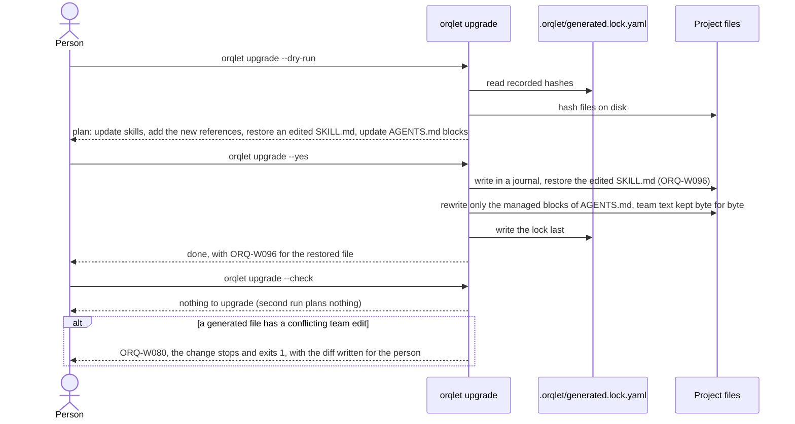

# Sequences

Three interactions with their main failure paths. For readability the diagrams leave out some branches that ADR-003 decisions 4 and 6 and ADR-002 decision 3 hold:
- a validator error other than ORQ-E350;
- a git check that ends with an unexpected exit status or error output ("check not run");
- a missing or never-fetched ref of the protected branch;
- a merge commit that is not a full hex id, not reachable from that ref or from HEAD, or did not change the approved files;
- each kind of ledger change that the fail-closed rule stops on, against the design merge and, in implement, the plan merge;
- other commits in scope that keep the approval valid;
- the standards-hash row;
- in implementation, a command on the warning list, which runs only after the person's yes, and the tester handing such a check back to the coder.

Sequence 2 also leaves out the same-project check and the ancestor checks, which run as in sequence 1.

## 1. A phase starts in a fresh session: the input check

The example is `/orqlet-plan`; design and implement run the same check on their own inputs (ADR-003 decision 4). Every value taken from an artifact goes into a command as one single-quoted argument.

## 2. One implementation phase, with a design revision

## 3. Upgrade in a project with team text and a local edit

