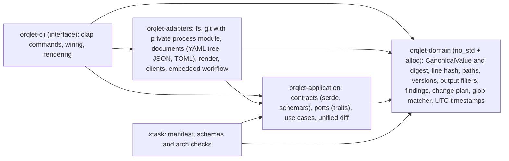

# Rust migration: design brief

## 1. Summary

Rewrite Orqlet as a Cargo workspace of four crates, one per existing layer, built into one native binary `orqlet` 1.0.0. Commands, ORQ codes, exit statuses, the JSON envelope, file paths, the hash algorithms and the 0.5.2 security controls stay; rendered bytes and wording may change.

## 2. Requirements

- R-1 Port every reachable command (request, A-5, Q-8).
- R-2 One cargo-built binary for macOS, Linux and Windows (Q-4, Q-14).
- R-3 Version 1.0.0, no byte-compatibility promise (Q-5, Q-13).
- R-4 Keep ORQ codes, exit statuses and the envelope (Q-6).
- R-5 Drop Python API extraction and unwired code (Q-7, Q-8).
- R-6 Schemas from Rust types; Rust manifest tooling (Q-9).
- R-7 A rust-cli project kind (Q-12).
- R-8 Rust tests required; Linux and Windows compiled and linted only (Q-3, Q-11, Q-15).
- R-9 Rewrite the Python-named standards, README, profile and AGENTS.md text (Q-10).
- R-10 Then remove only the Python code and tooling (Q-2).
- R-11 Refuse a data directory inside the repository (Q-16).

## 3. Behaviour

Command line: as A-5 to A-7 and the captured 0.5.2 help (ADR-002); the `orqlet.cli-result/v1` envelope is unchanged (A-6); usage errors exit 2 (`clap-exit-status.md`). Text, help and library wording may change (Q-6, U-11).

Files: the same project paths, journal, backups and lock (A-20, A-25, A-26); `generated.lock.yaml` keeps `orqlet.generated-lock/v1`; rendered bytes may differ (ADR-004). Hook output stays one JSON line, `{}` on failure. Data directory: `ORQLET_DATA_DIR`, otherwise the OS local data folder plus `orqlet`, never inside the repository (ADR-007).

## 4. Responsibilities and interfaces

- Ports stay traits (A-16), except ProcessRunner, now private to the Git module; contracts become serde types with `deny_unknown_fields` plus explicit validation (A-8, A-12).
- `crates/orqlet-adapters/src/documents/` alone parses YAML (through a generic tree), JSON and TOML, and its messages never quote input (ADR-007; A-13, A-14).
- The workflow data moves to `workflow/`, is embedded by the adapters crate and served only for paths that `MANIFEST.json` lists (A-23).

## 5. Failures

| Trigger | Result | Recovery |
|---|---|---|
| Strict reader rule broken | ORQ-E325 or the existing load code, exit 5 | Fix the file |
| Apply lock held 10 s | ORQ-E137, exit 3 | Retry |
| Open journal | Upgrade, or any change if 0.x, refuses: ORQ-E131, exit 3 | `upgrade --resume`; a 0.x change with 0.5.2 |
| Unreadable journal, 0.x rollback, bad project id | ORQ-E136, exit 3 | Inspect the named file; use 0.5.2 |
| Data directory inside the repository | Writing commands: ORQ-E105, or ORQ-E106 if Git fails, exit 3; doctor, sync, explain: finding; hook: `{}` | Move it |
| Process timeout or output cap | Child killed, existing finding | Rerun |
| Stale plan | Refused before writing (A-25) | Rerun |
| Panic outside the hook | ORQ-E900, exit 70, no payload | Report |
| Error or panic in the hook | `{}`, exit 0 | None needed |
| Windows rename blocked | Five retries, then failure with the journal open | Resume |

## 6. Acceptance criteria

- BC-1 Every command, group and option of 0.5.2 exists; envelopes have the same fields (R-1, A-5, A-6).
- BC-2 Exit statuses and ORQ codes match 0.5.2 for the same inputs, except the fixture's listed differences (R-4, A-7).
- BC-3 `digest_of`, the line-range, file and block-marker hashes match vectors captured from 0.5.2 (ADR-004).
- BC-4 `validate as-is`, `design`, `plan` and `ledger` give the 0.5.2 verdict and codes for every artifact under `docs/design/` at 3e3c311, except listed differences (ADR-002).
- BC-5 A second `orqlet upgrade` on this repository changes nothing; a team-edited file is never overwritten (ORQLET-SAFE-001).
- BC-6 The strict YAML loader refuses each case of ADR-007, out-of-range numbers included, and gives each scalar form the value and type of the 0.5.2 vectors (ORQLET-SEC-002).
- BC-7 `std::process::Command` outside the process module fails Clippy, and that module compiles only as a private child of the Git module; each parser entry point of ADR-007 decision 7 fails Clippy outside the documents module (ORQLET-SEC-001, ORQLET-SEC-002).
- BC-8 The domain builds with `#![no_std]`; each path listed in the application's Clippy configuration fails Clippy there; `xtask arch` passes (ORQLET-ARCH-001, ORQLET-ARCH-002).
- BC-9 `cargo fmt --check`, Clippy with `-D warnings` and `cargo test` pass on macOS; check and Clippy pass for `x86_64-unknown-linux-gnu` and `x86_64-pc-windows-msvc` (R-8).
- BC-10 `xtask check` passes (R-6).
- BC-11 Profiling this repository records kind rust-cli with facts citing Cargo.toml and Cargo.lock (R-7, ADR-006).
- BC-12 Python-API surfaces give NOT_RUN with a finding; the three manifests declaring `public_api` still pass the schema (R-5).
- BC-13 `--version`, `identity.json` and `.orqlet/versions.yaml` say 1.0.0 (R-3).
- BC-14 After removal no `src/orqlet/`, `pyproject.toml`, `uv.lock`, `tools/`, `.venv` or Python cache remains, and no other task's records change (R-10).
- BC-15 Standards, README, profile and AGENTS.md name no ruff, mypy, uv, pytest or import-linter (R-9).
- BC-16 The workspace forbids unsafe code (ADR-001).
- BC-17 The strict JSON reader refuses each case of ADR-007, oversized integers and floats included (A-14).
- BC-18 Hostile Git configuration (clean filter, external diff, textconv, fsmonitor, hooks) runs nothing through any allowed GitRunner call; each argument check of ADR-007 refuses before any process starts; the child environment holds only the allow-list (ADR-007).
- BC-19 A link or reparse point on any path component is refused; a failed write leaves the target unchanged; a 0600 project file stays 0600 when rewritten; data-directory files are 0600 and folders 0700 on Unix (ADR-007).
- BC-20 CanonicalPath refuses each case of A-15; the Rust project scanner refuses an oversized Cargo.toml, a bad `rust-version` and a globbed or escaping member (ADR-007).
- BC-21 A contract holding a secret-shaped value in a wrongly typed field and an unknown key gives a message containing neither; a failed Git call's message holds none of Git's error output (A-12, ADR-007).
- BC-22 With journals in 0.5.2's folder and record shape, every case of ADR-007 decision 11 holds for upgrade, a profile edit, doctor and rollback, and a 0.x record stays unchanged; a panic never prints its payload, and in the hook prints `{}` and exits 0 (ADR-007).
- BC-23 Every test case listed in ADR-007 decision 10 passes (R-11, Q-16, Q-18, Q-19).
- BC-24 A `workflow.lock` version with extra text adds no hook context, a path with a hidden character is not shown, and a commit subject with control characters, or a manifest artifact path or claim anchor holding U+2028 or U+FE0F, is shown escaped (ADR-007, Q-21).

## 7. Decisions

ADR-001 to ADR-007, listed in the manifest.

## 8. Unresolved decisions

None; the plan confirms what ADR-003 and ADR-007 mark, and asks where it differs.

## 9. Constraints

- Fixtures are captured from 0.5.2 at 3e3c311 before removal (ADR-002).
- The standards rewrite, replacing the Python scopes, lands before or with the first crate code (ADR-006).
- Generated files are re-rendered right after the rewrite and again with 1.0.0, re-binding this task's artifacts each time (ADR-006).
- Removal waits for the removal gate of ADR-002 (Q-2).
- Open 0.5.2 changes are finished with 0.5.2 first, and the two binaries never run on one project at once (ADR-004).
