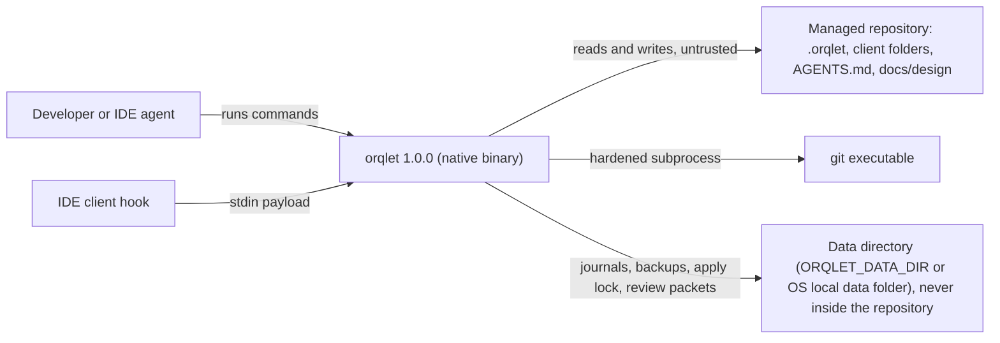
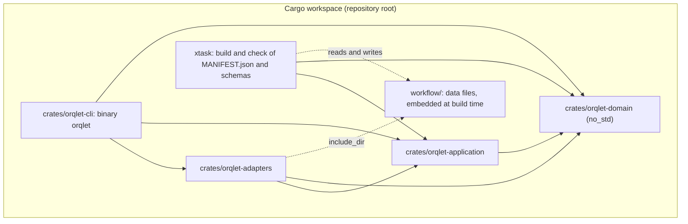
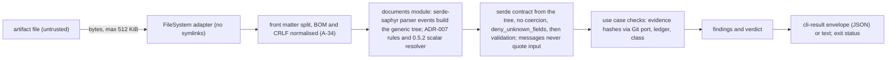

# Rust migration: views

## Context



No new trust boundary: the same repository, Git and data directory as 0.5.2 (A-17, A-18, A-26).

## Container



## Data flow: validate an artifact



## Sequence: upgrade

```mermaid
sequenceDiagram
  participant P as Person
  participant C as orqlet-cli
  participant U as upgrade use case
  participant L as apply lock (File::try_lock)
  participant J as journal and backups
  participant F as FileSystem adapter
  P->>C: orqlet upgrade
  C->>C: data directory inside the repository? refuse, ORQ-E105 (ORQ-E106 if Git fails)
  C->>U: run with wired adapters
  U->>J: read format and status of every record in the project's upgrade folder
  Note over U,J: open record: refuse, ORQ-E131; unreadable: refuse, ORQ-E136
  U->>F: read generated.lock.yaml and current files
  U->>U: render embedded workflow, classify each file by recorded hash
  U->>L: acquire, retry up to 10 s
  U->>F: re-check hashes (stale plan refused)
  U->>J: back up targets, open journal
  loop each write, lock file last
    U->>F: atomic write or delete
    U->>J: mark entry done
  end
  U->>J: mark change complete
  U-->>C: result and findings
  C-->>P: text or JSON, exit status
```
