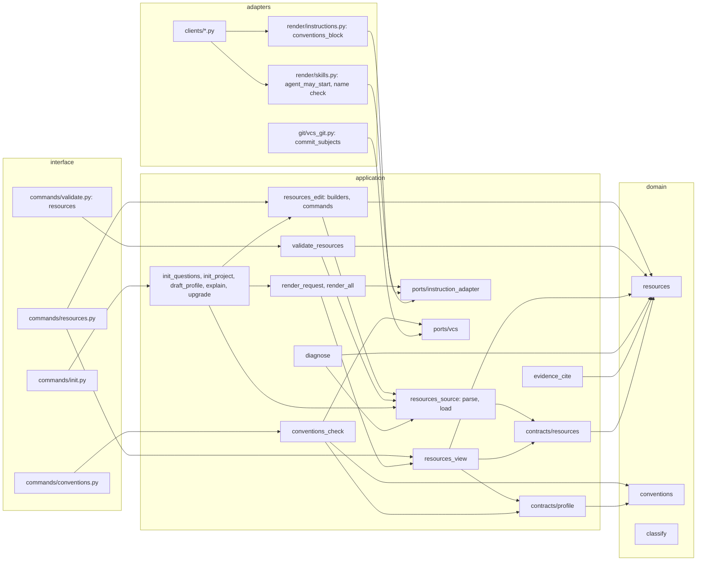

# Component view: new and changed components, their layers and public names

Scope: the components inside the containers of `container.md`. Every arrow points inward (interface to adapters to application to domain). A pure module imports no module that does I/O, and the application reaches files, Git and the terminal only through ports (ORQLET-ARCH-001, ORQLET-ARCH-002). Contracts call domain functions, as `common.py` already does (`common.py:15-16`).

## Components

The right column lists every public name that the change adds or changes; the manifest declares each of them (a public name that no entry covers is reported as an addition, rule 6 below).

| Component | Layer and file | New or changed | Public names |
|---|---|---|---|
| Resource rules | domain `src/orqlet/domain/resources.py` | new | `url_problems`, `text_problems`, `resource_id_problems`, `glob_problems`, `copy_path`, `copy_problems`, `hidden_text_problems`, `credential_problems`, `is_stale`, `uncovered_names`, `host_of` |
| Convention rules | domain `src/orqlet/domain/conventions.py` | new | `pattern_problems`, `branch_problems`, `commit_subject_problems`, `is_checkable_convention`, `printable` |
| Seeded classification | domain `src/orqlet/domain/classify.py` | changed | none; `_seeded` returns `UP_TO_DATE` when the current text equals the new text and differs from the record; the case where all three are equal keeps its result |
| Resources contract | application `contracts/resources.py` | new | `Resources` (with `covered_tools`), `Resource`, `AppliesTo`, `StoredCopy` (`orqlet.resources/v1`); validators call the domain rules, so the committed JSON Schema carries only shapes and limits |
| Profile contract | application `contracts/profile.py` | changed, additive | `Repository` gains `branch_model`, `release_flow`, `branch_patterns`; `PullRequests` gains `shape`, `required_checks`; all five are facts whose default is an unknown with its question, so an old profile still loads |
| Registry source | application `usecases/resources_source.py` | new | `resources_path`, `parse_resources`, `load_resources`; the one place that reads the declaration (rule 1) |
| Registry edit | application `usecases/resources_edit.py` | new | `ResourceSpec`, `CopySpec`, `ResourcesEditResult`, `resources_with`, `resources_without`, `add_resource`, `update_resource`, `remove_resource`, `attach_copy`; the two builders are pure and shared by `init` and the commands; each command builds a `ChangePlan` of the registry and the lock and calls `apply_plan` (ORQLET-SAFE-001) |
| Registry view | application `usecases/resources_view.py` | new | `resource_rules`, `resource_skills`, `catalogue_skill`, `conventions_view` (returns the view and the findings of the values it left out), `ResourcesListing`, `list_resources`; the only code that derives where a resource reaches an agent (rule 2) and the only code that quotes a value for a generated file |
| Registry validator | application `usecases/validate_resources.py` | new | `validate_resources`; offline; checks the contract, every stored copy (existence, size, header, content, hash, scan), a copy of a `login` entry that is not a summary, any file under `docs/resources/` that no entry names, and nothing that needs the standards packs |
| Convention check | application `usecases/conventions_check.py` | new | `ConventionsRequest`, `check_conventions`; finds the base with a few private lines of its own, reads the profile at the base revision and the commit subjects through `Vcs`; verdict `PASS`, `FAIL` or `NOT_RUN` |
| Render request and composition | application `render_request.py`, `render_all.py`, `explain.py`, `upgrade.py`, `init_project.py` | changed | `build_render_request` gains `resources` and `conventions`; `compose` gains `resources` and `resources_bytes` and no longer executes `del profile`; `data_files` gains `resources_bytes`; `init`, `upgrade` and `explain` load the registry and pass it |
| Questions | application `init_questions.py`, `init_project.py`, `draft_profile.py`, `profile_edit.py` | changed | `ANSWER_KEYS` gains seven keys; `questions_for` asks them while unknown; `_repository` handles the nested keys and `_with_pr_template` keeps the new fields; the link prompt of `init` builds the registry in memory with `resources_with` |
| Diagnosis | application `diagnose.py`, `render_all.py` | changed | new findings: a stored copy past its time-to-live, a copy that differs from its recorded hash, a registry that fails its contract, one information finding for unknown conventions and for answers that only the host can enforce, and the code-owners notice (ORQ-I030) extended to `.orqlet/**`, `docs/resources/**`, the generated paths and `.github/workflows/**`; the check for reserved-prefix names ignores a folder that holds no file, which is what a removed tool skill left behind before `apply_plan` removed emptied folders. A generated file that is behind the registry is reported by `upgrade --check`, not by `doctor` |
| Evidence guard | application `usecases/evidence_cite.py` | changed | none; for a path under `docs/design/*/evidence/web/` it reads the file with a cap and runs `credential_problems` before it returns a citation; no header is required |
| Request types | application port `ports/instruction_adapter.py` | changed | `ConventionsView`; `RenderRequest.conventions`; `ClientSkill.agent_may_start` |
| Vcs port | application port `ports/vcs.py` | changed | `Vcs.commit_subjects(base, head)` returns the subjects of the commits in `base..head`, newest first, each cut at 1 KiB, at most 201, so that the use case can see that the range is longer than the 200 it reads |
| Block and skill renderers | adapters `render/instructions.py`, `render/skills.py` | changed | `conventions_block`; the skill file omits `disable-model-invocation` when `agent_may_start` is true, and the name is checked |
| Client adapters | adapters `clients/claude_code.py`, `codex.py`, `cursor.py` | changed | none; each returns the `conventions` block next to the baseline block; Codex writes no sidecar for a skill that the agent may start |
| Git adapter | adapters `git/vcs_git.py`, `git/objects.py` | changed | `GitVcs.commit_subjects` through `rev-list` and `cat-file`, both already in `ALLOWED_SUBCOMMANDS`, with ids only; `objects.py` gains the reading of a commit object, which it does not do today because `read_blobs` returns nothing for a non-blob |
| Commands | interface `commands/resources.py`, `conventions.py`, `validate.py`, `app.py` | new and changed | `resources_group`, `conventions_group` (factories that return the Typer applications) and `resources_command` in `validate.py` (its file argument defaults to `.orqlet/resources.yaml`); every command function of the new groups and every helper is private; `capabilities.IMPLEMENTED_COMMANDS` lists the seven new commands |
| Workflow text | workflow package `baseline/baseline.md`, `skills/orqlet-{onboard,research,design,implement}/skill.md`, `roles/*.md`, a reference file, and new `templates/*.md` | changed and new | the templates of the generated rules, skills, catalogue and block, read through the `WorkflowSource` port, so that they are in the manifest and the digest; a section and a changed sentence in the baseline; a step in four skills, each marked `requires: resources list`; one sentence in each of five roles |

## Rules between the components

1. **One reading of the registry.** Only `load_resources` (through `parse_resources`) reads `.orqlet/resources.yaml`. The catalogue, the rule files, the tool skills, the validator, `doctor` and the edit commands take its result, so two readers can never disagree.
2. **One derivation of reach.** A resource reaches an agent in four ways (ADR-002): the catalogue skill for every resource; a path-scoped rule when `applies_to.paths` is not empty; a tool skill when `tool` is set; a stored copy when `stored_copy` is set. `resources_view` computes all four from the one entry, and no other component repeats the test. Entries and catalogue lines are in order of id.
3. **No clock in a render.** A render writes only what is in the registry and the profile. The time-to-live is compared with the clock only in `doctor` (`Services.clock`), so the generated bytes are the same on every run (ORQLET-DET-001).
4. **Generated names.** Rule files are `orqlet-resource-<id>`, tool skills `orqlet-tool-<id>`, the catalogue `orqlet-resources`. All start with the reserved prefix, and the id limit of 32 characters keeps every skill name under the limit of 64 that the skill tests assert (AS-IS U-36). `build_render_request` is the one place that sees both the registry and the `MUST` rules of the packs, so it refuses two sources that would claim the same file name (as it does for two rules today); `validate resources` cannot see the packs and does not claim to check it.
5. **Limits are in the contract and in the loader.** At most 100 resources; a title up to 80 characters; a note up to 200; at most 8 path globs of up to 120 characters; an address up to 300; a stored copy up to 64 KiB. The registry file is read whole and refused above 256 KiB before it is parsed (100 entries at the field maxima come to about 190 KB); the loader's own bounds on depth and nodes apply, and the field limits bound every string. The caps for the profile answers are in ADR-003. Every echo of text from the repository (a registry value, a profile answer, a line of a stored copy) in a finding or a listing goes through `printable`.
6. **No new public assignment.** (This rule is for existing modules as well as new ones: a helper in `objects.py`, a function in `render_all.py`, a limit constant in an adapter, a status alias next to `ProfileEditStatus` are private, or get an entry in the manifest.) The public-API extractor reads every public name of the package, assignments and aliases included, and reports a name that no extractor entry covers as an addition that needs a renewed approval (`src/orqlet/domain/python_api.py:220-241`, `src/orqlet/domain/expected_change.py:236-247`). The new modules therefore define public names only for functions and classes, keep every constant private, and hand a Typer application out through a factory function. The paths that other modules need (`.orqlet/resources.yaml`, the copy folder) come from `resources_path` and `copy_path`.
7. **The registry reaches `compose` parsed and as bytes** (ADR-002 decision 6). `compose` takes `resources` and `resources_bytes` next to `profile` and `profile_bytes`. `init` builds the registry in memory; `upgrade` loads it and refuses, with a stable finding code and before any plan is built, a registry that fails its contract or is missing while the lock records it; `explain` builds no plan, so it previews without the resource files and prints the finding.
