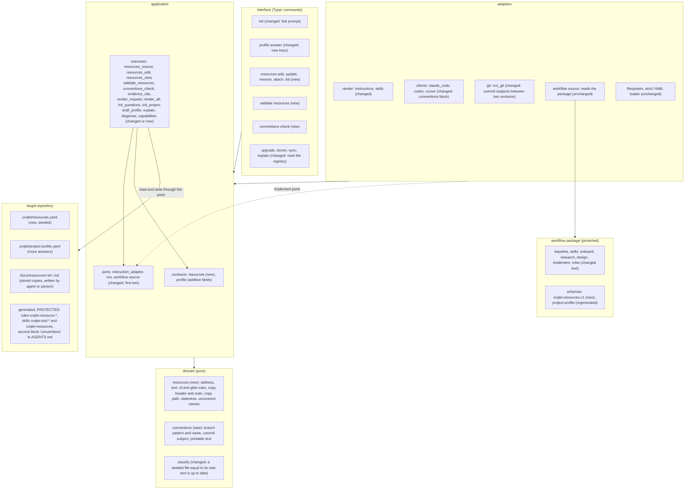

# Container view: the parts this change touches

Scope: the containers of Orqlet and of the target repository that change. The layers and their import direction are the standards ORQLET-ARCH-001 to ORQLET-ARCH-003 (interface to adapters to application to domain), and nothing below adds a dependency or a third-party import (ORQLET-ARCH-002). The application reads the workflow package only through the `WorkflowSource` port.

## What changes in each container

| Container | Change |
|---|---|
| domain | Two new pure modules: `resources` (rules for an address, a one-line text, an id, a glob, the header and the content of a stored copy, a credential scan, the path of a stored copy, staleness by a given time, names without a resource) and `conventions` (branch pattern, branch name and commit subject checks, and the one function that escapes text for output). One branch of `classify` changes: a seeded file whose current text equals the new text is up to date, whatever is recorded. No I/O, no clock, no third-party import. |
| application contracts | `orqlet.resources/v1` is new (id, title, kind, address, note, access, applies-to paths, tool, version, stored copy with hash, time and time-to-live). `orqlet.project-profile/v1` gains optional fields with defaults, so an existing profile still loads (ADR-003). |
| application use cases | Loading and parsing the registry (the seam of the single declaration), pure builders that add, update and remove an entry, editing it through a journalled plan (`apply_plan`), building rules, skills and the catalogue from it, validating it, the convention check, the new questions of `init`, new findings of `doctor`, a guard in `evidence cite` for web evidence files. `compose` stops discarding the profile and takes the registry next to it. |
| application ports | `RenderRequest` gains the conventions; `ClientSkill` gains one flag so that a skill the agent may start by itself can exist next to the workflow skills that only a person starts. `Vcs` gains one read method: the commit subjects between two revisions. |
| adapters | The three client adapters write one more managed block in `AGENTS.md`. The skill renderer omits `disable-model-invocation` for a skill that is marked as one the agent may start, checks the skill name, and the Codex adapter writes no sidecar that forbids it. The Git adapter uses `rev-list` and `cat-file`, which the Git runner already allows. |
| interface | A `resources` group, `validate resources`, a `conventions` group with `check`, and the link prompt in `init`. `IMPLEMENTED_COMMANDS` lists them, and the existing test keeps the list and the application equal. |
| workflow package | The baseline gains a section on looking things up and a changed sentence about the lock; four skills gain a step; five roles gain a sentence; one reference file gains a section; one schema is added and one is regenerated; the manifest, the identity and the release record follow (ORQLET-DET-002, ORQLET-DET-003). |
| target repository | One seeded file, the stored copies, and generated `PROTECTED` files that carry the reserved prefix `orqlet-` and are therefore Orqlet's (AS-IS A-41, A-45). |

Nothing runs in the background and no service is added. The one new runtime path is the check on the code host's CI, which calls the command line and reads Git objects.
