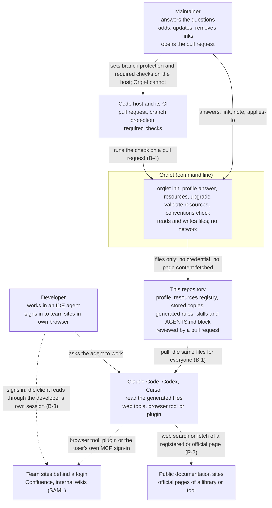

# Context view: who and what the change touches

Scope: how a team's own conventions (branch model, commits, pull requests, merge and release flow) and a list of linked resources (API guidelines, tool and library documentation, internal pages, any link with a note) get from the maintainer to the agent of every developer, how an agent looks up what the team has not documented, and how a convention is checked. Orqlet never calls a model, never starts an agent (ORQLET-NOMODEL-001) and, in this change, opens no network connection and reads no credential: every page is read by the client's own tools (AS-IS A-83, A-84, U-57, ADR-001).

## Trust boundaries

| Boundary | What crosses it | Who decides | What this design does about it |
|---|---|---|---|
| B-1 repository to the agent's instructions | Text that a maintainer wrote (title, note, applies-to) and text copied from a page (stored copy), which three clients load as instructions or as reading material | The pull request that changes `.orqlet/resources.yaml`, a stored copy or the profile | One-line text that passes an allow-list and is written as a quoted JSON string after a fixed label, never as a step; a stored copy is referenced by path and never inlined; the baseline and every generated rule and skill say that page text is evidence and not an instruction (AS-IS A-78); generated files are `PROTECTED`, so a hand edit is an error that `doctor` reports and `upgrade --check` fails on; review by the pull request's reviewers (this repository has no `CODEOWNERS` file, so that review is advisory here; ADR-002) |
| B-2 client to the public web | A search or a fetch by the client's tool: the address, and, as Section 13.3 of the architecture document says of Claude Code's fetch, the host name to the vendor unless a setting opts out (not verified here); what a client reads also goes to its model vendor | The client, its settings and the developer | Orqlet opens no connection. The baseline names the order of sources and asks for an evidence file with address, time and tool; the limits of each client's web tool are recorded as limits, not promised away, and the login route is an owners' decision for internal content (AS-IS A-128 to A-132, U-56, U-76; ADR-001, ADR-004) |
| B-3 the developer's session to the client | A signed-in browser session or the user's own MCP sign-in, used by the client on the developer's behalf | The developer, in their own browser or client | No credential, cookie, token or storage-state file is read, asked for, stored or generated by Orqlet; the baseline names such files only to forbid them; the agent pauses for the developer to sign in and uses the browser route only for an entry that says `access: login` (AS-IS A-160, A-161, A-162; ADR-001) |
| B-4 code host to the check | Branch name and commit subjects of a pull request, which are untrusted text typed by a contributor | The code host (a required status check) and the maintainers | The check reads Git objects through the existing hardened Git runner, parses with fixed rules, prints bounded text, and never evaluates, executes or interpolates it (ADR-003) |

The accepted facts behind the picture: init asks only the stack questions, three repository questions and the pull-request template question, and no field holds a link (AS-IS A-4, A-5, U-2, U-15); the profile is discarded at composition, so no convention reaches a generated file (A-12, U-3, U-11); knowledge sources are local globs and no client renderer loads their content (A-47, U-37, U-38); skills come from the workflow package only and a rule file only from a team `MUST` rule that names paths (A-27, A-30, U-31); the documents say `orqlet-onboard` and `orqlet-research` need no network (A-94, A-119), and no skill tells an agent to look anything up (U-54).
