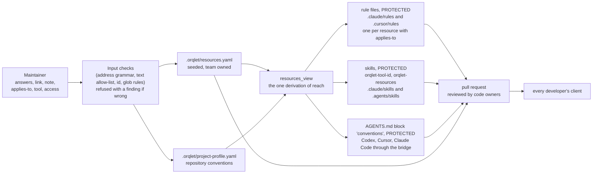
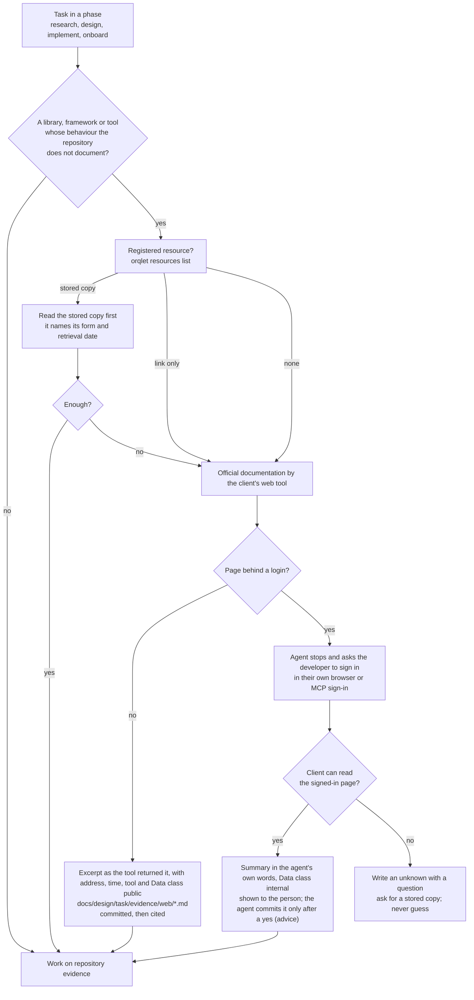
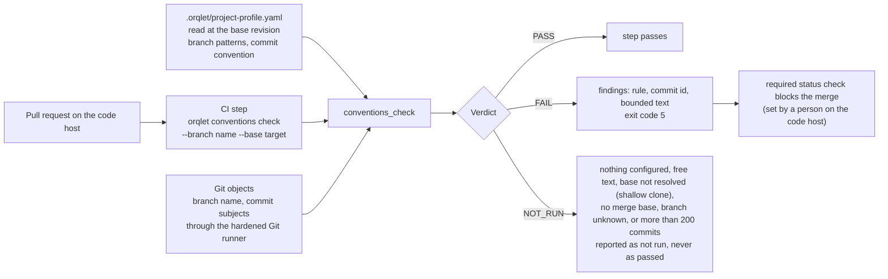

# Data flow

Scope: how the answers and the links travel, what an agent does with them, and how a convention is checked. Orqlet itself moves only files and Git objects. A page is read by the client's tool, in the developer's own session, and never by Orqlet (ADR-001).

## Flow 1: from an answer or a link to the files every developer receives

What leaves the maintainer's terminal is text that passed the checks of the domain rules. A refused value is never written, and the finding names the rule and the field, not the rejected content when that content could hold a secret (ORQLET-SEC-003). A value that reaches a generated file is checked again at render, written as a quoted JSON string, and the generated files are `PROTECTED`, so a hand edit of a rule, a skill or the block is an error that `upgrade` undoes.

## Flow 2: an agent looks something up, with or without a login

Data classes in this flow: the registry and the stored copies are team data in the repository (a page behind a login is `access: login`, which means internal; its stored copy is a summary that `attach` confirms at a terminal, and its evidence file is a summary that the person approves before it is committed, ADR-002 and ADR-004); the page text on its way to the agent is untrusted and is treated as evidence, and it also goes to the client's model vendor (ADR-001); Orqlet writes no session, cookie or token into the repository, a rendered file or a log, and the baseline asks the agent not to write one (advice; the scan of `credential_problems` includes the shape of a browser storage-state file at the two places where it runs). Git history cannot be cleaned afterwards, and Orqlet cannot see offline whether the repository is public.

## Flow 3: a convention is checked

Merge strategy, required checks, reviewers and the release flow are recorded and told to agents, but they are enforced by the code host's branch protection, which only a person with admin rights sets and which Orqlet cannot read offline (AS-IS A-87; ADR-003).
