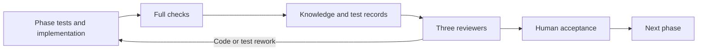

# workflow-efficiency: current development-time research

## Request

Investigate why developing Orqlet itself takes too long, including repeated checks, reviews, approvals and rework; refresh the research using recent work generally (Q-28, Q-29). The phase/review structure and recent records provide the evidence (A-85–A-125).

## Scope

This refresh covers the current source at `9d2053314ff32f459fdb17cb0f476bb0315e2e3c`, workflow-efficiency P-1–P-8 records, its design reviews and ledger, workflow instructions, validation paths and CI configuration. The project is a Python CLI, with three enabled clients and repository-owned standards (A-120, A-125). Earlier frozen work stays frozen (A-85). The historical transcript summary is context only; it predates these changes and cannot establish their effect (A-108, A-122).

No tests, benchmarks, new raw-transcript survey or hosted CI inspection ran. Retained summaries are evidence of what was recorded, not independently reproduced results (A-98, A-107). Existing uncommitted P-8 records were excluded from base-bound facts; `self_check` records the locally observed global/repository CLI mismatch (A-121).

## Existing capabilities and behaviour

**The measurable part is expensive full-suite verification.** Eight retained final runs total **241.013 minutes (4 hours 1 minute)**. They are local Python 3.12.11 runs, labeled `claimed`; they do not include all prior, targeted or CI executions (A-98).

| Phase | Retained final pytest seconds | Minutes |
|---|---:|---:|
| P-1 | 1569.82 | 26.16 |
| P-2 | 1656.32 | 27.61 |
| P-3 | 1962.19 | 32.70 |
| P-4 | 2221.34 | 37.02 |
| P-5 | 1741.46 | 29.02 |
| P-6 | 1705.24 | 28.42 |
| P-7 | 1758.03 | 29.30 |
| P-8 | 1846.38 | 30.77 |
| Total | 14460.78 | 241.01 |

All values above derive from A-98. P-7 alone records three full runs; the first two durations are missing. Its golden files were regenerated each round (A-99). P-4/P-5 record concrete test rework, including oversized fixture text and an incorrect output expectation (A-105).

**The workflow multiplies work by phase and rework round.** Eight phases specify 51 check-list entries (requirements, not 51 measured executions). Every phase includes a tester, coder, three reviewers, knowledge records and a human acceptance point (A-86, A-87, A-97, A-109). The following is the current prescribed loop, as implemented (A-87–A-90):

**Review work does not always produce an independently passing gate.** All 24 retained implementation reviewer records say advisory/NOT_RUN. P-8 code review explicitly cites missing approved binding and unknown models; useful reviewer conclusions and a successful independence gate are different recorded outcomes (A-101, A-124). P-7/P-8 filenames say round 1 while their notes describe actual third/second rounds because earlier evidence was lost (A-102, C-29). The design had an authorized fourth round, followed by human review instead of a fifth agent round (A-103).

**Review also found substantive gaps.** The first design security review led to accepted changes in dependency watching, task-name handling, negative tests and evidence boundaries. The record therefore does not support treating every review round as wasted work (A-104). P-7 fixed incorrect instructions; P-8 fixed stale README versions (A-102).

**Approval and document maintenance recur inside delivery.** The contract still requires human merge references and stale-input classification. P-4/P-5/P-7 explicitly record confirmations after earlier task commits made inputs stale (A-92, A-106, A-111, A-112). Q-12/Q-13 document research refreshes during design; newly discovered facts can send design back to research, and out-of-list files require plan amendments (A-86, A-93, A-123).

**Source text has several coupled representations.** Four phase-contract sources, eight installed copies, golden fixtures and wording/placement tests participate in changes. Generated files come from their sources (A-95, A-96). Review preparation exports broad context and recomputes bindings; record validation repeats component work, and evidence-record edits can invalidate reviews without invalidating test bindings. Their time cost is unmeasured (A-113–A-117).

**Known failures remain in the verification path.** P-7/P-8 carry the frozen-file lint, type and collection errors, despite over 14,000 passing tests; their overall test records remain NOT_RUN (A-100). CI configures twelve test combinations per applicable event, without path filters and with setup-uv caching disabled. Matrix size is neither actual execution count nor serial elapsed time (A-107).

**Several earlier problems are already addressed.** Current text reuses citations, permits targeted iteration, limits full runs to pre-review/rework rounds, skips nested model resolution and conditionally reuses validators. It binds research early for squash merges. Current code batches citations, allows checked task-owned evidence and permits a current gate to PASS (A-88, A-89, A-91, A-92, A-110, A-118, A-119). The plan explicitly leaves observed before/after change to a later equivalent task (A-108).

## Inferences

- I-1 Repeated full verification is a substantial recorded development cost: eight final suites alone sum to about four hours, and rework adds runs (A-88, A-98, A-99). Complete run logs would confirm total cost and whether runs overlapped other work.
- I-2 Phase boundaries, human confirmations and invalidation loops plausibly add delay beyond coding (A-86, A-87, A-92, A-106, A-111). Session timestamps separating active work from waiting would quantify that contribution.
- I-3 Lost review evidence makes retained round counts understate actual review work and complicates audit/reuse (A-102, C-29). Earlier packet and reviewer logs would establish the full sequence; their absence is recorded.
- I-4 Text/fixture coupling contributes to rework: wording/version findings and regenerated copies appear in the same recent delivery (A-95, A-96, A-99, A-102, A-105). Per-edit traces would establish how much rework was necessary versus avoidable.
- I-5 Advisory reviews with insufficient independence and carried baseline failures leave manual interpretation work even after checks run (A-100, A-101, A-124). Approval discussions would establish the time spent interpreting these results.
- I-6 Packet export and repeated binding computation are plausible secondary costs, but their relative importance is unmeasured (A-113–A-117). Per-command profiles would test that inference; this research does not rank them above recorded test costs.

## Open questions

The front matter preserves **52 uncertainty records and 29 contradiction records**, including historical questions now partly answered and findings superseded by 0.5.1. These counts are not 52 newly discovered unknowns or 29 current defects. U-1–U-47 and C-1–C-25 retain their prior wording and reassessment status; C-26–C-28 identify historical claims corrected by current code, and C-29 identifies the review-round discrepancy (A-102, A-110, A-118, A-119).

Q-30 groups the remaining measurement questions: active versus waiting time and packet costs (U-11), rerun eligibility (U-21/U-31), reviewer reads (U-27), CI runs (U-42), total omitted test time (U-48), observed effect (U-49), missing review evidence (U-50), slow individual tests (U-51) and earlier CLI invocation choice (U-52). Q-31 tracks inherited questions not resolved by this narrower refresh; the original specific question references remain where available. These evidence gaps prevent percentage attribution or a verified end-to-end speedup claim (A-98, A-102, A-107, A-108).

## Inputs for design

The refreshed facts cover workflow requirements (A-85–A-96), recent execution/review records and CI configuration (A-97–A-109), current validation behavior (A-110–A-119), and project/history context (A-120–A-125). Q-28/Q-29 authorize this refresh. The person accepted the refreshed research and requested design work on 2026-11-25; the acceptance is recorded in self_check and the artifact is approved. Design, plan and implementation approvals remain separate. All retained uncertainty and contradiction records remain available to design; no remedy is selected here.
