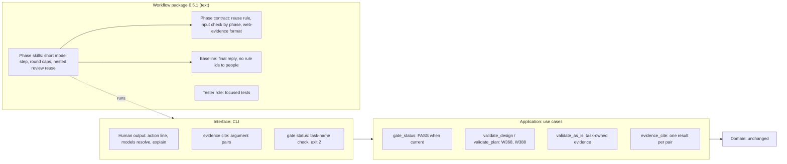

# workflow-efficiency: design brief

## 1. Summary

Cut repeated checks, words and messages without removing a gate: make five outputs plain, add two length warnings, keep the base revision valid under squash merges. No cache, dependency, CI or model-policy change. A-n cite `as-is.md` at 86e07abc.

## 2. Requirements

- R-1 Reuse valid results with explicit invalidation, batch lookups, group fixes, affected checks while iterating, full checks at gates; keep roles, isolation, security (request group 1).
- R-2 Plain results with the next action; no empty fields, unrelated candidates, rules or standard ids; suggested versus observed models (group 2, Q-17, Q-20).
- R-3 Concise designs and plans with small diagrams, referencing evidence; 1,200 words per brief, 400 per plan phase, as warnings (group 3, Q-16).
- R-4 Smallest complete change, focused tests, verified removal of unused code (group 4, Q-10).
- R-5 Final replies: Completed, Questions, Next prompt; about 120 words outside the prompt (group 5).
- R-6 Documentation synchronised in the final implementation commit; CLI and workflow at 0.5.1 (group 6, Q-11, Q-15).
- R-7 An approved artifact survives a squash merge (Q-12, Q-13, C-23).

## 3. Behaviour

Command line:

- `gate status <task> [--phase P]`: nothing stale, failed or deviating: PASS, exit 0, saying the input check confirms approval. Stale: NOT_RUN, exit 5. Invalid task name: exit 2.
- `validate …` and `gate status` text ends with one action line (ADR-002); `--json` fields are unchanged.
- `models resolve`: one plain sentence, then only fields holding a value; rejected models only in `--json`.
- `explain`: limits once; standards as counts per source; ids and levels only in `--json`.
- `evidence cite FILE LINES [FILE LINES]...`: one entry per pair, in order; a single pair behaves as today.
- `validate design` warns ORQ-W368 when `component.md` exceeds 1,200 words outside fenced blocks; `validate plan` warns ORQ-W388 per phase above 400 words; exit status is unchanged (ADR-004).
- `validate as-is` accepts cited files in its own `evidence/` folder at another commit, hash-checked and scanned at HEAD.
- `orqlet --version` and the workflow package report 0.5.1.

Files written: `orqlet upgrade` regenerates the enabled clients' instruction files.

## 4. Responsibilities and interfaces

## 5. Failures

- Inputs of a reused result changed: the diff shows it; the check reruns.
- A cited evidence file changed after acceptance: ORQ-E335 or the input check stops; re-cite, accept again.
- Task evidence fails the `validate as-is` scan (ORQ-E338, rule and line): revoke or rotate a shown credential, fix, re-cite, accept again.
- From implement phase 2, earlier phases' commits give ORQ-W390; the person confirms planned work once per phase (A-83, A-84).
- Base bound after the first branch commit: the next input check fails; rebind, accept again.
- Odd `cite` argument count: exit 2. A failing pair is reported, the others print, exit 5.
- Review cap reached with a blocking finding: one consolidated report; the person decides.
- After the final upgrade, this task's artifacts show ORQ-W390 (upgrade row).
- Main's red jobs (Q-14): known failures are accepted only when all come from the two frozen test files; anything else stops the phase.

## 6. Acceptance criteria

- BC-1 Each check source is cited once per phase, matching the plan's hash; later runs confirm it with `orqlet evidence hash`, re-citing only changed ones (R-1, A-14, A-15, U-22).
- BC-2 One `gate status --phase` per implement phase; a later phase reuses the validators' result when its only stale cause is confirmed planned work (R-1, A-13, A-83, A-84).
- BC-3 Plan runs gate status once; design hashes once before review, into each note, and compares before stopping; a difference starts a new round (R-1, A-11, A-12).
- BC-4 Every rerun names its reason; a rework round makes all fixes, then one full check run (R-1, A-18, U-21).
- BC-5 A plan may name a targeted check form for iteration; the full form runs before review (R-1).
- BC-6 Design and code reviews stop after three rounds with one consolidated report (R-1, A-20, A-58).
- BC-7 Review resolves models at most twice, never for the skill when nested; with no candidate it records none requested (R-1, R-2, A-21, C-9, U-7).
- BC-8 Gate status as section 3 (R-2, A-27, A-28, C-7).
- BC-9 The action line as ADR-002 (R-2, A-41).
- BC-10 `models resolve` and `explain` as section 3 (R-2, A-38 to A-40, C-5).
- BC-11 ORQ-W547 says in plain words what changes and what the person decides (R-2, A-43).
- BC-12 No instruction tells the agent to show rules or standard ids to people; records keep them (R-2, Q-17, Q-20, A-81).
- BC-13 Reports label models suggested, observed or unknown (R-2, A-49).
- BC-14 ORQ-W368 and ORQ-W388 as section 3 (R-3, Q-16).
- BC-15 Formats ask for evidence ids, not restated content, and each list once (R-3, A-55, A-56).
- BC-16 The design skill's web-evidence format resolves in its own installed references (R-3, A-9, U-2).
- BC-17 Implement and the tester carry R-4's guidance; instruction files grow only as ADR-004 allows; every skill keeps the source-as-evidence paragraph (R-4, A-1 to A-6).
- BC-18 Removed code has no reference in `src` or `tests` and is not frozen (R-4, Q-10, U-32).
- BC-19 Tests this task touches assert behaviour or facts, not README phrasing (R-4, A-60).
- BC-20 Final replies follow R-5 and end with a copyable prompt of task, next skill, fixed artifact paths and pending approvals only, never copied source text or commands (R-5, A-36, A-44).
- BC-21 `evidence cite` pairs as section 3; each pair under `evidence/web/` is scanned, a failing one reporting ORQ-E511 and no hash (R-1, A-26).
- BC-22 Task-owned evidence as section 3; evidence elsewhere, including a sibling folder sharing the prefix or `Evidence/`, still fails ORQ-E332; every existing AS-IS file still passes (R-7, A-71, A-73).
- BC-23 Phase skills bind `base_revision` before their first branch commit (R-7, A-69, A-70, C-23).
- BC-24 Version 0.5.1; README, the architecture proposal's gate status text, `work-status.md` and generated copies match delivered behaviour; C-1, C-2, C-4, C-10, C-11, C-21, C-22 resolved (R-6, Q-11, Q-15).
- BC-25 The final phase reports instructed runs and instruction words before and after; observed counts follow on the next equivalent task (R-1, A-31, A-37).

## 7. Decisions

- [ADR-001](adr-001-check-reuse-and-rechecking.md): check reuse without a cache.
- [ADR-002](adr-002-plain-cli-results.md): plain results, gate status verdict.
- [ADR-003](adr-003-base-revision-under-squash-merges.md): base revision under squash merges.
- [ADR-004](adr-004-concise-documents-and-replies.md): length warnings, reply format, shared text.

## 8. Unresolved decisions

None blocks design. Implementation finds U-43. U-1, U-18, U-19, U-23, U-31, U-45 to U-47 and C-3 stay unverified.

## 9. Constraints for the plan

- Frozen work stays untouched (Q-10): `copilot.py`, `render_rich.py`, `user_scope.py`, both user-render tests, frozen tasks' documents.
- Every pull request lists main's red lint, types and tests jobs as known (Q-14). The plan names, for the person's yes, a local pytest form running past the two import errors with every configured option.
- CLI changes precede skill text relying on them, so no skill instructs missing behaviour.
- A phase changing the workflow package rebuilds MANIFEST.json and golden files, which tests compare; the version bump, upgrade and README go in the final implementation commit (R-6).
- Prose people read names no rules or standard ids.
