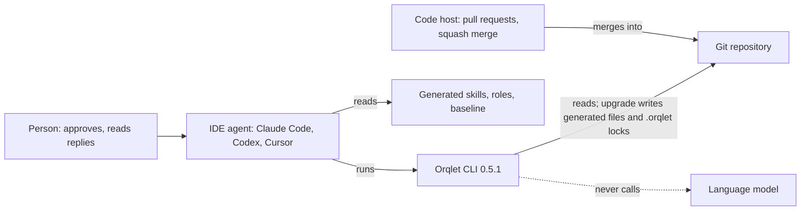
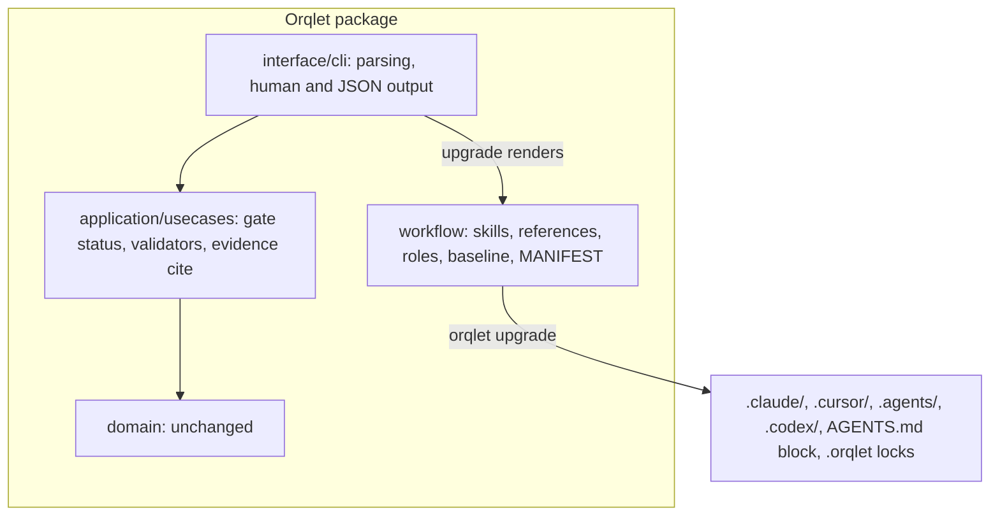
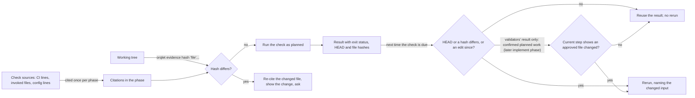
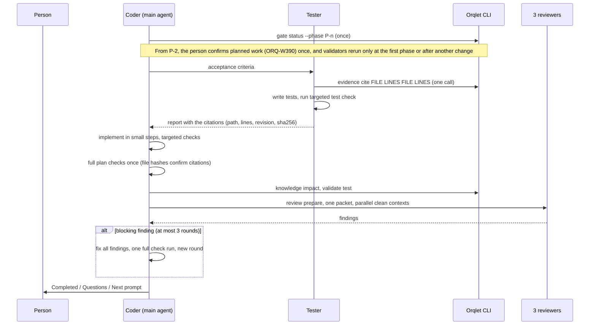

# workflow-efficiency: views

The design brief is in [component.md](component.md). These views show what the brief changes and nothing else.

## Context

No new actor, trust boundary or integration. The code host's squash merge is the one outside behaviour the design adapts to (ADR-003).

## Container

## Data flow: reusing a check result

A result is reused only while its inputs are provably unchanged (ADR-001).

## Sequence: one implement phase after the change

